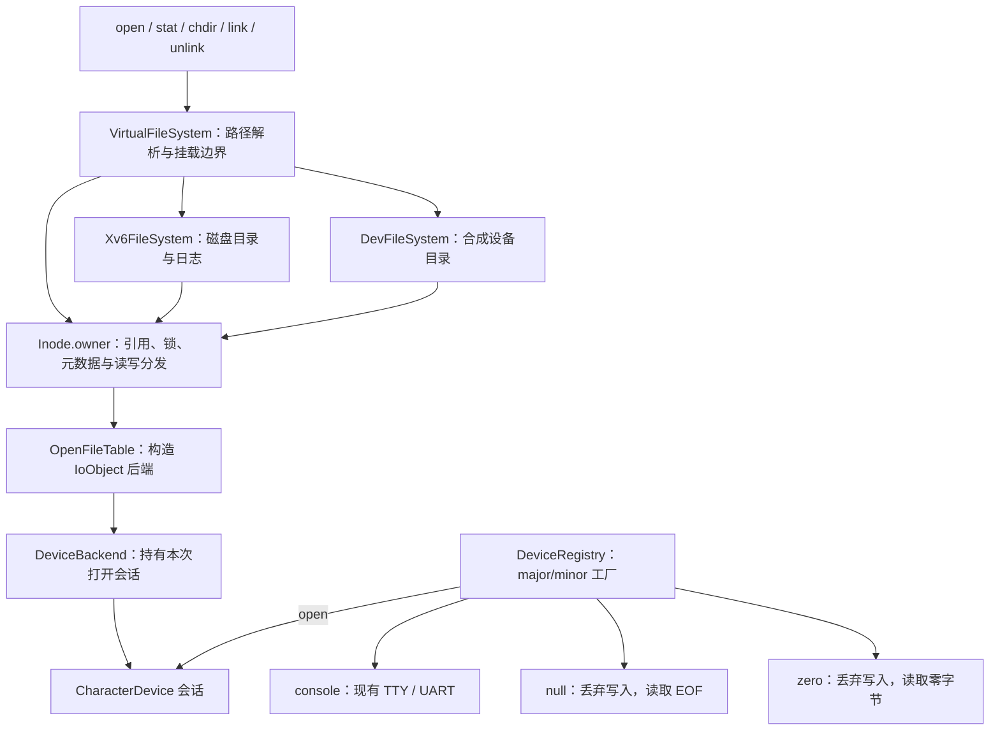

# VFS 与 devfs

系统保留 xv6 日志磁盘作为根文件系统，启动时挂载 `/dev`、`/proc` 和 `/tmp`。init 从 `/dev/console` 打开标准输入，再用 dup 建立标准输出和错误输出。



## 设备

| 路径 | major/minor | 读取 | 写入 |
| --- | --- | --- | --- |
| `/dev/console` | 1/0 | 现有 TTY 输入和行规程 | 现有终端输出 |
| `/dev/null` | 2/0 | 立即返回 0，表示 EOF | 丢弃并返回长度 |
| `/dev/zero` | 3/0 | 按请求长度复制零 | 丢弃并返回长度 |
| `/dev/ptmx` | 4/0 | 打开后为独立 PTY 主端 | 打开后向终端注入输入 |
| `/dev/pts/N` | 5/N | 对应 PTY 从端输入 | 对应 PTY 终端输出 |

设备使用已有 read、write、fstat、poll、ioctl、fcntl 和 dup 接口。null/zero 始终可读可写，不支持的 ioctl 返回 -1；console 的 termios、进程组、信号和非阻塞行为保持由 TTY 实现。

设备没有普通文件偏移。每次打开仍得到独立 File；dup 和 fork 共享同一次打开的标志与引用。最后关闭先归还会话，再释放节点和 File。静态字符设备默认 open 返回自身、close 无额外操作；ptmx 的 open 创建独立 PTY 主端。匿名 openpty 与 [命名 PTY](named-pty.md) 共用驱动。

## 路径与挂载

`filesystem()` 返回独立的 VirtualFileSystem 路径服务，VFS 不继承 FileSystem。FileSystem 后端只实现节点、目录项和打开契约，不再提供无效的独立路径接口。每个 inode 的 owner 指向实际文件系统；引用计数、锁、元数据、读写由所属实例处理。设备号只用作 stat 身份和设备查找，不用来判断节点归属。

VFS 按路径组件遍历。查到磁盘 `/dev` 时切换到 devfs 根，devfs 根的 `..` 返回磁盘父目录；相对路径从进程当前目录引用开始。因此下面的用法都有效：

```sh
ls /dev
cd /dev
/echo discarded > null
/ls ../dev
cd ..
devfstest
```

磁盘目录与 devfs 目录共用现有 dirent 布局。devfs 在读取时按字节偏移生成 `.`、`..` 和登记的设备条目，支持短读、非对齐读取及 EOF，无需磁盘数据块。

`/dev` 挂载点和设备条目不能删除；devfs 不允许创建名称或硬链接。跨文件系统硬链接返回 -1。`O_CREATE` 可以打开已有设备，`O_TRUNC` 只作用于普通文件。隐藏在挂载点下的磁盘目录内容不会显示出来。

## 初始化与资源

1. 板级启动初始化 UART/TTY，登记 console 1/0 和 ptmx 4/0。
2. 主核初始化磁盘、devfs 和 procfs 的节点锁及 owner，随后为初始进程取得尚未加载磁盘内容的根引用。
3. 首个进程恢复磁盘日志并回收孤儿 inode，devfs 登记 null/zero 后封存 DeviceRegistry。
4. VFS 复用或创建 `/dev`、`/proc` 覆盖目录，保留覆盖节点、后端根和父目录引用，建立固定挂载后执行 init。

登记名称最多 13 字节，不能包含斜杠或使用点目录名称。重复名称、重复 major/minor、容量超限和封存后登记都会触发内核错误。一个 major 可以登记多个不同 minor；设备实例必须保持系统运行期有效。

设备节点与根目录存放在固定内存表中。引用计数用自旋锁保护，节点操作沿用 inode 睡眠锁约定；引用降到零不销毁设备节点。设备 read/write 和 devfs 最后关闭不使用磁盘日志。路径系统调用仍保留外层磁盘事务，因为解析可能穿越磁盘目录并释放磁盘引用。

挂载表保留 `/dev`、`/proc` 和 `/tmp` 三个固定记录，运行期另外支持最多四个独立 RAM 挂载，见 [动态挂载](mounting.md)。静态设备注册表保持封存；动态 pts 名称来自驱动的发布状态。PTS inode 取得首个引用时固定 PTY，最后引用释放后解除固定，因此旧 fd 和临时路径引用都不会误指向复用编号的新会话。块设备文件与 `/dev/tty` 尚未加入。

## 验证

```sh
cmake --build --preset dev
ctest --test-dir build/dev --output-on-failure -R '^(fs_contract|devfs_[15]cpu)$'
```

原生 `fs_contract` 使用实际 VFS/devfs 实现，验证合成目录的非对齐读取、minor 分派、复制失败、相对路径、挂载保护、并发打开，以及这些操作不产生磁盘写入。QEMU 单核/五核 `devfstest` 验证用户指针错误、设备内容、poll/ioctl、dup/fork、重复打开和并发子进程；脚本同时检查 shell 的目录遍历与设备重定向。

函数文档保存在 [VFS 实现](functions/kernel/fs/vfs/vfs.cpp.md)、[devfs 实现](functions/kernel/fs/devfs/devfs.cpp.md) 和 [设备注册表](functions/kernel/fs/file/open_file.cpp.md)，通过现有外部索引显示 Doxygen hover。

## 用户与权限

设备节点权限：console 为 root:root 0600，null/zero/ptmx 为 0666，命名 pts 为创建者有效 uid/gid 的 0600。目录与元数据只读，字符设备数据按节点权限授权；su 继续使用继承的标准终端 fd。

完整规则见 [用户、组与权限](users-permissions.md)。
