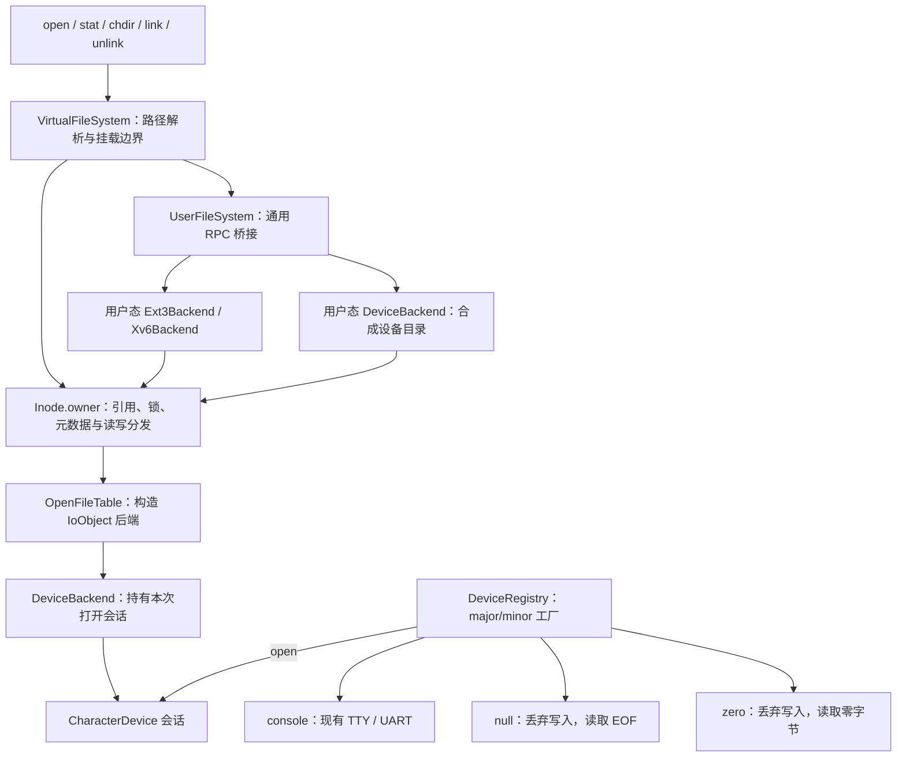

# VFS 与 devfs

用户态 fsboot 识别根盘格式并启动 ext3/xv6 根服务，再分别启动 devfs、procfs 和 ramfs 服务挂载 `/dev`、`/proc` 和 `/tmp`。devfs 的目录、节点属性和设备编号由用户态 `userfs::DeviceBackend` 管理；设备数据 I/O 和终端会话仍由内核驱动处理。init 从 `/dev/console` 打开标准输入，再用 dup 建立标准输出和错误输出。完整边界见 [文件系统服务迁移](fs-service-migration.md)。



## 设备

| 路径 | major/minor | 读取 | 写入 |
| --- | --- | --- | --- |
| `/dev/random`、`/dev/urandom` | 7/0、7/1 | VirtIO entropy 返回的随机字节 | 只读，非空写入失败 |
| `/dev/tty` | 6/0 | 当前会话的控制终端输入 | 当前会话的控制终端输出 |
| `/dev/console` | 1/0 | 现有 TTY 输入和行规程 | 现有终端输出 |
| `/dev/null` | 2/0 | 立即返回 0，表示 EOF | 丢弃并返回长度 |
| `/dev/zero` | 3/0 | 按请求长度复制零 | 丢弃并返回长度 |
| `/dev/full` | 2/1 | 按请求长度复制零 | 非空写入失败，空写入返回 0 |
| `/dev/vda` | 8/0 | 根磁盘的原始字节 | 禁止原始写入 |
| `/dev/vdb`（存在第二磁盘时） | 8/16 | 第二磁盘的原始字节 | 禁止原始写入 |
| `/dev/ptmx` | 4/0 | 打开后为独立 PTY 主端 | 打开后向终端注入输入 |
| `/dev/pts/N` | 5/N | 对应 PTY 从端输入 | 对应 PTY 终端输出 |

设备使用已有 read、write、fstat、poll、ioctl、fcntl 和 dup 接口。null/zero/full 始终可读可写，不支持的 ioctl 返回 -1；console 的 termios、进程组、信号和非阻塞行为保持由 TTY 实现。

字符设备没有普通文件偏移。块设备具有独立打开偏移，dup/fork 共享该偏移；支持 read、lseek、fstat、fsync，以及 `kernel/io/block.h` 的 BLKGETSIZE64、BLKSSZGET、BLKROGET。容量来自驱动而不是文件系统超级块，扇区为 512 字节。根磁盘及第二磁盘登记为只读，避免绕过已挂载文件系统的缓存；可写原始设备只能通过显式的独立设备登记。非对齐访问按扇区处理，部分写入保留两端数据，复制失败不提交当前扇区。

每次打开仍得到独立 File；dup 和 fork 共享同一次打开的标志与引用。最后关闭先归还会话，再释放节点和 File。静态字符设备默认 open 返回自身、close 无额外操作；ptmx 的 open 创建独立 PTY 主端。匿名 openpty 与 [命名 PTY](named-pty.md) 共用驱动。

## 路径与挂载

`filesystem()` 返回独立的 VirtualFileSystem 路径服务，VFS 不继承 FileSystem。FileSystem 后端只实现节点、目录项和打开契约，不再提供无效的独立路径接口。每个 inode 的 owner 指向实际文件系统；引用计数、锁、元数据、读写由所属实例处理。设备号只用作 stat 身份和设备查找，不用来判断节点归属。

VFS 按路径组件遍历。查到磁盘 `/dev` 时切换到 devfs 根，devfs 根的 `..` 返回磁盘父目录；相对路径从进程当前目录引用开始。因此下面的用法都有效：

```sh
ls /dev
cd /dev
/echo discarded > null
/ls ../dev
cd ..
devfstest
```

磁盘目录与 devfs 目录共用现有 dirent 布局。devfs 在读取时按字节偏移生成 `.`、`..` 和登记的设备条目，支持短读、非对齐读取及 EOF，无需磁盘数据块。

`/dev` 挂载点和设备条目不能删除；devfs 不允许创建名称或硬链接。跨文件系统硬链接返回 -1。`O_CREATE` 可以打开已有设备，`O_TRUNC` 只作用于普通文件。隐藏在挂载点下的磁盘目录内容不会显示出来。

## 初始化与资源

1. 板级启动初始化 UART/TTY，建立内核设备注册表和块设备机制。
2. 内核从 QEMU 提供的引导载荷装载用户态 fsboot；此时没有根挂载和 cwd，标准描述符直接绑定控制台。
3. fsboot 通过预开的磁盘能力启动根服务，在用户态恢复日志、回收孤儿并挂载 `/`。
4. 独立 devfs 服务通过类型化设备能力取得名称和设备号并发布 `/dev`；内核桥接将设备节点打开交给实际驱动。procfs 和 ramfs 也分别挂载，之后执行 init。

登记名称最多 13 字节，不能包含斜杠，不能使用点目录名称或保留的 pts 名称。重复名称、同类设备重复 major/minor、容量超限和封存后登记都会触发内核错误。注册表有 32 个槽，主设备号独立于槽下标；字符设备与块设备拥有独立的 major/minor 命名空间。一个 major 可以登记多个不同 minor；设备实例必须保持系统运行期有效。

设备目录和节点记录位于 devfs 服务的地址空间；内核保留通用 inode 引用、驱动注册表及 PTY 寿命能力。节点最后一个聚合引用的 Forget 撤销相应 PTY 固定。设备 read/write 和最后关闭直接访问驱动会话，不请求磁盘日志；路径事务边界在服务模式下也不预留内核磁盘日志。

默认挂载由独立用户态服务提供，运行期创建和卸载实例交给通用挂载管理进程，见 [文件系统服务迁移](fs-service-migration.md)。静态设备注册表保持封存；动态 pts 名称来自驱动的发布状态。PTS inode 取得首个引用时固定 PTY，最后引用释放后解除固定，因此旧 fd 和临时路径引用都不会误指向复用编号的新会话。`/dev/tty` 的打开工厂查询当前会话；无控制终端时打开失败，
setsid 后也不会隐式绑定 console。成功打开固定当时的实际终端，
后续 read/write/poll/ioctl 直接使用该会话；不会在每次 I/O 时重新解析。

PTY 的控制终端查找在进程组锁内只增加原子寿命引用，然后释放组锁再取得
PTY/TTY 锁、增加 slave 打开数并完成打开。主端挂断先解除会话绑定，
再释放自己的最后引用，因此与打开并发时，返回的是已固定的旧对象或失败，
不会打开复用编号的新对象。会话本身不额外持有 PTY 引用；已有 `/dev/tty`
文件持有实际 slave 引用，挂断后可排空输入并读到 EOF。该协议避免
组锁、PTY 列表锁、TTY 锁之间出现环形等待。

设备号沿用本项目 ABI，并不承诺与 Linux 的字符设备号一致。

## 随机设备

`VirtioEntropy` 属于驱动模块，使用 MMIO 第三个槽（IRQ 3）的现代 VirtIO
entropy 设备；根盘和第二块磁盘继续使用前两个槽。驱动协商 VERSION_1，
只提交设备可写描述符，并严格按 used 长度公开数据，规则依据
[VirtIO 1.2 entropy 规范](https://docs.oasis-open.org/virtio/virtio/v1.2/virtio-v1.2.html#x1-3050004)。
DMA 缓冲归设备所有时用户不能读取；完成后由中断发布，读完再提交下一次请求。
单次 read 最多复制 256 字节，允许短读；调用方需要更多数据时继续读取。
复制失败不消耗当前可用字节。poll 在完成时唤醒；空缓冲的非阻塞读取返回
-EAGAIN，阻塞读取可被信号中断。设备缺失或初始化分配失败时报告不可用，
不会用时间戳或固定数据补造随机字节；分配失败归还尚未发布的全部 DMA 页。

QEMU 的默认启动目标和 smoke 测试配置 `rng-random`，后端为宿主
`/dev/urandom`，并显式绑定 `virtio-mmio-bus.2`。`random` 和 `urandom`
共享该字节源，当前没有另外实现 Linux 熵池、熵计数、RNDADDENTROPY 或两者
不同的阻塞策略。设备节点为 0444，不允许通过写入替换随机源。

设备节点权限来自注册记录，不再在 devfs 中按文件名判断 console 等特例。
字符设备注册可显式指定权限；块设备默认由只读属性决定 0440/0660。

## 验证

```sh
cmake --build --preset dev
ctest --test-dir build/dev --output-on-failure -R '^(driver_contract|process_groups_contract|fs_contract|devfs_[15]cpu|devfs_no_entropy_1cpu|named-pty_[15]cpu)$'
```

原生 `fs_contract` 还在隔离的可写内存盘上检查跨扇区读写、保留两端、复制故障、共享偏移和 EOF，验证字符/块设备编号独立，以及已挂载磁盘拒绝可写打开。ext3 模块契约检查磁盘中的块设备 inode 也走相同注册表。

原生 `fs_contract` 使用实际 VFS/UserFileSystem 与用户态 RAM 后端，验证跨协议读写、重命名、同步和资源回收；devfs 的合成目录、minor 分派、复制失败及设备打开由用户态 devfs 与 QEMU 回归验证。宿主驱动还验证 entropy 的短 used 长度、每个 DMA 分配失败点、错误完成、复制失败，以及 16 位队列索引完整回绕。`devfs_no_entropy_1cpu` 使用没有随机硬件的 QEMU 验证不可用路径；`namedptytest` 增加控制终端打开与主端关闭并发、旧别名寿命和 setsid 隔离检查。

QEMU 单核/五核 `devfstest` 验证用户指针错误、设备内容、poll/ioctl、dup/fork、重复打开和并发子进程；脚本同时检查 shell 的目录遍历与设备重定向。

函数文档保存在 [VFS 实现](functions/kernel/fs/vfs/vfs.cpp.md)、[devfs 实现](functions/kernel/fs/devfs/devfs.cpp.md) 和 [设备注册表](functions/kernel/fs/file/open_file.cpp.md)，通过现有外部索引显示 Doxygen hover。

## 用户与权限

设备节点权限：console 为 root:root 0600，null/zero/full/ptmx/tty 为 0666，random/urandom 为 0444，命名 pts 为创建者有效 uid/gid 的 0600。目录与元数据只读，字符设备数据按节点权限授权；su 继续使用继承的标准终端 fd。

完整规则见 [用户、组与权限](users-permissions.md)。

`/dev/fb0`（字符 29:0，0600）连接可选 VirtIO-GPU；缺少显卡时打开失败，不影响串口。像素格式、ioctl 与运行方式见 [图形说明](graphics.md)。

`/dev/kbd0`（30:0，0600）提供8字节键盘事件、独占打开和poll；有效UID检查与溢出语义见 [键盘说明](keyboard.md)。
