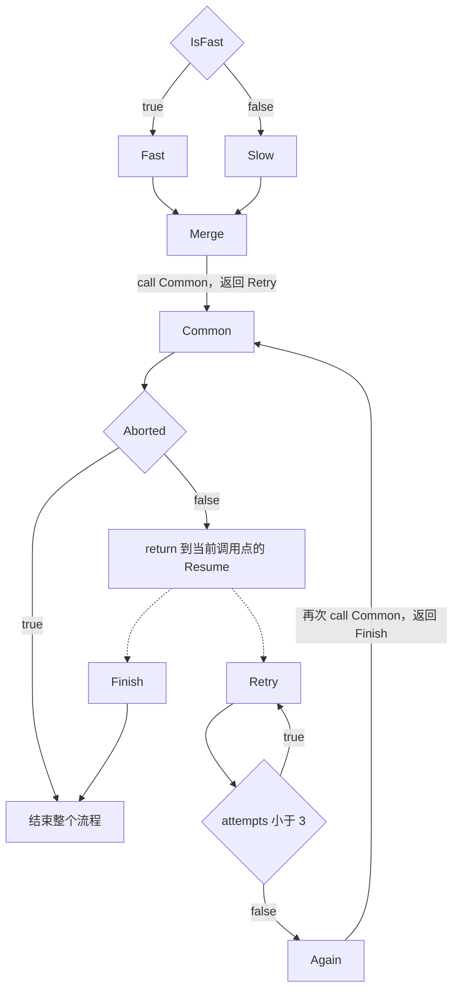

# 编译期声明的通用流程图

`kernel/support/flow.h` 是独立的 C++20 纯头文件，命名空间为 `xv::flow`。
不包含标准库或第三方头文件，不要求堆分配、异常、RTTI、虚函数、全局构造或运行时注册。
基础工具、示例和测试独立于业务；实际接入见 [网络声明式流程](network-flows.md)
和 [内核流程接入与验收](kernel-flows.md)。

## 接口与最小调用

完整最小图见 [minimal.h](../examples/flow/minimal.h)，运行验证见
[flow_contract.cpp](../tests/flow_contract.cpp)。直接调用：

```cpp
#include "examples/flow/minimal.h"

flow_example::Context ctx;
ctx.fast = true;
auto status = flow_example::Flow::run(ctx);
// status == xv::flow::outcome::stopped
// ctx.business_result == 10, attempts == 3, common_visits == 2, finished == 1
```

| 声明 | 语义 |
| --- | --- |
| `types<N...>` | 节点列表；`concat<List...>` 组合公共片段，不去重 |
| `node<Id, Action, Next>` | 独立身份的节点，先执行动作，再计算控制策略 |
| `graph<Entry, types<N...>>` | 固定入口、固定节点集合的图 |
| `go<Id>` | 转入同一张图中的节点，可指向自身或已有公共节点 |
| `branch<Predicate, Yes, No>` | 条件求值一次，只执行选中的控制策略；可嵌套组合 |
| `call<Entry, Resume>` | 压入返回节点，进入公共子流程 |
| `return_` | 弹出返回节点；顶层没有调用者时结束并返回 `returned` |
| `stop` | 立即结束整个图，包括所有尚未返回的子流程，返回 `stopped` |
| `noop` | 无业务操作，用于纯条件或连接节点 |
| `action<&Function>` / `condition<&Function>` | 将具名静态函数适配为动作/条件，保留真实返回类型与 noexcept 约束 |
| `run<MaxDepth = 16>(ctx, budget = unlimited{})` | 执行一次流程，返回执行状态 |
| `step_budget{n}` | 最多执行 n 个节点；耗尽返回 `step_limit` |
| `visit(visitor)` | 按声明顺序调用 `visitor.template node<N>()`，不执行图 |

Id 是类型，可以只前置声明。节点身份与 Action 类型独立，同一动作可以出现在多个
不同 Id 的节点中。每次到达节点都执行动作，工具不缓存、不去重、不合并重复执行。
公共节点通过 `go<Id>` 引用；公共子流程通过 `call` 引用，同一节点列表只组合一次。
若同一公共片段被重复拼入，重复 Id 会编译失败。

公共片段可带模板参数绑定其内部 Id、出口或业务动作，供多张图组合；跨模块复用
应使用同一个公共头文件中的类型定义。不同图的 Id 作用域互不影响。
`call` 的两个目标都属于当前组合后的图；不存在运行时跨图查找。

业务动作实现 `static void run(Context&) noexcept`，条件实现
`static bool test(Context&) noexcept`。业务返回码、结果或资源句柄放在 ctx 的具名字段中；
可以在动作中调用已有的有返回值函数并保存结果，再由条件判断。
工具的 `outcome` 只描述控制执行结果，不表示业务成功或失败。
动作和条件可以使用不同 ctx 类型，只需满足相同静态接口；配置、实例状态也可经 ctx 引用传入。
工具不构造 Action/Predicate 对象。

## 示例路径



Fast/Slow 汇合到 Merge。Common 只定义一份，正常路径执行两次，各自返回不同位置。
Retry 每次执行 Attempt，直到尝试次数达到 3；无专门重试魔法，次数上限和业务判断都能
从动作与条件看出。若 ctx.abort 为真，第一次进入公共子流程就结束整个流程，
不会运行 Retry、Again、Finish。图中的虚线表示依赖调用点的动态返回，不表示无条件跳转。

## 执行机制与边界

图实例化时检查非空、重复 Id、入口和所有控制目标，包含不可达节点、条件两侧和
call 的返回目标。仅写 `using G = ...` 可能延迟模板实例化；可用 `static_assert(sizeof(G) > 0)`
强制检查。动作/条件与具体 Context 的接口约束在实例化 `run` 时检查。
循环合法，不做拓扑排序，也不强制所有节点可达。

节点身份静态映射为连续 unsigned 索引，可在编译期求值，并在优化构建中折叠。执行器维护 pc，用静态 constexpr 函数指针表
进行 O(1) 索引分派；节点处理函数直接调用 Action 和 Predicate，解析静态控制策略。
处理函数返回后，外层 for 循环才执行下一个节点。不含 call 策略时使用单索引处理函数，返回下一节点或 stop/root-return 终端索引；
该路径没有返回栈和通用控制类型分支。含 call 策略时处理函数返回控制描述，使用有界返回栈。
普通循环、自环、重试都不累积 C++
调用栈，正确性不依赖内联或尾调用优化。

子流程与主图在同一个执行器中执行。返回节点存入本次 run 的固定数组：默认最多
16 层嵌套调用，递归子流程也允许，但超限返回 `call_overflow`。`run<0>` 禁止子流程
调用而允许普通循环。没有 call 策略的图不创建返回栈；含 call 策略而容量设为零时，
为满足标准的非零数组要求，存储声明保留一个 unsigned 槽，但进入调用前就报告超限。
正常的子流程循环若每次都返回，不会持续占用返回栈。

超限检测发生在当前节点动作和条件执行之后、进入被调子流程之前；当前动作的副作用
已经生效。步数预算在节点执行之前消耗，包括 noop、call 和 return 节点。
恰好在最后一步 stop/顶层 return 时返回其正常结束状态，不误报预算耗尽。
预算只限制节点数量，不能中断一个不返回的动作或条件。
`step_limit` 和 `call_overflow` 都终止本次执行，不保存可恢复的 pc，也不自动回滚 ctx。
再次 run 会从入口开始。工具不会自动执行图中的清理节点；需要清理的业务必须定义
相应错误路径，并为预算/调用超限约定调用方的资源处理。

`unlimited` 不统计步数，优化编译可消去预算调用与检查；不保证无条件终止。
允许用户提供有 `bool take() noexcept` 的预算策略，但其副作用和开销由调用方负责。
ctx 完全共享；串行化、抢占/中断适用性、锁和资源生命周期由业务负责。
工具无共享可变运行状态，不阻止业务在动作里自行递归调用 run；这种额外递归不在
执行器的有界栈保证范围内。

## 性能取舍

模板不天然零开销。此实现优先保证任意循环的有界调用栈与简单可提取结构：

- 每个节点一次间接函数调用，另有 pc 循环和终端检查；含 call 时还有控制类型分支；相比手写直线代码，可能降低
  跨节点内联和分支预测效果。条件在节点处理函数中是静态类型的直接调用。
- 每个 Graph/Context 组合有一组节点处理函数和约 N 个函数指针；不同 MaxDepth/Budget
  复用相同处理函数，但执行器可能有多个实例。链接器是否合并相同代码取决于工具链。
- 含 call 的图中，返回栈固定占 `max(MaxDepth, 1) * sizeof(unsigned)` 字节；无 call 的图不需要返回栈。
  还需要各执行路径的 pc、预算与处理函数局部量；不需要 N 个运行时对象，也没有逐边目标合法性检查。
- 含 call 的图保留调用深度检查和返回空栈检查。默认优化下无限预算可消除计步检查，O0 不作性能保证。
- 编译期 Id 唯一性检查和目标查找总体可能达到 O(N²)，超大图会增加编译耗时和模板负担。
  没有自动融合基本块、可达性分析或终止性证明。

固定表分派避免每步线性扫描所有节点，也避免为每条边生成递归调用链。若未来业务测量
发现间接调用占主要成本，可以增加独立分派后端；应对实际目标平台测量代码大小、延迟
和栈占用后再选策略。本次没有声称优于手写控制流或提供内核延迟基准。

## 提取结构与构建

`Graph::entry`、`Graph::nodes`、`Graph::node_count`、`contains<Id>`、`index<Id>()`
和 `visit` 均公开。N 有 `id/action/next`，控制策略公开 `target`、`entry/resume` 或
`predicate/yes/no` 类型。提取器递归匹配这些类型即可获得全部边及条件，不运行业务。
Id 不要求携带名称，显示标签可由外部类型映射提供；索引取决于声明顺序，不用作持久化 Id。

[to_dot.cpp](../examples/flow/to_dot.cpp) 是仅依赖宿主 C stdio 的完整提取示例，输出 DOT，
包含嵌套分支的 true/false 路径、call 入口、虚线 continuation 和 return/stop 终端。
return 的具体目标取决于调用栈，导出器保留此语义，不把它伪装成静态 go 边。

```sh
clang++ -std=c++20 -O2 -nostdinc++ -fno-exceptions -fno-rtti -I. \
  tests/flow_contract.cpp -o /tmp/flow_contract
/tmp/flow_contract
python3 tests/flow_compile_checks.py --cxx clang++
clang++ -std=c++20 -O2 -I. examples/flow/to_dot.cpp -o /tmp/flow_dot
/tmp/flow_dot > /tmp/flow.dot
# 可选：dot -Tsvg /tmp/flow.dot -o /tmp/flow.svg
```

已将契约程序加入现有宿主构建，测试注册到 CTest 的 support 标签。
内核 C++ Module 使用时，在 `module;` 全局模块片段中 include 本头文件；使用它的
每个翻译单元应按需包含，不依赖其他模块隐式导出头文件声明。
