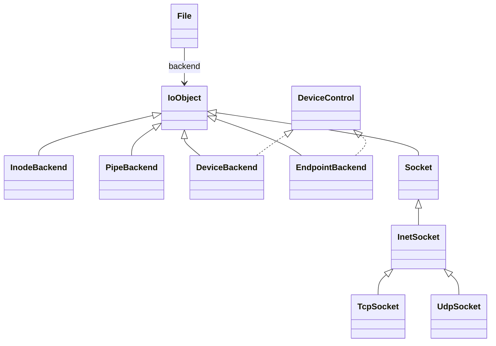

# 统一 File 后端

`File` 表示一次打开的公共状态：引用计数、访问权限、共享打开标志和一个 `IoObject*`。实际资源状态存放在具体后端中，常规 I/O 不使用类型标签或多组资源指针。



## 接口与分工

公共模块是 `import xv.io;`，源码位于 `kernel/io/object.cppm`。

| 接口/对象 | 职责 |
| --- | --- |
| `IoObject` | 多态 read/write/poll/stat/close；默认 stat 不支持、默认无附加能力 |
| `Buffer` | 用户地址与本次 I/O 的非阻塞要求 |
| `Metadata` | 内核中的 stat 数据；ABI 定义在 `kernel/io/stat.h`，旧 `kernel/fs/stat.h` 兼容转引 |
| `DeviceControl` | 独立 ioctl 能力，提供给设备节点和匿名字符端点 |
| `Socket` | 独立网络能力及 I/O 后端，包含 bind/connect/listen/accept 等操作 |
| `query<Interface>` | 按 Interface::Id 查询真实能力基类子对象；不支持时返回 nullptr，无 RTTI |

`read/write/poll/stat` 统一调用 `backend_` 的虚方法，File 只检查权限、长度并传递共享 O_NONBLOCK。元数据由后端填写，File 统一 copy_out；管道保留不支持 fstat 的行为。Socket 自己提供 T_SOCKET，匿名端点提供 T_DEVICE，普通文件/设备节点读取真实 inode 元数据。

ioctl 通过 `query<DeviceControl>(object)` 调用，网络系统调用通过 `query<Socket>(object)` 调用。能力 ID 表示附加接口，不参与公共读写分派。实现者必须保证 ID 返回对应接口的实际基类指针，查询失败返回 nullptr；不把不相关指针强转为资源对象。

## 具体后端

- `InodeBackend` 接收 inode 引用和共享偏移；procfs 另持有本次打开的内容快照。读写在所属节点锁内更新偏移，磁盘大写入按日志容量切分事务。
- `DeviceBackend` 接收设备节点引用及工厂成功打开的 CharacterDevice 会话。每个独立 open 取得一个会话，dup/fork 共享它；最后关闭先调用会话 close，再按节点归属释放 inode。
- `PipeBackend` 保存共享 Pipe 指针和本端方向，两端 File 各自负责最终关闭对应方向。
- `EndpointBackend` 接收匿名 CharacterDevice 端点关闭责任，转发 TTY/PTY 读写、poll 和 ioctl。
- `TcpSocket/UdpSocket` 直接作为 IoObject 绑定 File，保留协议队列及原有异步关闭逻辑。

前四种适配器在 File 的64字节、16字节对齐内置存储中 placement 构造，编译期检查容量和对齐，不额外分配物理页。Socket 沿用网络工厂的对象页和协议缓冲，由自己的 close/destroy 路径管理。设备工厂可以另分配会话页，procfs 为一次打开按需分配快照页链；这些资源在最后关闭时回收。

## 生命周期与偏移

```text
allocate: ref=1，backend=null
    ↓ bind_... / bind_object
发布到进程 fd 表
    ↓ dup/fork
多个描述符共享同一个 File、后端、打开标志及位置
    ↓ 最后一个 release
表锁内 ref=-1，保留槽位
    ↓ 释放表锁
backend->close()：可睡眠、可析构内置后端
    ↓ 重新取得表锁
清空 backend，ref=0，允许新打开复用槽位
```

关闭期间保留槽位是内置存储的生命周期要求：inode 释放可能提交事务并睡眠，如果提前复用，旧 close 会访问被新对象覆盖的存储。`retain` 只接受正引用；未绑定 File 的失败回滚可以直接 release。

后端 close 返回后，File 槽可以复用。对于 TCP，这表示关闭责任已经移交网络注册表；TCP 对象仍可能等待 FIN、TIME_WAIT 或超时。File 不直接 delete 统一接口。

两次独立 open 会构造两个 InodeBackend，因此偏移独立；dup/fork 保持同一个 File，因此共享偏移。`O_NONBLOCK` 也继续保存在共享 File 中，通过每次 Buffer 传递给后端。

## 验证

`fs_contract` 增加通用后端探针，验证虚调用、元数据、设备控制能力、非阻塞标志、非最后引用不关闭，以及阻塞 close 期间的槽位保留和表锁释放；原有共享偏移测试外，增加独立 open 偏移测试。

集成验证包括完整 `usertests -q`、原生文件系统/进程/网络契约，以及单核/五核 PTY、poll、非阻塞和 socket 通信。函数说明仍在 [IoObject 文档](functions/kernel/io/object.cppm.md)、[后端实现](functions/kernel/fs/file/file_operations.cpp.md) 与 [File 管理](functions/kernel/fs/file/open_file.cpp.md)，不注入源码。

设备命名空间、挂载边界与启动注册规则见 [VFS 与 devfs](devfs.md)。

`FileInfo` 保存打开实例的递增 identity、种类与节点身份，configure 完成后才发布。描述符表的 inspect 在短暂表锁内复制这些字段及原子 flags，不调用 stat、不取得节点锁，也不增加或释放 File 引用；procfs 观测因此不会触发目标文件最后关闭。fork 使用另一条 snapshot 接口保留文件引用。

## 用户与权限

Stat 增加 uid/gid/mode。路径 stat 使用独立系统调用，不再先 open，因此无需最终文件 R 权限；目录搜索仍需要 X。open 时授予 fd 读写能力，后续 chmod 或降权不撤销已经打开的描述符。

完整规则见 [用户、组与权限](users-permissions.md)。
