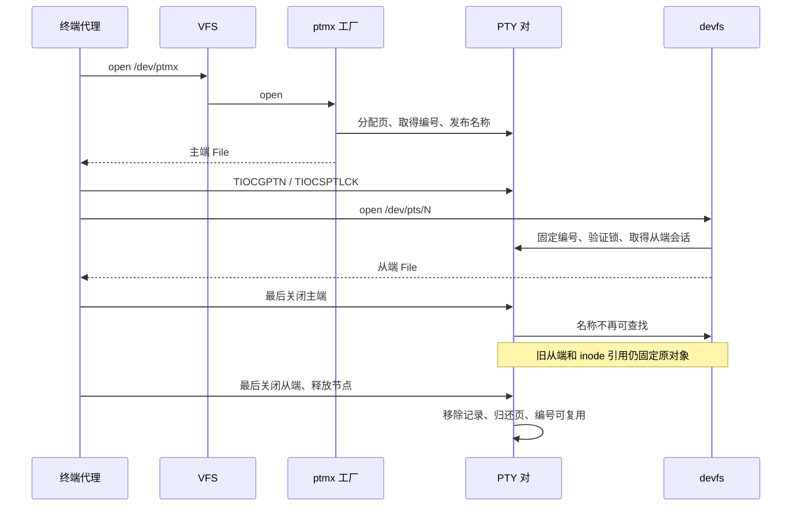

# 命名 PTY 与设备会话

打开 `/dev/ptmx` 分配一对 PTY，主端通过 ioctl 返回对应的 `/dev/pts/N` 名称。终端代理 `pty` 使用这条路径启动嵌套 shell，原有匿名 openpty 系统调用继续供匿名客户端使用。



## 用户接口

```cpp
int master = posix_openpt(O_RDWR);
grantpt(master);
unlockpt(master);
char path[32];
ptsname_r(master, path, sizeof(path));
int slave = open(path, O_RDWR);
```

这些函数在 `user/runtime/pty.cpp` 中实现，成功返回描述符或零，错误返回 -1。系统当前没有用户和设备权限模型，grantpt 验证传入描述符是命名主端；unlockpt 清除从端打开锁。

新建从端默认锁定。`TIOCGPTN` 复制编号到调用者提供的 unsigned 指针，`TIOCSPTLCK` 从 int 指针读取锁状态；它们只接受命名主端。ptsname_r 使用调用者缓冲，不使用共享静态字符串。

## 生命周期

CharacterDevice 的 open 是一次独立打开的工厂入口。默认返回静态设备自身，ptmx 覆盖它并分配主端会话。DeviceBackend 持有返回的会话指针，所有 I/O 都指向该对象；dup/fork 共享 File，最后一个引用消失时才执行一次会话 close。

每对 PTY 占一个物理页，编号范围为 0..63。多个独立从端 open 各计一个会话，关闭其中一个不会挂断其他从端；主端存续期间可以关闭所有从端后重新打开，终端设置保留。

主端最终关闭后，名称立即从 `/dev/pts` 消失，新 open 失败。已经打开的从端可以排空输入再读到 EOF；控制终端挂断沿用已有 SIGHUP/SIGCONT 行为。只要旧从端、File 或临时 inode 引用存在，原对象和编号都继续保留；最后引用释放后编号可复用。

PTY 列表锁保护编号、发布状态、会话计数和计时遍历，输出锁保护数据及连接标志。节点引用锁不会跨驱动释放操作持有。实际挂断和页面回收在释放列表锁后执行。

静态设备注册表没有变成可任意修改的热插拔表。pts 目录根据 PTY 驱动的发布列表生成；目录中的空闲编号输出空 dirent，固定各编号的字节偏移，避免动态删除导致后续枚举项移动。

## 验证

运行 `namedptytest`，或使用 `ctest --test-dir build/dev -R 'named-pty_[13]cpu' --output-on-failure`。测试覆盖初始锁、非法 ioctl 指针、多次从端打开、重新打开、dup、主端关闭撤名、旧引用固定编号、最终编号复用、fd 耗尽回滚和多进程并发创建。

现有单核/三核 PTY 测试继续验证嵌套 shell、终端信号、前后台切换及批量转发。
