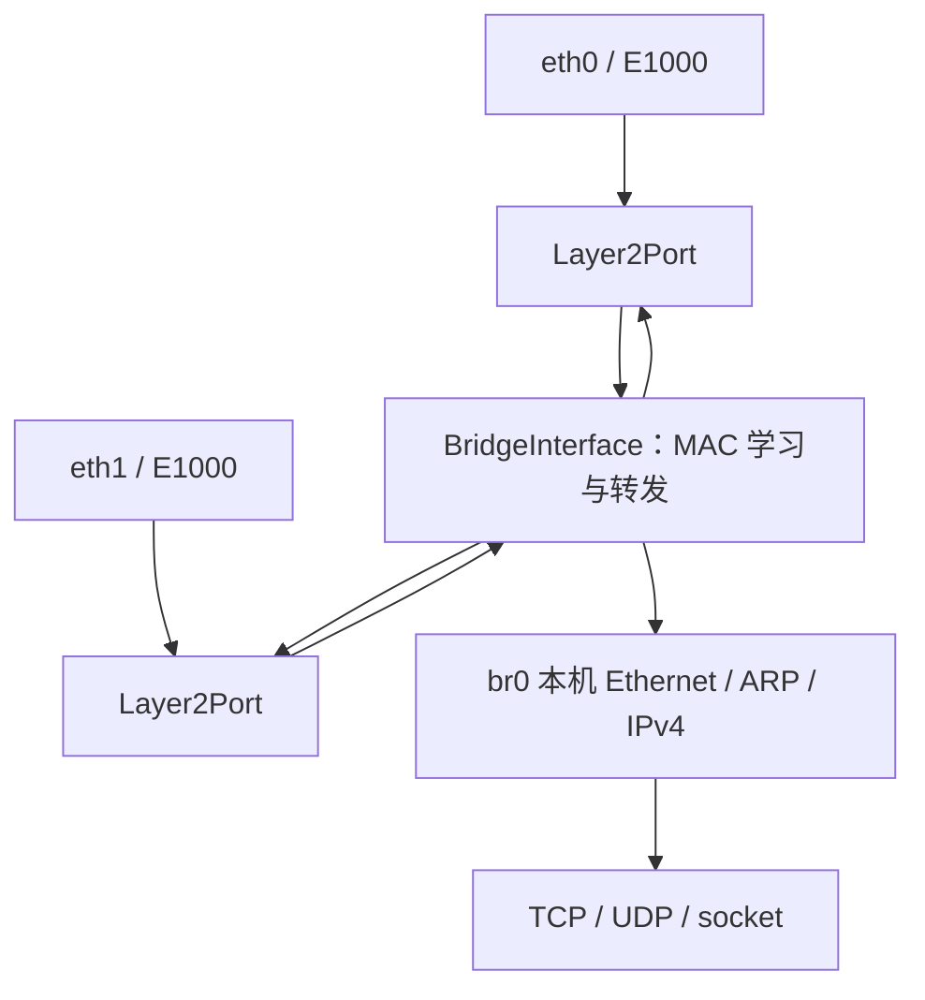

# 学习型软件网桥

网桥在二层交换完整以太帧，不修改过境报文的源/目的 MAC、IP 或 TTL。`br0` 则是本机连接到这个二层网络的接口，可以配置 IPv4 并复用现有 ARP、UDP、TCP 和 socket 栈。



成员端口的收包在目的 MAC 本机过滤之前进入桥，E1000 同时启用单播和组播混杂接收。桥收到发往自身 MAC 或广播/组播的包时，可以向本机协议栈交付；未知单播、广播和组播向其他可用成员泛洪，已知单播只发到学习到的目标端口，同入口目标不反射。以太组播可以过桥，本机 IP 栈仍沿用现有的组播支持边界。

## 使用 netctl

当前有两个可创建的固定桥槽 `br0`、`br1`，接口 ID 为 16、17。创建时默认 DOWN；对象、ID 和名称长期存在于内核存储中，只有创建后的对象才发布到接口注册表。

```sh
netctl bridge create br0
netctl bridge addport br0 eth0
netctl bridge addport br0 eth1
netctl link set br0 up
netctl bridge show
netctl bridge fdb br0
netctl link show eth0
netctl addr add 10.20.0.1/24 dev br0
```

加入桥前，成员必须没有自己的 IPv4 地址、活动 DHCP 客户端，也没有以该成员为出口或归其所有的路由。默认 DHCP 启动先执行：

```sh
netctl dhcp stop eth0
netctl dhcp stop eth1
```

停止会清理租约所属地址和路由；如果使用旧静态启动或手工配置，还需清理，例如：

```sh
netctl route del default dev eth0 via 10.0.2.2
netctl addr del 10.0.2.15/24 dev eth0
netctl route del default dev eth1 via 10.0.3.2 metric 10
netctl addr del 10.0.3.15/24 dev eth1
```

删地址会一并移除对应的自动本机和直连路由。桥建好后，把本机要使用的地址和网关配置到 `br0`，不要配在成员网卡上。桥接后各端口共享同一个二层广播域；桥上的 IP 和网关要按实际连接网络选择，创建桥不会替你修改 QEMU 后端或外部机器的配置。

`netctl link` 为桥显示 `bridge` 标记，为成员显示 `master 16`。成员仍可以独立 UP/DOWN，但不能再新增 IPv4 或路由。同一端口不能属于两个桥，桥本身和三层隧道不能作为成员；未来的二层虚拟链路可以实现 `Layer2Port` 接入。

桥 MAC 在启动时从首个有效接口 MAC 派生，设置本地管理位并对两个桥槽作区分；没有可用 MAC 时使用固定本地回退种子。MAC 在桥槽生命周期内不变，重新创建也不变。多台实例接入同一网络时应为底层网卡提供各自唯一的 MAC。

桥可使用 `netctl dhcp start br0` 自动取址，详见 [DHCP 说明](network-dhcp.md)。此时清理前先执行 `netctl dhcp stop br0`，不要直接删除租约地址。

以下是桥使用手工地址时的清理示例：

```sh
netctl bridge flush br0
netctl addr del 10.20.0.1/24 dev br0
netctl link set br0 down
netctl bridge delport br0 eth0
netctl bridge delport br0 eth1
netctl bridge delete br0
```

桥还有其他静态路由时，删除桥前也要先删除它们。删除只接受 DOWN、没有地址/路由、没有成员的桥，忙时返回 `-EBUSY`。移出成员会恢复网卡普通接收模式；地址和路由不会自动恢复到成员，需显式配置。迁移地址不自动迁移连接、不发送 gratuitous ARP；外部机器可能需要刷新原有邻居缓存。

## 类与报文所有权

| 类 | 责任 |
| --- | --- |
| `Layer2Port` | 完整以太帧发送、混杂能力和桥归属/代次；不要求 IPv4 |
| `FrameReceiver` | 携带入端口及接入代次的原始帧接收契约 |
| `EthernetLayer` | 普通本机以太收发，并把桥成员收包转交 `FrameReceiver` |
| `BridgeInterface` | 学习转发表、泛洪/定向转发，同时提供本机以太设备能力 |
| `BridgeManager` | 串行协调桥创建、成员接入/退出、转发表查询和注销 |
| `NetworkManager` | 继续管理桥的 IP、路由和启停，并将桥专用操作委托给 BridgeManager |

`EthernetInterface` 可复用为桥的本机三层接入，桥内部实现一个软件 `EthernetDevice` 作为它的下层。本机发送先正常完成 ARP 和以太编码，再按桥转发表选择实际出口；过境帧使用 `transmit_frame` 原样发出，不经过会填写源 MAC 的本机编码函数。

输入 `Packet` 独占驱动移交的页面。每个转发出口获得独立页面副本，目标端口失败的副本由 RAII 释放，不影响其他出口。本机交付可移交输入页面，未消费页面自然释放。克隆失败只影响该出口，不泄漏页面。

## 并发与生命周期

桥管理命令先持独立管理锁，配置锁内只检查/发布身份、成员和 FDB。驱动混杂设置、ARP 清理、页面分配以及帧发送均在配置锁外进行。接入成员时先检查配置，打开混杂后再次验证；若期间有其他管理操作为网卡加地址或路由，接入回滚。

接收入口保存接入代次，桥验证后才处理，防止移出又接入导致旧回调误入新归属。转发先在配置锁内形成目标快照，每个出口发送前再次核对桥归属、端口代次及状态。真正交给驱动前释放配置锁，不在持锁状态回调协议栈。

接口对象不会随桥删除释放。接口注册表的枚举和查找受配置锁保护，时钟维护先复制接口指针列表再解锁回调。因此正在运行的查询、选路或时钟回调不会持有已释放的接口指针。已经提交给驱动的帧可以完成，不保证撤回在途帧。桥槽的本机 IP 计数也随槽长期存在，不因逻辑删除清零。

## 管理 ABI

复用 `netctl_request` 版本一的 128 字节结构，不改变已有操作号或布局：

| 操作 | 输入 | 返回 |
| --- | --- | --- |
| `NETCTL_BRIDGE_CREATE` | name 为 br0 或 br1 | 成功 0 |
| `NETCTL_BRIDGE_DELETE` | ifindex 为桥 ID | 成功 0 |
| `NETCTL_BRIDGE_ADD_PORT` / `NETCTL_BRIDGE_DEL_PORT` | ifindex 为桥 ID，source 为成员 ID | 成功 0 |
| `NETCTL_BRIDGE_PORT` | ifindex、index | 一条返回 1，source 为成员 ID；结束 0 |
| `NETCTL_BRIDGE_FDB` | ifindex、index | 一条返回 1，mac、source 成员 ID、expires_ms 剩余有效毫秒；结束 0 |
| `NETCTL_BRIDGE_FLUSH_FDB` | ifindex | 成功 0 |

LINK 查询增加 `NET_LINK_BRIDGE`、`NET_LINK_SLAVE` 标记；source 字段在此查询中表示 master 的接口 ID，没有 master 时为零。已有地址/路由查询的字段意义不变。

## 范围与验证

每桥最多四个成员、六十四个动态 MAC 项，源 MAC 学习及移动刷新 300 秒老化时间，满表替换最早到期项。未知目的不占待发队列，直接泛洪。没有静态 FDB、VLAN、STP/RSTP、IGMP snooping、二层隧道或硬件交换卸载。带 802.1Q/802.1ad 标签的帧明确丢弃；IEEE 保留链路本地控制目的 `01:80:c2:00:00:00..0f` 不转发。

当前只能用于无环拓扑，不能用多条外部链路构成二层环。丢弃 STP 控制帧不提供环路检测能力。帧长受桥和成员 MTU 限制，桥本机的计数仍是纯 IP 接口统计，不代表所有二层过境帧。

```sh
ctest --test-dir build/dev --output-on-failure -R '^(network_contract|bridge_[13]cpu)$'
```

原生契约验证学习、MAC 移动、老化、广播、同端口过滤、容量、分配/出口失败页回收，以及并发移出和加入端口。QEMU 单核/三核各用三块共用 INTx 线路的真实 E1000，连接三个独立原始以太帧 UDP 后端；验证任意目的 MAC 的混杂接收、定向转发、泛洪、FDB 查询/清空、桥本机 ARP 与 UDP，以及同次启动删除后重建。

接口和路由管理基础见 [用户态网络管理](network-management.md)。函数说明见 [二层端口](functions/kernel/net/link/port.cppm.md)、[桥数据路径](functions/kernel/net/bridge/bridge.cpp.md) 和 [桥管理](functions/kernel/net/bridge/manager.cpp.md)。
