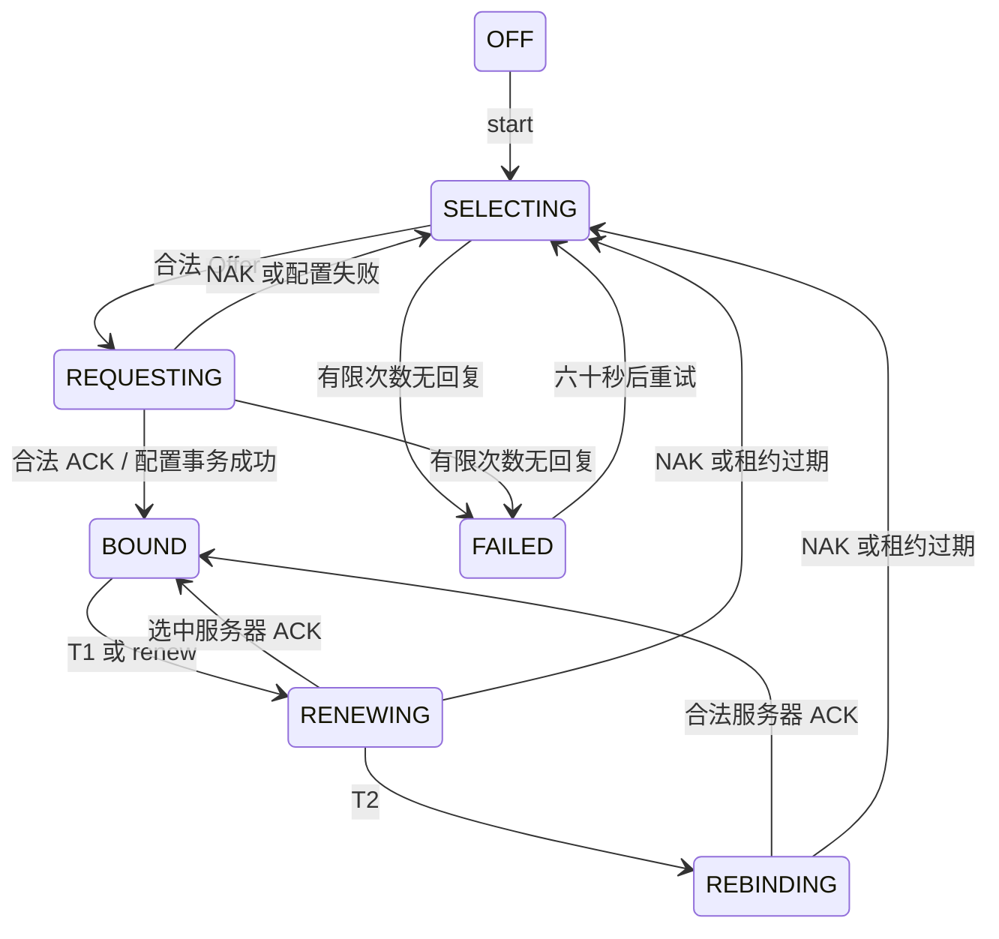

# DHCP 动态 IPv4 配置

默认启动已经启用 DHCP。物理 E1000 接口只完成设备和链路初始化，不再预装 `10.0.2.15`；内核客户端通过 QEMU `user` 后端的 DHCP 服务取得地址。每个接口维护独立事务和租约，桥上则在 `br0/br1` 本机接口运行客户端，成员网卡不运行 DHCP。

## 启动与使用

```sh
conda activate OS-LAB
cmake --preset dev
cmake --build --preset dev
cmake --build build/dev --target qemu
```

在客体 shell 中查看：

```sh
netctl dhcp show
netctl dhcp wait eth0
netctl addr
netctl route
```

`wait` 默认最多等待二十秒，可写 `netctl dhcp wait eth0 30`。这是等待客户端状态，不会创建客户端；启动缺少服务器时客户端会自行重试，命令超时不停止后台取址。开机打印接口时租约可能尚未到达，不能用这一次地址列表代替最终状态。

默认 QEMU 参数 `-netdev user,id=net0` 已有虚拟 DHCP 服务，不依赖宿主机局域网的路由器。默认地址常见为 `.15`，但这个值现在由服务器分配。验证不是静态地址可显式换地址池：

```sh
cmake --preset dev '-DXV_NET_BACKEND=user,id=net0,dhcpstart=10.0.2.100'
cmake --build --preset dev
cmake --build build/dev --target qemu
```

此时 `netctl dhcp wait eth0` 应显示类似：

```text
eth0 DHCP BOUND ip 10.0.2.100/24 gateway 10.0.2.2 dns 10.0.2.3 server 10.0.2.2 ...
```

恢复 QEMU 默认后端：`cmake --preset dev -DXV_NET_BACKEND=user,id=net0`。需要旧静态启动策略时配置 `cmake --preset dev -DXV_NET_DHCP=OFF`；重新开启为 `-DXV_NET_DHCP=ON`。自定义 `NetworkSetup` 完全接管启动配置，不会被默认 DHCP 策略覆盖。

手动控制：

```sh
netctl dhcp renew eth0
netctl dhcp wait eth0
netctl dhcp stop eth0
netctl dhcp start eth0
netctl dhcp wait eth0
```

`start` 要求接口 UP、没有 IPv4 地址、不是桥成员，并具备有效以太 MAC 和足够 MTU。它不会擅自删除静态地址；已有手工配置时返回忙，先按原管理命令清理再启动。`renew` 请求提前续租，`stop` 尽力发送 RELEASE 并撤销本客户端配置；链路或 ARP 不可用时不能保证服务器已收到 RELEASE。

## 桥上获取地址

先停止成员客户端，再创建桥：

```sh
netctl dhcp stop eth0
netctl bridge create br0
netctl bridge addport br0 eth0
netctl link set br0 up
netctl dhcp start br0
netctl dhcp wait br0
```

如果成员原来用的是手工静态地址，还需显式删除它的地址和路由。桥的至少一个成员必须连到实际 DHCP 服务；原始帧 `socket` 后端本身不会提供 DHCP。停止桥客户端后才可清空并删除桥；处于 SELECTING 或失败重试阶段也算占用接口，避免创建桥时旧客户端继续发包。

## 模块与状态机

| 组件 | 职责 |
| --- | --- |
| `DhcpCodec` | BOOTP 固定字段、cookie、选项、重载区域及配置字段验证 |
| `DhcpManager` | 八个按接口隔离的事务、超时、Offer/ACK/NAK、续租与过期 |
| `LeaseConfiguration` | 校验租约字段，把 DHCP 租约转换为地址配置请求 |
| `AddressConfiguration` | 手工与租约地址共用的事务服务，原子协调地址和路由 |
| `Ipv4Bootstrap` | 在普通目的地址过滤前检查受限启动协议候选 |
| `NetworkManager` | DHCP 管理命令分派及租约配置保护 |



所有活动阶段都可 `stop` 回到 OFF。初次获取以 `0.0.0.0:68` 向 `255.255.255.255:67` 广播；选择第一份有效 Offer 后，Request 带请求地址和服务器标识。T1 时以租约地址单播给原服务器，T2 改为广播重新绑定；此时仍保留有效地址，到期或有效 NAK 才撤销。无限租约不自动续租或过期，仍可主动 renew/stop。

缺省 T1/T2 为租期的 1/2、7/8；服务器给出的时序非法则使用缺省值。获取阶段最多六次带事务扰动的退避发送，间隔上限约十六秒，失败后六十秒重试。续租/重新绑定根据剩余期限安排有界重试。链路 DOWN 时暂停发送，但租期不会暂停，防止使用过期地址。

## 收发限制与并发

无地址通信只通过内核 DHCP 入口开放。普通 socket 的源地址/路由检查不变，UDP 68 永久保留给客户端。启动发送必须是 UDP 68 到 67，接口须已发布、启用、运行 DHCP 且不是桥成员；重新绑定的非零源必须仍属于该接口。

接收先经过驱动和以太 MAC/桥分派，再由 IPv4 检查首部、长度、校验和与入接口。活动客户端只消费端口 67 到 68 的匹配回复，继续验证 UDP 长度/校验和、硬件类型/长度、cookie、事务 ID、客户端 MAC、目标地址、消息阶段及服务器标识。其他流量仍须通过正常的本机目的地址检查。初次取址不支持分片 DHCP 回复。

解析支持掩码、首个路由器、首个 DNS、租期、T1/T2 和 BOOTP file/sname 选项重载，拒绝越界、截断、重复关键选项、无 End 和非法掩码。配置前会检查本机其他接口的地址冲突；发现冲突拒绝安装并发送 Decline，稍后重新发现。

所有客户端状态和地址/路由事务用短配置锁串行化。发包、页面分配、ARP 清理以及用户复制都在配置锁外进行。发送动作保存接口、事务和串行号快照，执行前再次核对，防止 stop/restart 后旧动作修改新会话。接收和时钟路径不睡眠，也不依赖用户进程持续运行。

## 配置归属

租约地址和路由带单独的接口归属标记，普通 `addr del`、`route del` 不允许删除它们。`netctl addr/route` 会显示 `dhcp`。每份租约原子安装本机 /32、直连前缀及可选默认路由；默认路由 metric 为 `100+接口 ID`，首选源为租约地址，手工的更低 metric 路由可优先。

容量不足或地址冲突不会留下部分安装。配置内容相同的续租只更新租期，不更改接口代次、不清理已有 ARP。stop、NAK 和过期只撤销租约所属配置，保留手工别名与手工路由；引用已失效源地址的手工路由保留但暂时不可选。配置实际变化后，在配置锁外清理邻居和待解析页。

`LeaseConfiguration` 校验租期并转换租约字段，将安装或撤销委托 `AddressConfiguration`；后者负责地址冲突、地址槽位和接口代次，再把租约路由的构造、比较、容量预检、替换及撤销委托 `RoutingTable`。替换先扣除本租约可复用的路由数量再检查容量，检查成功后才移除旧记录并追加新记录，保留其他路由的相对顺序。地址提交和路由替换始终处于同一配置锁作用域；路由容量不足时不会修改地址、路由或代次。`lease_routes_match()` 使相同配置续租保持原路由顺序。

现有 socket 不会被隐式关闭。租约过期后，固定绑定旧地址的发送会不可达；重新获得同一地址可能恢复，获得其他地址时不会自动迁移旧连接。

## 管理 ABI

复用版本一的 128 字节 `netctl_request`，新增操作：

| 操作 | 输入 | 结果 |
| --- | --- | --- |
| `NETCTL_DHCP_START` | ifindex | 异步开始获取，成功 0 |
| `NETCTL_DHCP_STOP` | ifindex | 本地撤销并停止，成功 0 |
| `NETCTL_DHCP_STATUS` | ifindex | 状态记录，成功 1 |
| `NETCTL_DHCP_RENEW` | ifindex | 提前续租，成功 0 |

STATUS 中 flags 为 DHCP_* 状态，index 为最近的正 errno，mtu 为本阶段重试数；address/prefix/gateway 为候选或租约配置，source 为 DNS，metric 为服务器地址，expires_ms 为剩余有效毫秒，rx_packets/tx_packets 分别为 T1/T2 剩余毫秒。这里复用的是状态记录字段，不代表流量统计；只有 BOUND/RENEWING/REBINDING 才表示已安装租约。LINK/统计操作的原字段含义不变。

## 验证与范围

```sh
ctest --test-dir build/dev --output-on-failure -R '^(network_contract|dhcp_[15]cpu)$'
```

原生契约使用可控时钟验证编解码边界、选项重载、错误事务/服务器/入接口、T1/T2、续租、重新绑定、NAK、过期、无限租约、重试、分配失败、地址冲突与 Decline、容量回滚，以及保留手工配置。QEMU 单核/五核把地址池改为 `.100` 起点，在同次启动重复验证实际取址、续租、以动态地址 UDP 往返、停止/重启，以及桥本机取址，排除沿用固定 `.15` 的假成功。

完整回归包含多网卡、socket、网桥、非阻塞、poll、信号和启动/驱动/文件系统。网桥原始帧测试按实际到包等待，兼容 QEMU E1000 写 RCTL 后的一秒接收队列延迟，不重发来掩盖丢包。

本版本不做 ARP 地址冲突探测，不持久化租约或实现 INIT-REBOOT、IPv6/DHCPv6、RFC3396 分片选项拼接、classless 静态路由；DNS 地址由用户态解析器读取，使用方式见 [DNS 说明](network-dns.md)。默认 QEMU 隔离网络提供服务，连接其他后端时需确保链路确有 DHCP 服务器。

协议字段与流程参照 [RFC 2131](https://www.rfc-editor.org/rfc/rfc2131) 和 [RFC 2132](https://www.rfc-editor.org/rfc/rfc2132)，这是上述范围内的教学客户端。QEMU 接收队列延迟依据其 [E1000 实现](https://github.com/qemu/qemu/blob/v9.2.0/hw/net/e1000.c)。

函数说明见 [客户端状态机](functions/kernel/net/dhcp/client.cpp.md)、[编解码](functions/kernel/net/dhcp/message.cpp.md) 和 [租约事务](functions/kernel/net/dhcp/lease.cpp.md)。
