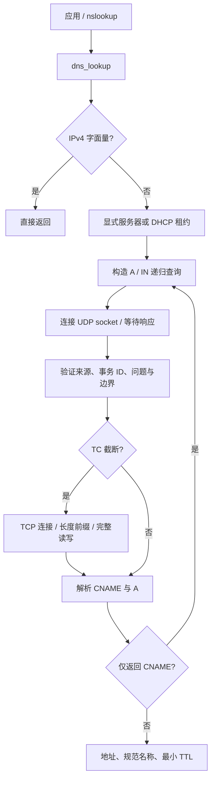

# DNS 用户态解析

系统提供 IPv4 DNS stub resolver 和 `nslookup`。解析器把递归查询交给配置的 DNS 服务器，不在本机实现递归服务器。默认每次调用都读取当前 DHCP 租约中的首个 DNS 地址，不固定使用 `10.0.2.3`，也不缓存旧租约；桥接口同样适用。

## 在 QEMU 中使用

```sh
netctl dhcp wait eth0
nslookup example.com
nslookup example.com 10.0.2.3
nslookup 192.0.2.7
```

默认 QEMU user 后端中，DHCP 通常下发 `10.0.2.3`，由 QEMU DNS 代理转交宿主机的上游 DNS。公网查询需要宿主机的 DNS 和外部网络可用；`nslookup localhost` 可以在当前测试环境验证代理链路，而不依赖公网域名。直接输入 IPv4 字面量不发包。

静态配置没有 DHCP DNS 信息时，请传入服务器地址。当前没有 `/etc/resolv.conf`、持久化静态 DNS 设置、搜索域或 DNS 管理守护进程。错误会明确区分无服务器、超时、NXDOMAIN、没有 A 记录和网络错误。

## 用户程序 API

包含 `user/runtime/user.h`，或单独包含 `user/runtime/dns/dns.h`：

```cpp
dns_result answer{};
int status = dns_lookup("example.com", &answer);
if (status == 0) {
  sockaddr_in peer{};
  peer.sin_family = AF_INET;
  peer.sin_port = htons(80);
  peer.sin_addr.s_addr = htonl(answer.addresses[0]);
  // 使用现有 socket/connect 接口。
} else {
  fprintf(2, "%s\n", dns_strerror(status));
}
```

需要指定服务器或调整超时时：

```cpp
dns_options options{};
options.server = 0x0a000203;
options.port = 53;
options.timeout_ms = 1500;
options.attempts = 3;
int status = dns_lookup("example.com", &answer, &options);
```

地址均为主机字节序，交给 socket 时显式 `htonl`。零值字段使用默认值：DHCP 服务器、端口 53、每次 UDP 等待 1500 ms、三次尝试。每次 TCP 回退另有同样时限；跟随 CNAME 可能产生多个查询，因此这个时限不是整个调用的总时限。新增 `total_timeout_ms` 可选字段（零表示不另设总时限，最大 3600000 ms）把全部查询、重试和 TCP 回退约束在同一截止时间内，供 HTTP 客户端复用。超时最大 30000 ms，尝试次数最多五次。调用是同步的，受系统 100 ms 时钟粒度影响；信号中断会返回网络错误。

成功返回至多八个去重后的 IPv4 地址、规范名称、实际服务器和整条 CNAME 链的最小 TTL。超过八个地址时保留前八个；IPv4 字面量的服务器和 TTL 都为零。失败时输出结构清零，不暴露部分解析结果。调用之间没有共享可变解析状态，可在不同进程中并行使用。

## 分层与处理流程



| 文件 | 职责 |
| --- | --- |
| `user/runtime/dns/dns.h` | 稳定用户 API、结果、选项和错误码 |
| `user/runtime/dns/codec.*` | 与系统调用无关的查询编码和响应解析 |
| `user/runtime/dns/resolver.cpp` | DHCP 选择、socket 生命周期、超时重试和 TCP 回退 |
| `user/apps/nslookup/nslookup.cpp` | 命令行展示 |

`user_dns` 是静态库，只链接到实际使用 DNS 的程序，避免把解析器和调试信息重复装进所有用户程序。

默认服务器选择只考虑 UP、有 carrier、非桥成员、持有 BOUND/RENEWING/REBINDING 租约且 DNS 非零的接口；按该接口默认路由的最小 metric 优先，同值按接口枚举顺序。没有默认路由的候选排在有默认路由的候选后，允许同子网 DNS。自动模式把 socket 绑定到该租约的 IPv4 地址，显式服务器模式由现有路由表选择源地址。这里不是完整的策略 DNS 路由，也不在多个 DHCP DNS 服务器间自动切换。

UDP 使用连接式 socket，由内核过滤响应源 IP/端口；解析器再验证事务 ID、响应标志、唯一问题、域名、A/IN 类型及记录边界。事务 ID 混合时钟、PID 和本次临时端口，不提供密码学随机性；当前 socket 临时端口分配也不是安全随机分配。不存在 DNSSEC 验证或针对恶意网络的完整抗伪造保证。

名称忽略 ASCII 大小写，支持末尾根点，标签最多 63 字节、文本名称最多 253 字节。主机名称支持字母、数字、连字符和下划线，不支持 IDNA 转换和任意二进制 DNS 标签。压缩指针必须向前文引用，名称展开有步数和长度上限。忽略无关名称的 A 记录，CNAME 与 A 同属一个 owner 或冲突的 CNAME 会被拒绝；记录顺序不影响结果。仅有 CNAME 时继续查询，链长和后续查询均有限额，避免循环无限执行。

传统 UDP 报文上限 512 字节；TC 响应触发 TCP，TCP 消息上限 4096 字节，通过两字节长度前缀读取，并处理部分读写。超时和服务器临时错误会有限重试；不匹配或畸形 UDP 响应被忽略至本次截止时间。TCP socket、UDP socket 和工作缓冲区在所有退出路径释放。没有 EDNS、AAAA、PTR、SRV、mDNS、缓存或完整 POSIX `getaddrinfo` 接口。

## 外部 Doxygen 函数说明

以下注释保存在开发文档，源代码保持分离。当前 kernel 外部索引工具只覆盖内核，这些用户态说明不宣称已经进入 kernel 的 clangd 索引。

```cpp
/**
 * @fn int dns_lookup(const char *name, dns_result *result, const dns_options *options)
 * @brief 同步解析主机名为至多八个 IPv4 地址，或直接接受 IPv4 字面量。
 * @param name 非空主机名；允许 ASCII 大小写和末尾根点，不包含端口。
 * @param result 调用方持有的结果空间，必须非空；入口清零，只有成功才发布结果。
 * @param options 可为空；零字段采用 DHCP 服务器、53 端口、1500 ms、三次尝试。
 * @return 成功为零，失败为 DNS_* 负错误码。
 * @pre 需要发包时应已建立有效地址和路由；自动服务器模式需有有效 DHCP DNS。
 * @post 所有临时描述符和工作内存均释放，不修改接口、路由和 DHCP 配置。
 * @note 结果地址和服务器为主机字节序；TTL 是 CNAME 链与 A 记录的最小值。
 * @warning 同步等待；超时按每次查询和传输计算，不代表整个调用总时限。
 */

/**
 * @fn const char *dns_strerror(int status)
 * @brief 把解析器返回值转换成静态错误描述。
 * @param status dns_lookup 的返回值。
 * @return 静态字符串，调用方不得修改或释放；未知状态也有固定描述。
 */

/**
 * @fn int dns_parse_ipv4(const char *text, unsigned *address)
 * @brief 严格读取四段十进制 IPv4 文本，不发包，也不查询网络配置。
 * @param text 四段 0 至 255 的数值，禁止空段、符号和尾随字符。
 * @param address 成功时写入主机字节序地址；失败时保持原值。
 * @return 成功为零，空指针或格式错误为 DNS_INVALID。
 */

/**
 * @fn int xv::dns::normalize(const char *name, char *output)
 * @brief 校验主机名，将 ASCII 转为小写并去掉末尾根点。
 * @param output 至少 DNS_NAME_SIZE 字节；失败时不得使用其部分内容。
 * @return 成功为零，否则 DNS_INVALID。
 */

/**
 * @fn int xv::dns::make_query(const char *name, unsigned short id, unsigned char *packet)
 * @brief 编码含一个 A/IN 问题且设置 RD 位的传统 DNS 请求。
 * @param packet 调用方提供至少 272 字节的输出空间。
 * @return 正报文长度，名称无效时返回 DNS_INVALID。
 */

/**
 * @fn int xv::dns::parse_reply(const unsigned char *packet, unsigned size, unsigned short id, const char *question, dns_result &result)
 * @brief 在有界消息内验证问题与全部记录，再沿 CNAME 查找匹配的 A 记录。
 * @param question 已规范化的预期问题名称。
 * @param result 成功时包含地址、规范名和 TTL；alias 时包含待继续查询的规范名。
 * @return 零表示成功；truncated 请求 TCP 重试；alias 请求后续查询；负值表示失败。
 * @note 不进行 I/O，不保留外部指针。调用者只在成功时向应用发布结果。
 */
```

## 验证

```sh
cmake --build --preset dev
ctest --preset dev -R '^dns_' --output-on-failure
python3 tests/dns_network.py --qemu /usr/bin/qemu-system-riscv64 \
  --kernel build/dev/kernel.elf --image build/dev/fs.img --cpus 3 --public
```

`dns_contract` 检查名称边界、畸形响应、压缩指针和变异语料；该语料还可用 ASan/UBSan 编译运行。`dns_1cpu/3cpu` 各自重复执行真实用户程序，与宿主机确定性 DNS 服务通信，覆盖多地址、去重、压缩 CNAME、无序答案、后续查询、循环、来源/事务/问题过滤、超时、重试、NXDOMAIN、SERVFAIL、无 A 记录、TCP 分段帧及 QEMU 代理。随后停止 DHCP 验证无 DNS 配置错误，再在桥上取租约并解析。`--public` 额外验证公网域名，需要外部网络，不作为离线回归的硬条件。

协议依据：[RFC 1035](https://www.rfc-editor.org/rfc/rfc1035) 的报文、压缩和传输格式，以及 [RFC 5452](https://www.rfc-editor.org/rfc/rfc5452) 的响应匹配原则。实现范围和随机性限制如上。
