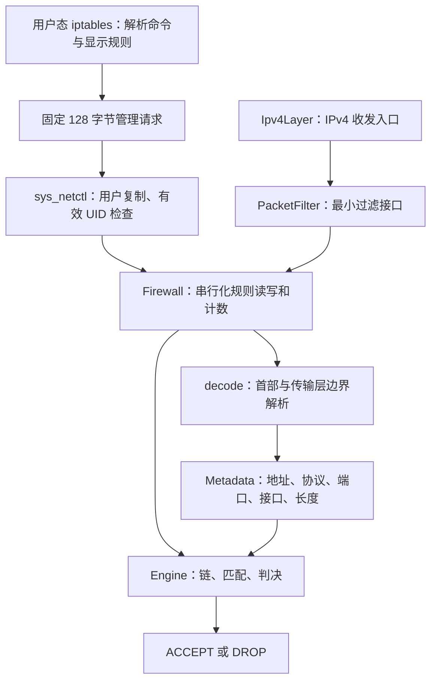

# iptables 与分层 IPv4 过滤

系统提供 `iptables` 命令，安装在 `/sbin/iptables`，通过现有 `netctl` 系统调用管理内核 IPv4 过滤器。它实现本系统的 iptables 风格子集：`filter` 表、`INPUT` / `OUTPUT` 内建链、自定义链、顺序匹配、链跳转和返回。启动时两条内建链均为空，默认策略为 `ACCEPT`。

## 从命令到数据包



| 文件 | 职责与依赖 |
| --- | --- |
| `kernel/net/filter/control.h` | 操作码和固定布局值对象；无用户指针，不包含内核对象 |
| `user/apps/iptables/iptables.cpp` | 文本语法、CIDR/端口检查、网卡名解析和规则展示 |
| `kernel/syscall/sysnetctl.cpp` | 用户地址检查、凭据检查和请求复制；不知道如何匹配数据包 |
| `kernel/net/filter/hook.cppm` | `FilterHook` 和 `PacketFilter` 抽象；IPv4 只依赖它 |
| `kernel/net/filter/filter.cppm`、`filter.cpp` | `Firewall` 服务，组合解析器、规则核心和自旋锁 |
| `kernel/net/filter/metadata.h` | 解析器与规则核心共用的报文值对象；不依赖管理 ABI 或引擎 |
| `kernel/net/filter/decoder.h` | 仅依赖元数据，把完整 IPv4 数据报转为 `Metadata` |
| `kernel/net/filter/engine.h` | 无动态分配的规则核心；不访问驱动、用户内存、文件系统或锁 |
| `kernel/net/core/service.cpp` | 创建静态防火墙实例，初始化并注入 IPv4 层，提供管理入口 |

更换驱动不会影响规则核心；增加过滤入口只需适配 `PacketFilter`；改写命令行不会改变收发路径。测试可以直接给 `Engine` 传入元数据，也可以给 IPv4 注入独立的过滤实现。共享的管理结构用于表达规则，不绑定具体系统调用实现。

`Metadata` 使用 `source_port`、`destination_port`、`input_interface`、`output_interface`、`total_length` 和 `has_ports` 表达匹配信息，与固定布局管理 ABI 中的缩写字段在边界处对应。解析器可以单独使用，无须包含规则数组或管理操作。

`Firewall::accept()` 显式把 `FilterHook` 映射到 `Engine::BuiltinChain`，不把枚举的整数值当作链下标。引擎内部负责槽位映射，管理查询仍沿用原有枚举次序。`execute()` 分派查询、链管理和规则修改；`accept()` 负责有界遍历，`RETURN` 与链结束共用返回栈处理，`apply_policy()` 统一累计默认策略计数。

## 收发时机与所有权

- `OUTPUT`：路由选出出口、IPv4 首部完成后，交给 `NetworkInterface` 前执行。DHCP 无地址广播发送也执行。拒绝返回 `-13`；UDP `sendto` 可直接观察该错误。
- `INPUT`：IPv4 首部校验、分片重组完成后，交给 DHCP、TCP、UDP、ICMP 等上层之前执行。拒绝静默丢包，并增加接口的接收丢弃计数。
- 回环流量依次经过 `OUTPUT` 和 `INPUT`。IP-in-IP 的外层与内层是各自的数据报，分别经过相关入口。
- 非首片不会被当作无端口数据报提前放行；完整重组后按端口匹配一次。重组资源仍受原有槽位和超时限制。
- 过滤器借用报文字节，不移动或释放 `Packet`；调用方沿用现有对象生命周期回收被拒绝报文。
- ARP 和软件网桥纯二层转发不经过 IPv4 过滤器。

## 链与规则语义

规则从第一条开始匹配；同一条规则内指定的条件必须同时满足。地址使用 IPv4 CIDR；协议 `0` 表示任意协议。端口仅适用于明确指定 `tcp` 或 `udp` 的规则；端口上界 `0` 是 ABI 的不限端口标记，因此单独匹配端口 `0` 不支持，范围 `0:65535` 可以表达。

匹配后：`ACCEPT` 放行、`DROP` 丢弃、`RETURN` 返回调用者的下一条规则；跳转到自定义链会保存当前位置。自定义链走到结尾相当于 `RETURN`。内建链结尾或内建链的 `RETURN` 使用自身默认策略。自定义链没有可修改的默认策略。

最多 10 条链（2 条内建、8 条自定义），每链最多 32 条规则，链名最多 15 个 ASCII 字母、数字、下划线或短横线。添加跳转时拒绝不存在的目标、内建链目标及环路；被引用或仍有规则的链不能删除。单包最多执行 1024 个规则/链结束步骤，复杂重复跳转超限按 `DROP` 处理。

规则使用稳定的数字接口 ID；CLI 通过 `netctl` 把当前接口名称转换为 ID。不存在名称会报错，不会退化成通配符。接口删除后旧规则保持原 ID；重建接口后应核对并重建相关规则。`-i` 只在 `INPUT` 路径有值，`-o` 只在 `OUTPUT` 路径有值；自定义链继承调用路径的接口信息。

每条命中规则统计包数和 IPv4 总字节数（含 IP 首部），跳转规则与子链规则可以同时计数，因此不能把各行相加作为唯一流量。内建链显示的计数只记录使用默认策略的包。`-Z` 清零计数；`-F` 清空规则，保留默认策略。

## 使用示例

查看规则：

```sh
iptables -L
iptables -t filter -L INPUT -n -v --line-numbers
```

建立分层规则，先允许回环、DHCP 和 DNS 回复，再使用默认丢弃：

```sh
iptables -N TRUSTED
iptables -A TRUSTED -s 127.0.0.0/8 -i lo -j ACCEPT
iptables -A TRUSTED -p udp --sport 67 --dport 68 -i eth0 -j ACCEPT
iptables -A TRUSTED -p udp --sport 53 -i eth0 -j ACCEPT
iptables -A TRUSTED -j RETURN
iptables -A INPUT -j TRUSTED
iptables -P INPUT DROP
```

这只是演示链结构的无状态规则集，不会自动允许已建立的 TCP 连接；根据需要补充服务规则。默认丢弃也会影响 DHCP 续租，因此应先添加相应允许规则。

插入、删除和恢复：

```sh
iptables -I INPUT 1 -p tcp -s 10.0.2.0/24 --dport 2021 -j ACCEPT
iptables -D INPUT 1
iptables -Z INPUT
iptables -P INPUT ACCEPT
iptables -F INPUT
iptables -F TRUSTED
iptables -X TRUSTED
```

`-D` 的编号从 1 开始；`-I CHAIN` 默认插在第一条。`-F` / `-Z` 不指定链时作用于所有链。规则查询允许普通用户执行，所有修改操作要求有效 UID 为 0。

## 并发、边界和扩展

`Firewall` 在一把短期自旋锁内完成单次规则查询/修改或一次完整判决及计数，过滤期间不进行分配、睡眠、用户复制或网络发送。解析报文在锁外完成；锁内不获取网络配置锁或 socket 锁。返回判决后释放锁，才继续协议或驱动调用，避免过滤器反向进入收发路径。

每次管理操作是原子的，多条命令组成的规则集更新不是事务；同时改动时 `-L` 的多次查询也不构成完整快照。准备自定义链后再添加入口跳转可以减少配置中间状态。

本版为内存规则，重启恢复空链和 `ACCEPT`，不自动保存或加载。可以将命令保存为 root 管理的脚本，通过 `sh /etc/firewall.sh` 显式应用。尚无 IPv4 转发、`FORWARD`、NAT、连接跟踪、`ESTABLISHED` 状态匹配、IPv6、Linux netfilter 二进制 ABI 或 iptables 插件兼容。

后续若增加转发，可在路由转发路径补充 hook；若增加 NAT 或连接跟踪，应使用独立处理阶段，明确报文修改、校验和更新及状态表生命周期，不把这些职责塞入当前匹配器。

## 构建与验证

```sh
cmake --preset dev
cmake --build --preset dev
ctest --test-dir build/dev --output-on-failure -L network
```

`network_contract` 覆盖规则顺序、CIDR/端口/接口匹配、跳转/返回、环路与容量拒绝、计数、错误 ABI、报文边界、并发控制，以及真实 socket 收发和分片重组后的拦截。DHCP 原生测试检查发现包与引导接收均经过 hook。

`firewall_1cpu` / `firewall_5cpu` 在隔离镜像上执行真实命令行、实际 E1000 UDP 回显拦截、权限校验及规则修改与回环流量并发。其余网络回归继续检查 TCP、网桥、多网卡、DHCP、DNS 和 HTTP。

已有持久化 rootfs 需要退出 QEMU 后执行 `cmake --build build/dev --target rootfs-update`，将新增命令和测试程序装入现有镜像；工具会备份磁盘并保留账户与用户文件。新建 rootfs 自动包含这些程序。
