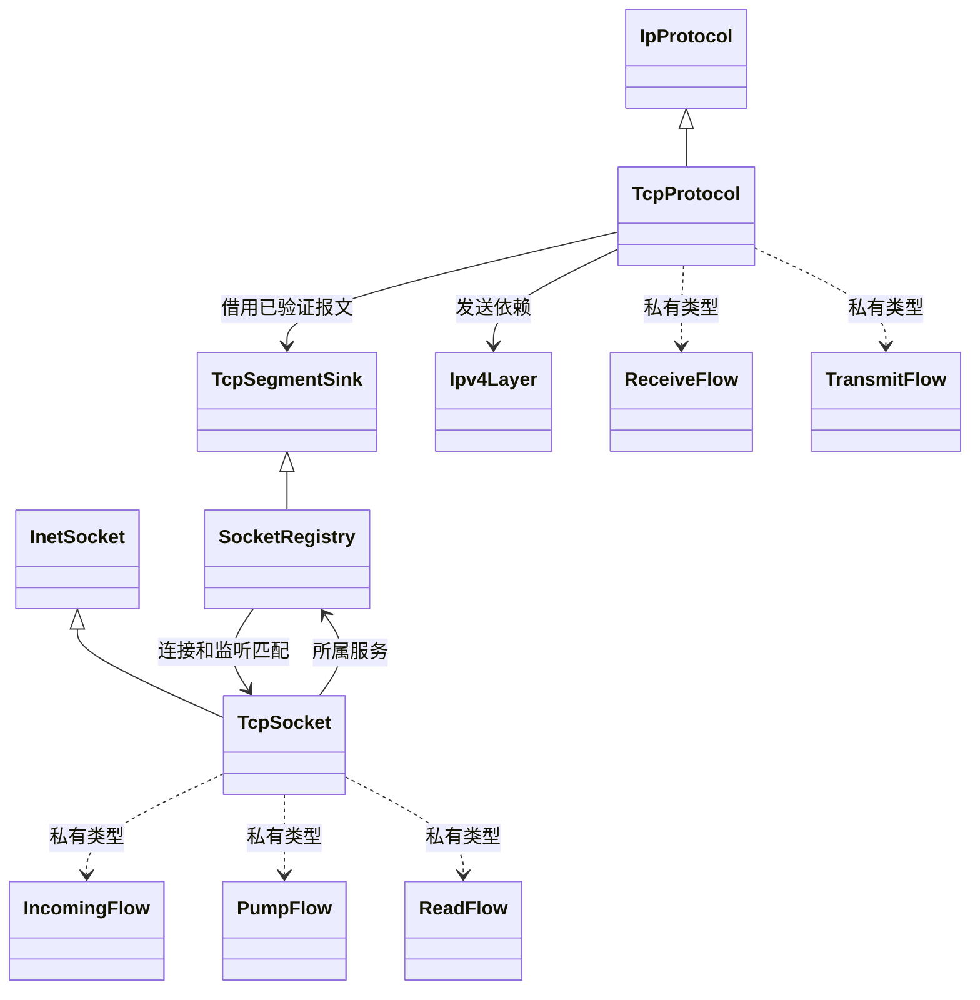

# 网络模块的类与声明式流程

网络模块保留原有类、继承关系、构造依赖和 `.cppm` 接口。模板流程图用于连接类内部的
处理阶段，业务状态仍由原类持有。原有 34 个 `.cppm` 文件及其中 44 个类声明和 2 个枚举类声明均保留；
新增内部模块分区通过 `cmake/net-modules.cmake` 同时接入内核和宿主网络契约程序。

## 阅读顺序

1. 先看原 `.cppm`：了解类负责什么、依赖谁、持有什么状态，以及有哪些私有 Flow。
2. 再看原 `.cpp`：入口负责组装本次调用的 Context，保留必要的外层锁，运行对应图并返回业务结果。
3. 最后进入类对应的子目录：内部 `.cppm` 定义 `Owner::SomeFlow`、Context、具名动作/条件和 Graph。
   一个文件聚合相关流程，不为每个节点创建独立文件。

例如 `TcpProtocol` 在 [tcp.cppm](../kernel/net/transport/tcp.cppm) 中仍是完整的协议类，
私有声明 `ReceiveFlow` 和 `TransmitFlow`。它的入口仍在
[tcp_protocol.cpp](../kernel/net/transport/tcp_protocol.cpp)，实际节点与图分别在
[tcp_protocol/receive.cppm](../kernel/net/transport/tcp_protocol/receive.cppm) 和
[tcp_protocol/transmit.cppm](../kernel/net/transport/tcp_protocol/transmit.cppm)。

Flow 是原类的私有嵌套类型。它能访问原类私有状态，因此不需要新增 friend、公开字段、
虚拟节点接口或一套平行服务。节点不会成为替代业务类的长期运行对象，Context 只在本次调用中存活。

## 各层入口

| 原类 / 主体接口 | 已声明的处理流程 | 节点所在子目录 |
| --- | --- | --- |
| `TcpProtocol` / `transport/tcp.cppm` | TCP 校验、接收器分派、RST，路由、编码和发送 | [transport/tcp_protocol](../kernel/net/transport/tcp_protocol/) |
| `UdpProtocol` / `transport/udp.cppm` | UDP 校验、接收器分派、ICMP 不可达和发送 | [transport/udp](../kernel/net/transport/udp/) |
| `TcpSocket` / `socket/tcp_socket.cppm` | 主动/被动/同时握手、接收、窗口、ACK、发送循环、重传、persist、FIN、定时回收，以及 connect/listen/accept/read/write/poll/shutdown/close | [socket/tcp](../kernel/net/socket/tcp/) |
| `SocketRegistry`、`InetSocket` / `socket/registry.cppm` | 对象创建与失败销毁、连接/监听分派、绑定和自动绑定 | [socket/registry](../kernel/net/socket/registry/) |
| `UdpSocket` / `socket/udp_socket.cppm` | connect、发送、匹配入队、接收等待和复制 | [socket/udp](../kernel/net/socket/udp/) |
| `Ipv4Layer` / `ip/ipv4.cppm` | 接收、目的分类、INPUT、引导分派、普通发送与 DHCP 引导发送 | [ip/ipv4](../kernel/net/ip/ipv4/) |
| `Ipv4Reassembly` / `ip/reassembly.cppm` | 片段检查、重组槽操作、等待/拒绝/完成与首部修复 | [ip/reassembly](../kernel/net/ip/reassembly/) |
| `IcmpProtocol` / `ip/icmp.cppm` | Echo 应答和端口不可达应答 | [ip/icmp](../kernel/net/ip/icmp/) |
| `RoutingTable` / `ip/routing.cppm` | 路由有效性、逐项选路、手工增删、租约匹配和整组替换 | [ip/routing](../kernel/net/ip/routing/) |
| `AddressConfiguration` / `interface/address_configuration.cppm` | 静态地址增删、租约安装/移除和代次更新 | [interface/address](../kernel/net/interface/address/) |
| `NetworkInterface`、`InterfaceRegistry` / `interface/interface.cppm` | 入站计数/交付/丢弃、登记检查、启动添加、运行期发布/撤销及封存 | [interface/registry](../kernel/net/interface/registry/) |
| `EthernetInterface` / `interface/ethernet_interface.cppm` | 普通发送、广播/邻居选择和引导发送 | [interface/ethernet](../kernel/net/interface/ethernet/) |
| `LoopbackInterface` / `interface/loopback.cppm` | 入队和最多 64 次出队交付循环 | [interface/loopback](../kernel/net/interface/loopback/) |
| `IpInIpInterface`、`IpInIpProtocol` / `interface/tunnel.cppm` | 封装/失败恢复、匹配/解封、隧道登记和接收分派 | [interface/tunnel](../kernel/net/interface/tunnel/) |
| `EthernetLayer` / `link/ethernet.cppm` | 长度/网桥/目的筛选、协议扫描、设备发送和首部回滚 | [link/ethernet](../kernel/net/link/ethernet/) |
| `ArpCache` / `link/arp.cppm` | 缓存命中或排队、请求、学习、逐项刷新、重试和超时 | [link/arp](../kernel/net/link/arp/) |
| `BridgeInterface`、`BridgeManager` / `bridge/bridge.cppm` | 帧校验、学习/选出口、逐项克隆转发/本地交付，以及成员变更与管理命令 | [bridge/forward](../kernel/net/bridge/forward/)、[bridge/manager](../kernel/net/bridge/manager/) |
| `DhcpManager` / `dhcp/client.cppm` | 管理命令、请求发送、Offer/ACK/NAK、安装/回滚/Decline、续租/重绑定/过期 | [dhcp/flows](../kernel/net/dhcp/flows/) |
| `DhcpCodec` / `dhcp/message.cppm` | 编码、带 overload 的解码、TLV 迭代与租约校验 | [dhcp/flows](../kernel/net/dhcp/flows/) |
| `Firewall` / `filter/filter.cppm`，`filter::Engine` / `filter/engine.h` | hook 映射、元数据解码、管理命令和规则解释器 | [filter/flows](../kernel/net/filter/flows/) |
| `NetworkManager` / `core/control.cppm` | 管理请求、查询序列化、修改分派和锁外失效通知 | [core/control](../kernel/net/core/control/) |
| `TcpCongestion`、`RetransmissionTimer` / 对应原 `transport/*.cppm` | 重复 ACK、恢复/慢启动/拥塞避免，以及 RTT 采样与计时更新 | [transport/algorithms](../kernel/net/transport/algorithms/) |
| `TcpPageBuffer`、`TcpSendBuffer`、`TcpReceiveBuffer` / `transport/stream_buffer.cppm` | 页初始化、追加，以及 FIN/字节插入/连续前沿推进 | [transport/algorithms](../kernel/net/transport/algorithms/) |
| 服务组装入口 / `net.cppm` | 初始化与定时处理顺序；保留 constinit 服务对象 | [core/service.cpp](../kernel/net/core/service.cpp) |

纯头文件的过滤器核心仍能脱离 C++ Modules 单独编译。它的类继续定义在原头文件，私有流程定义在
`filter/flows/*.h`。没有为了统一文件后缀破坏它原有的无分配、无锁纯规则核心边界。

完整类清单、实际图定义位置及保留原语的逐类理由见
[迁移覆盖清单](network-flow-coverage.json)。抽象接收契约、Packet、ConfigurationGuard、
Layer2Port 适配及 LeaseConfiguration 薄转换器保留各自职责，不创建虚假的流程层。

## 控制、锁与所有权

流程使用 [基础工具](flow.md) 的类型声明。具名静态函数通过 `action<&function>` 和
`condition<&function>` 适配，不构造可调用对象。图中的条件决定 go/stop，动作只操作业务上下文。
业务 errno、已处理标记、候选对象和序号等保存在 ctx，工具的 outcome 不代替业务返回值。

主收发路径、重试、等待和扫描循环都有固定的 Graph 节点关系。比如 TcpSocket 的 Pump、
connect/read/write/accept 等循环以及 ARP 重试、DHCP 遍历不会通过递归推进下一节点。
网络图没有使用工具层的 call 策略，均通过 `run<0>` 执行，无隐式返回栈，也没有新增步数限制。

原有资源原语继续是具名业务操作：字节复制、校验和、位图扫描、有限数组查找/压缩、规则字段校验与位集可达性判断，以及字段序列化
在操作内部执行，不为每个字节、每个位或每个字段分派一次节点。Packet 的移动/克隆/前缀操作、
锁与平台适配、地址掩码和规则匹配等基础值操作也保留原接口，没有包装成无意义的单节点图。

锁范围采用原来的词法作用域：

- 原先整段持锁的绑定、地址/路由提交、接收器分派等入口，继续在外层 Guard 内执行图。
- 需要锁内选择、锁外回调的流程使用具名受保护阶段。该阶段创建原 Guard、同步运行自己的图，
  返回后 Guard 已析构，外层图才继续发送、复制或调用 invalidate。
- 这些受保护阶段是独立的同步 run，不是工具的 call 子流程。stop 结束当前 run，外层图根据
  显式业务条件继续。调用深度由代码中有限的阶段组合决定，循环边不会累积这些调用帧。
- TCP/UDP 阻塞等待继续在持锁时登记，释放锁后睡眠，醒来重新持锁检查；用户复制位置不变。
  close/tick 的对象销毁节点为终点，销毁之后不再访问对象状态。

接收 ctx 借用 Packet；发送 ctx 持有唯一 Packet，所有出口依靠其原析构回收。Packet 原来没有移动
赋值，因此需要跨阶段构造发送包时使用现有 placement new 原位重建成员，不额外申请存储。
排队时继续显式 release，长度与 Packet::Context 继续保留；网桥复制页在下一出口或本地交付前释放。

防火墙的运行期用户链是业务数据，模板图描述解释器步骤。它保留原先的显式链返回栈、
1024 次解释迭代预算和逐次计数语义；没有用节点预算替代解释预算，也不会合并相同链的重复调用。

## 保留的协议行为

- TcpProtocol 先校验，再借用交付；接收器返回 true（包括 backlog 满）就停止，不错误回复 RST。
- 未匹配 RST 不应答；其他复位的 ACK/SEQ、SYN/FIN 占用和 unsigned 回绕保持不变。
- IPv4 完成重组后才重新进入目的分类、INPUT 和协议分派，重组锁外交付。
- 配置预检与整组提交仍在原配置锁下；续租相同配置不推进代次，容量不足不留下半配置。
- 网桥出口快照仍在锁外发送前复查代次；DHCP 在提交、Release、Decline 之间继续校验客户端代次。
- 所有对象依然使用所属服务与注入依赖，不引入新的全局协议实例或旁路注册表。

## 性能与验证

模板图仍有每节点一次间接调用。基础工具现在对不含 call 策略的图使用单索引处理函数，
只返回下一节点或终端标记；含 call 的图继续采用控制描述和固定返回栈。
这省去网络图中的通用调用控制分支，但没有消除间接调用、跨节点优化障碍或模板实例化成本。

使用独立的 HEAD 源码副本与当前实现，在同一 Clang RISC-V `dev -O1` 配置下构建。
GNU size 报告的整内核 text（代码及只读常量）由 213248 字节增加到 257232 字节，
增加 43984 字节，即 20.63%；data 为 259168 字节、BSS 为 176616 字节，均未变化。
单索引路径比本次初版通用控制分派节省约 4 KiB。逐层目标文件统计排除了旧构建残留对象，
但包含可能被链接器合并的 COMDAT，不能把各层目标文件的简单求和当作整内核增量。

最终验证：完整 dev 构建通过；network/support 共 23 项 CTest 通过（网络 21 项、工具 2 项），
包含单核/五核真实网络交互；ASan/UBSan 和泄漏检查下的原生网络契约通过。
工具另外通过 O0/O2 百万次循环、调用/返回/提前结束与预算语义，以及 15 项编译检查。
函数文档覆盖为零缺失，真实 clangd 索引、悬浮、声明/调用点和跳转验证通过。
其中外部 Doxygen 2660 项、源码注释优先 10 项、原生索引或优先级限制 205 项、仅文档 65 项，
另有 5 项跨模块探针；文档覆盖不表示每个位置都显示外部 Doxygen。

具体记录位于 `build/docs/net-flow/`：`final-tests.log`、`final-sanitize-tests.log`、
`final-size.json`、`architecture-audit.json`、`document-sync.json` 和
`final-document-verification.log`。测试使用独立镜像，基线构建不启动或修改交互 QEMU。
不把 QEMU 功能回归当作延迟或吞吐量基准，也不声称这次改动是零开销。
