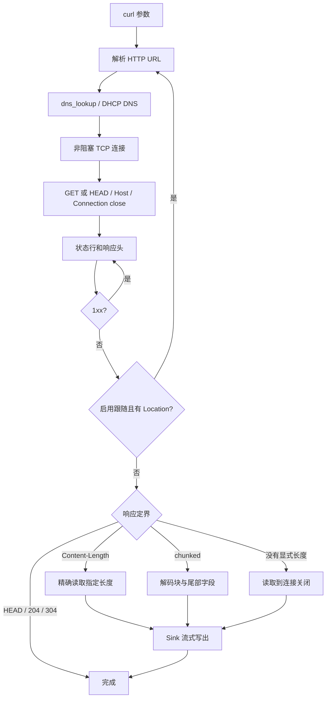

# HTTP 客户端与 curl

`curl` 是当前系统的精简 HTTP/1.0、HTTP/1.1 客户端，复用用户运行库中的 DNS 解析器和内核 TCP socket。协议解析、传输和命令行分离，其他用户程序可以复用 HTTP 客户端库。

## 使用

重新构建并启动 QEMU：

```sh
cmake --build --preset dev
cmake --build build/dev --target qemu
```

在客体 shell 中：

```sh
netctl dhcp wait eth0
curl http://example.com/
curl -I http://example.com/
curl -i http://example.com/
curl -L http://example.com/
curl -o page.html http://example.com/
curl -f -m 10 http://example.com/
```

| 选项 | 行为 |
| --- | --- |
| `-I`, `--head` | 使用 HEAD，输出响应头，不读取响应体 |
| `-i`, `--include` | 在响应体前输出响应头；包含信息响应和跟随过程中的头 |
| `-L`, `--location` | 跟随 301/302/303/307/308，最多五次；默认不跟随 |
| `-f`, `--fail` | 最终状态码大于等于 400 时返回 22，不输出错误响应体 |
| `-o FILE`, `--output FILE` | 创建或截断文件并写入结果；`-o -` 使用标准输出 |
| `-m SECONDS`, `--max-time SECONDS` | DNS、TCP 连接、请求发送、响应读取及重定向共用总时限；整数 1 至 3600 秒，默认 30 秒 |
| `--` | 后续参数按 URL 处理 |
| `-h`, `--help` | 显示用法 |

支持 `-iL` 等无参数短选项组合。一次命令只接受一个 URL；URL 必须显式使用 `http://`。不支持 HTTPS、代理、认证、cookie、POST、自动解压、下载续传或完整上游 curl 参数集。网络时限以系统 100 ms 时钟计量；同步输出回调本身若阻塞，不由网络超时机制打断。

默认输出只有收到的内容，不插入进度条或额外换行。错误写到标准错误，退出码表示失败。没有 `-f` 时，404 等 HTTP 响应仍按正常传输返回零。失败前已经写出的部分文件会保留；输出文件在请求前打开，因此可能被创建或截断。

## 从宿主机提供测试文件

在宿主机的文件目录运行：

```sh
python3 -m http.server 8080 --bind 127.0.0.1
```

客体中：

```sh
curl http://10.0.2.2:8080/
curl -o sample.bin http://10.0.2.2:8080/sample.bin
```

QEMU user 后端默认使用 `10.0.2.2` 访问宿主机回环服务；这类客体主动连接不需要 `hostfwd`。域名通过 DHCP 提供的 DNS 解析，公网访问取决于宿主机网络。直接使用 IPv4 地址时不需要 DNS 配置。

## 抽象与处理流程

| 组件 | 职责 |
| --- | --- |
| `http::Url` 与 URL 编解码函数 | 主机、端口、路径、查询、片段剥离和重定向引用解析 |
| `http::HeaderParser` | 状态行、字段、响应长度、分块标志和 Location |
| 内部 `Deadline` | 跨 DNS、传输和重定向的总时限 |
| 内部 `Connection` | 非阻塞 TCP、连接完成检查、部分读写、带缓存 CRLF 行读取和描述符关闭 |
| `http::Client` | GET/HEAD、信息响应、重定向、响应体定界和流式传送 |
| `http::Sink` | 应用提供的响应头和解码后响应体消费接口 |
| curl 命令中的 `FileSink` | 把数据完整写入标准输出或普通文件 |



请求使用 `HTTP/1.1`，发送 `Host`、`User-Agent: xv-curl/1`、`Accept: */*`、`Accept-Encoding: identity` 和 `Connection: close`。非默认端口进入 Host 字段；路径中的百分号编码保留，片段不发给服务器。支持绝对、协议相对、根相对、目录相对、仅查询和仅片段的重定向引用，并按 URI 路径规则去除字面 `.`、`..` 段。没有 IDNA、IPv6 URL 或 userinfo。

响应体逐块传给 Sink，不整体缓存；二进制 NUL 不影响长度。支持大小写无关的头字段、相同值重复 Content-Length、传统 EOF 定界、chunked 块扩展和尾部字段。分块标记、CRLF 以及 trailer 不进入响应体。跳转响应体丢弃并关闭连接，最终响应体才写出。HEAD 和 204/304 不等待连接关闭；最多处理八个信息响应，不接受 101 升级。

解析器拒绝冲突 Content-Length、同时出现 Transfer-Encoding 和 Content-Length、非法状态行/字段、折叠字段、数值溢出和错误块边界。固定长度或分块响应提前关闭被识别为不完整；EOF 定界响应无法区分正常关闭和语义上的内容缺失。只支持 `chunked` 传输编码和 `identity` 内容编码，服务器发送 gzip 等内容时返回不支持错误。

资源边界：主机名最多 253 字节，请求目标最多 1023 字节，状态/字段/块大小行最多 2047 字节，每组响应头和尾部字段各最多 16 KiB，字段名最多 127 字节。流式响应体没有额外固定总大小上限，实际受截止时间、目标文件容量和 64 位计数范围限制。类库最多允许二十次重定向，命令默认五次。网络缓存、URL、解析工作区和 DNS 结果位于堆上，避免深层 DNS 调用耗尽单页用户栈。

## 类库接口

包含 `user/runtime/http/http.h`，链接 `user_http`。项目用户程序已由 CMake 按需链接静态库；不用 HTTP 的程序不会装入 HTTP 实现。

```cpp
class Consumer final : public xv::http::Sink {
public:
  bool headers(const char *, unsigned) override { return true; }
  bool body(const char *data, unsigned size) override {
    // 消费二进制数据；data 只在本次回调期间有效。
    return consume(data, size);
  }
};

xv::http::Client client;
xv::http::Options options;
options.follow = true;
xv::http::Response response;
Consumer sink;
int error = client.get("http://example.com/", options, sink, response);
```

Sink 回调返回 false 会立即中止并返回 Output。响应头只有启用 `include_headers` 或 `head` 才交给 Sink；响应体总是交给 body。Response 保存最后已解析的状态码、已跟随次数和已写出的最终响应体字节数，出错时也可用于诊断。Client 不持有跨请求连接或缓存；所有退出路径释放工作区与描述符。

错误码采用常见 curl 数值：1 不支持，3 URL/选项错误，6 解析失败，7 连接/套接字错误，8 HTTP 格式错误，18 消息不完整，22 HTTP 失败，23 输出失败，27 内存不足，28 超时，47 重定向超限；这不表示实现了上游 curl 的全部错误细分。

## 外部 Doxygen 函数说明

说明与代码分开维护。当前 clangd 外部索引覆盖 kernel；以下用户态函数说明不宣称已经进入 kernel 索引。

```cpp
/**
 * @fn int xv::http::Client::get(const char *url, const Options &options, Sink &sink, Response &response)
 * @brief 同步执行一个 HTTP 请求，将响应体流式交给调用者。
 * @param url 完整 http:// URL；不支持 TLS、userinfo 和 IPv6 字面量。
 * @param options 请求方式、响应头输出、失败策略、重定向次数和总时限。
 * @param sink 调用期间有效的消费对象；任何回调失败会中止传输。
 * @param response 入口清零，随后保存最后状态、跳转次数和已发布字节数。
 * @return 零表示传输成功，否则返回 Error 中的正错误码。
 * @post 关闭本次网络连接并释放工作区；已交给 Sink 的数据不会回滚。
 * @note DNS 使用当前 DHCP 配置；多个 A 记录按顺序尝试连接，共用截止时间。
 */

/**
 * @fn bool xv::http::Sink::headers(const char *data, unsigned size)
 * @brief 消费响应头原始行及其 CRLF，可包含中间响应。
 * @param data 临时只读字节；不得保存指针供回调结束后使用。
 * @return true 继续，false 以 Output 错误终止。
 */

/**
 * @fn bool xv::http::Sink::body(const char *data, unsigned size)
 * @brief 消费去除传输分块标记后的二进制响应体片段。
 * @param size 明确的字节数，数据不保证 NUL 结尾。
 * @return true 表示整段已被接收，false 表示输出失败。
 */

/**
 * @fn int xv::http::parse_url(const char *text, Url &url)
 * @brief 校验 HTTP URL，将主机、端口和规范化请求目标写入调用方空间。
 * @return 零表示成功；其他值表示 URL 无效或协议不支持。
 * @note 不执行 DNS 或网络 I/O；失败时不得使用部分输出。
 */

/**
 * @fn int xv::http::resolve_location(const Url &base, const char *location, Url &url)
 * @brief 按基准 URL 解析重定向引用并去除路径点段和片段。
 * @pre 相对引用时 base 和 url 必须为不同对象。
 * @return 零表示成功；HTTPS 等其他协议明确返回 Unsupported。
 */

/**
 * @fn int xv::http::HeaderParser::status_line(const char *line)
 * @brief 开始一组新响应头，清空旧状态并解析 HTTP/1.0 或 HTTP/1.1 状态。
 * @param line 不含 CRLF、以 NUL 结束的完整行。
 * @return 零表示成功，否则 Protocol。
 */

/**
 * @fn int xv::http::HeaderParser::field(const char *line, bool trailer)
 * @brief 验证字段语法并收集响应定界、重定向与编码信息。
 * @param trailer 为 true 时只校验尾部字段，禁止其修改消息定界。
 * @return 零表示成功；冲突或非法字段返回 Protocol，不支持的编码返回错误。
 */

/**
 * @fn int xv::http::HeaderParser::finish() const
 * @brief 检查已收集字段间的消息定界约束。
 * @return 同时存在长度与传输编码时为 Protocol，否则零。
 */

/**
 * @fn int xv::http::chunk_size(const char *line, unsigned long long &size)
 * @brief 读取有溢出检查的十六进制块长度，忽略可打印块扩展。
 * @return 零表示成功，否则 Protocol；失败时不得使用部分 size。
 */

/**
 * @fn const char *xv::http::error_string(int error)
 * @brief 返回错误码对应的静态说明，无内存分配或外部状态依赖。
 */
```

## 验证

```sh
ctest --preset dev -R '^(http_.*|dns_.*)$' --output-on-failure
```

`http_contract` 以同一份 URL/头字段/块解析代码验证 URI 引用、格式错误、数值溢出和变异语料；语料另外以 ASan/UBSan 运行。`http_1cpu/3cpu` 使用宿主机可控 TCP 服务，重复验证实际用户态类库和 CLI，包括二进制流式下载、分块和 trailer、EOF、1xx、HEAD、204、404、重定向、截断、冲突定界、慢速传输总时限和输出失败。保存后的文件由客体程序重新读取并比较长度和内容哈希。客体回环 HTTP 服务还通过 DHCP DNS 对 localhost 的实际解析验证域名链路，不依赖公网域名。

协议参考：[RFC 9112](https://www.rfc-editor.org/rfc/rfc9112.html) 的 HTTP/1.1 消息语法与定界规则，以及 [RFC 3986](https://www.rfc-editor.org/rfc/rfc3986.html) 的 URI 引用解析规则。
