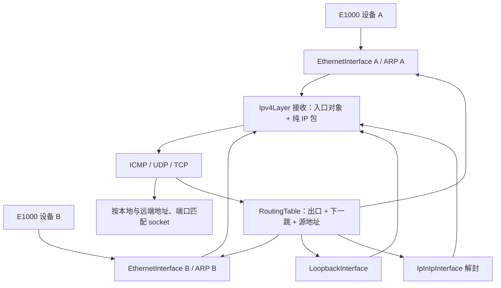

# 网络接口、选路与三层隧道

IP、TCP、UDP 和 socket 服务各只有一份。每块网卡或虚拟链路对应一个 `NetworkInterface` 对象；接口保存自己的身份、MTU、管理状态及零至四个 IPv4 地址。以太接口另外组合自己的链路编码器与 ARP 缓存。协议代码通过对象参数识别入口，通过路由结果选择出口。

## 接口能力和配置

| 对象 | MAC | IPv4 地址 | 报文边界 |
| --- | --- | --- | --- |
| `EthernetInterface` | 来自所绑定设备的 EEPROM | 可以暂时为空；当前 IPv4 发送需要本地地址 | 驱动收到以太帧，接口向上交纯 IP |
| `LoopbackInterface` | 无，`mac()` 返回空指针 | 默认 `127.0.0.1/8` | 纯 IP 经有界队列本机投递 |
| `IpInIpInterface` | 无 | 可以配置内层地址，也可以无编号 | 内层纯 IP 封装到另一个 IPv4 报文 |

`up()` 是管理状态，`carrier()` 是链路可用状态。路由查询同时检查二者。物理接口 MAC 与是否配置 IPv4 相互独立；没有地址的以太设备仍可以被发现、初始化和注册。三层虚拟接口不需要伪造 MAC。

`InterfaceRegistry` 借用最多八个长期存活的接口，检查 ID、名称和地址拥有关系。配置入口在启动阶段执行：默认 `initialize()` 使用 QEMU 策略；`initialize(&setup)` 调用 `NetworkSetup::configure`，取代默认物理接口配置。回调结束后启动配置 API 被封存；运行期地址、管理状态和路由由受锁保护的 NetworkManager 事务修改，见 [netctl 用户态管理](network-management.md)。物理接口注册仍只在启动期执行；网桥槽可运行期发布/注销，见 [软件网桥](network-bridge.md)。没有物理热插拔、DHCP 或 IPv6。

默认策略为发现顺序中的 `eth0..3` 设置 `10.0.2.15/24` 至 `10.0.5.15/24`，网关为对应子网的 `.2`，默认路由 metric 为 0、10、20、30。它是一项启动策略；接入不同网络时应替换它，并为 QEMU 的每个后端设置相应网段。

## 一份协议栈如何服务多个接口



RX 驱动回调已经绑定具体设备的 `EthernetLayer`。验证以太目标与 EtherType 后，`EthernetInterface` 去掉十四字节以太首部，调用 `deliver`。IPv4 验证接口注册身份、报文长度、首部校验和与目的地址，再向协议接收器传递包含入口指针的 `IpDatagram`。分片重组键也包含入口，避免不同接口的同标识分片混在一起。

TX 路由按最长前缀优先，同长度选较小 metric。绑定源地址和强制出口会先筛掉不匹配的候选路由。结果包含接口、下一跳与实际源地址；UDP 在计算伪首部校验和前取得此源地址，TCP 按此出口 MTU 限制段长。以太出口通过自己的 ARP 解析下一跳，回环出口排队，隧道出口封装。

`Packet` 始终独占一个页面。接口边界上的 IP 首部位于页面偏移零；`prepend` 和 `remove_prefix` 在同页移动数据。成功排队或交给 DMA 时显式移交页面，失败时未移交页面仍由 RAII 释放。回环在锁外调用上层，每次服务最多投递六十四报，避免直接递归调用传输状态机。

具体本地地址可以在不同 socket 上复用同一个 UDP/TCP 端口；`INADDR_ANY` 与这些具体地址冲突。未连接且绑定 ANY 的 UDP 可以逐包选不同出口；连接后的 UDP 以及 TCP 固定选中的源地址。

## 自定义启动配置示例

下面替换默认物理配置，并添加一个有内层地址的 IP-in-IP 接口。配置对象和接口必须长期存活；在原网络初始化位置调用 `xv::net::initialize(&setup)`，不能在默认初始化后再次调用。

```cpp
import xv.net;

class LabNetwork final : public xv::net::NetworkSetup {
  xv::net::IpInIpInterface tunnel_{20, "tun0", 1480};
public:
  bool configure(xv::net::InterfaceRegistry &ifs,
                 xv::net::RoutingTable &routes,
                 xv::net::Ipv4Layer &ip,
                 xv::net::IpInIpProtocol &tunnels) override {
    auto *eth = ifs.find(2);
    auto *lo = ifs.find(1);
    if (!eth || !lo) return false;
    constexpr unsigned local = 0x0a00020f; // 10.0.2.15
    constexpr unsigned remote = 0x0a000203; // 10.0.2.3，另一端隧道端点
    return eth->add_address({local, 24}) &&
      routes.add(0x0a000200, 24, *eth) &&
      routes.add(local, 32, *lo, 0, 0, local) &&
      routes.add(0, 0, *eth, 0x0a000202) &&
      tunnel_.initialize(ip, *eth, local, remote) &&
      tunnel_.add_address({0xc0a86401, 30}) && // 192.168.100.1/30
      tunnel_.set_up(true) &&
      (tunnel_.attach(ip), true) &&
      ifs.add(tunnel_) && tunnels.add(tunnel_) &&
      routes.add(0xc0a86401, 32, *lo, 0, 0, 0xc0a86401) &&
      routes.add(0xc0a86400, 30, tunnel_) &&
      routes.add(0x0a0a0000, 16, tunnel_); // 远端内网 10.10.0.0/16
  }
};
static LabNetwork setup;
```

另一端必须配置相反的外层端点、合适的内层地址及回程路由，并允许承载网络传递 IPv4 协议号 4。仅创建本地接口不会自动建立远端或改变宿主机网络。默认 QEMU 启动策略不创建隧道。

无编号配置省略 `tunnel_.add_address` 及其地址对应的两条路由，并把远端内网路由写成 `routes.add(0x0a0a0000, 16, tunnel_, 0, 0, local)`，显式借用物理接口的本机地址作为内层源。隧道接收允许目标为注册表中任一已启用本机地址。

## IP-in-IP 处理与边界

发送时先产生完整内层 IP 报文，隧道前插二十字节外层 IPv4 首部，用协议号 4、指定外层源/目的以及强制下层接口再次调用 IP 发送。入口匹配外层源、目的和真实下层接口，移除外层首部后，以隧道接口身份重新验证内层包。封装方式参照 [RFC 2003](https://www.rfc-editor.org/rfc/rfc2003.html)。

当前拒绝以隧道作为另一个隧道的下层；解封另有每 Packet 四层深度限制。内层 MTU 必须比下层至少小二十字节，不实现隧道路径 MTU 发现、加密或身份认证。端点匹配用于分派，不能当作来源认证。

PCI 发现目前只支持总线零、function 零的 E1000 `8086:100e`，最多四块；每设备独立 BAR、MAC 和 DMA 环。共享 INTx 线路会遍历并服务该线路上的所有已发现设备。新增其他网卡需实现以太设备接口并接入设备发现；其他三层接口则直接实现 `NetworkInterface`。

## 已有验证

- `network_contract`：地址/接口注册、封存、路由前缀与 metric、源地址约束、载波回退、无地址以太接口、回环、编号与无编号隧道、错误入口/端点拒绝、报文容量及页面归还。隧道使用可控下层进行契约验证。
- `multinet_1cpu/3cpu`：两块真实 QEMU E1000 分别连接两个子网，在不同本地地址上绑定同端口交错往返；插槽 1 和 5 共用 INTx，验证正确分派与返回源地址。
- 既有 network、socket、poll、nonblock、signals 和启动/驱动/文件系统契约回归保持通过。

函数入口见 [接口](functions/kernel/net/interface/interface.cppm.md)、[选路](functions/kernel/net/ip/routing.cpp.md)、[隧道](functions/kernel/net/interface/tunnel.cpp.md) 和 [启动组装](functions/kernel/net/core/service.cpp.md)。
