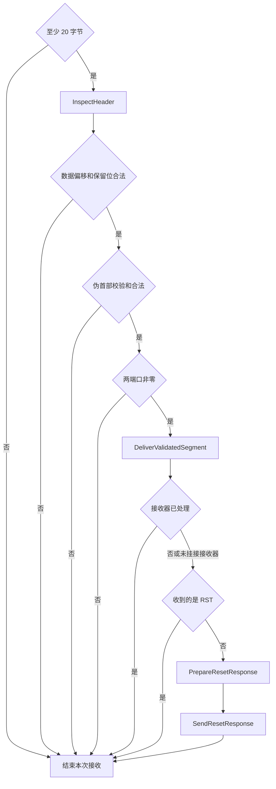
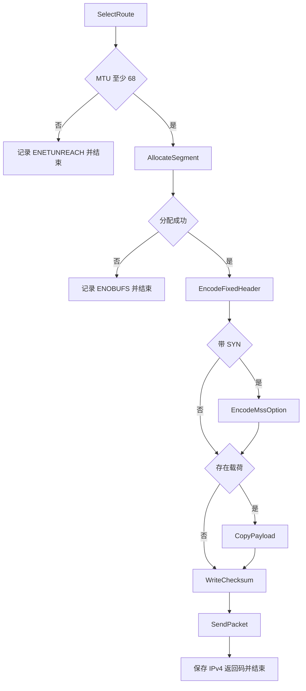

# TcpProtocol 的声明式处理流程

本文说明 `TcpProtocol::receive` 和 `TcpProtocol::transmit` 的迁移，使用现有
[模板流程工具](flow.md)，保持 TCP 与 socket 注册表之间的职责边界。

## 从哪里读

- [tcp.cppm](../kernel/net/transport/tcp.cppm)：保留 TcpProtocol 类及其私有 ReceiveFlow/TransmitFlow 声明。
- [tcp_protocol.cpp](../kernel/net/transport/tcp_protocol.cpp)：业务入口和上下文组装。
- [receive.cppm](../kernel/net/transport/tcp_protocol/receive.cppm)：接收上下文、校验条件、接收器调用和 RST 动作。
- [transmit.cppm](../kernel/net/transport/tcp_protocol/transmit.cppm)：发送上下文、路由和分配条件、TCP 编码与 IPv4 发送动作。

动作和条件按接收、发送分组在 `transport/tcp_protocol/` 子目录，避免每个节点单独一个文件。
这两个文件是 `xv.net` 的内部接口分区，登记在 `cmake/net-modules.cmake`，由内核与原生测试共同编译；
不导出到网络公开 API，不给 TcpProtocol 增加 friend 或扩大私有字段可见性。

业务动作只读写各自 ctx，条件返回 bool。连接关系在这两个私有流程分区中用
`node<Id, Action, Next>`、`branch`、`go`、`stop` 声明。
字段编码中的三元表达式用于计算值，不负责选择下一节点。

## 接收



读取 TCP 数据偏移之前先判断最短长度。首部布局、校验和、端口的判断顺序与原实现一致，
任一步失败都不调用接收器，也不发送复位。仍由 IPv4 入口保证 packet/datagram 范围合法，
协议层没有另加一套 IP 解析或改变其输入契约。

`DeliverValidatedSegment` 解码 Endpoint，同步借用原始字节调用 `TcpSegmentSink`。
返回 true 表示已处理，包含监听 backlog 满或接收器内部分配失败后的静默丢弃；
只有 false 或没有接收器时才进入未匹配报文的 RST 分支。
检查收到的 RST 在接收器调用之后，保证已有连接仍能收到自己的复位。

| 未匹配报文 | 回复 |
| --- | --- |
| RST | 不回复 |
| 带 ACK | RST，SEQ = 收到的 ACK，ACK 字段为零 |
| 无 ACK | RST\|ACK，SEQ = 0，ACK = 收到的 SEQ + 载荷长度 + SYN/FIN 各占用的一个序号 |

序号运算保持 unsigned 回绕。复位发送发生在接收器返回之后，不进入其注册表锁作用域。
复位发送失败继续按原先的 best effort 行为忽略；借用的接收 Packet 始终由调用方持有。
复位调用本实例的 transmit，因此自然复用同一发送图，不另建公共编码路径。

## 发送



发送图先检查路由，再分配 Packet；只有 SYN 编码 MSS，MSS 继续使用出口 MTU 减 40。
无载荷时不触碰 data。可选路径分别汇合到 Payload 和 Checksum，不重复定义公共动作。
固定首部、载荷复制、校验和和发送各由具名动作负责。
`ctx.result` 保存业务 errno，流程返回的 `outcome` 不代替发送结果；
IPv4、过滤器和设备发送错误都沿原接口返回。

ctx 中的 Packet 是唯一所有者，作用域退出统一析构，成功、分配失败和发送失败保持同一回收语义。
现有 Packet 只有移动构造，没有移动赋值；AllocateSegment 使用仓库已有的 placement new
在 ctx 的空 Packet 存储中构造分配结果。先结束空对象生命周期，再原位构造，
不分配额外存储、不持有裸页所有权，也没有扩展 Packet API。当前图中该节点只到达一次。

两张图均无工具层的 call 或回边，使用 `run<0>`，选择单索引执行路径；不启用步数预算，所有分支明确以 stop 结束。
通用执行器中收到 stop 后返回；业务入口不需要根据 outcome 再进行一次动态分派。

## 验证与成本

[协议契约测试](../tests/tcp_protocol_flow.cpp) 调用真实 TcpProtocol、Ipv4Layer、路由表和
Packet 分配器，设备出口由捕获接口代替；没有复制一份待测流程实现。
新增测试在重构前的实现上先运行通过，再对迁移后的实现运行。覆盖：

- 七类非法首部、空短报文、不调用接收器/不发 RST 的拒绝路径。
- IPv4/TCP 选项偏移、借用字节身份、接收器 true/false，以及未挂接接收器。
- RST 不回复、ACK 复位和载荷加 SYN/FIN 的序号回绕。
- 固定首部、奇数长度载荷、独立计算的伪首部校验和、SYN MSS 与无载荷 ACK。
- 不可达路由、分配失败、容量拒绝、IPv4 MTU 拒绝、设备错误和所有出口页面回收。

原有 TCP 连接、重传、窗口、注册表隔离和 backlog 契约也继续调用相同生产实现。
完整构建和 CTest 的 network 标签测试使用隔离镜像，不访问交互 QEMU 的私有根盘。

两张图使用不含 call 的单索引执行路径，每节点仍有一次间接分派。
有效报文通常执行 5 个接收节点，未匹配且需回复复位时执行 8 个接收节点，再进入发送图。
无 SYN、无载荷发送执行 6 个节点；带 SYN 和载荷发送执行 8 个节点。
ctx、节点调用及局部量仍会影响寄存器和栈占用，没有宣称零开销。

完整网络迁移后，在同一 RISC-V `dev -O1` 配置下，整内核代码及只读常量增加 43984 字节
（20.63%），静态 data/BSS 未变化。具体基线、完整验证和逐层统计口径见
[整模块说明](network-flows.md)。此数据不表示延迟或吞吐量，也不能用个别目标文件代替整内核成本。

```sh
cmake --build --preset dev
ctest --test-dir build/dev --output-on-failure -L network
```

本次实际验证：完整 dev 构建通过；network 标签 21/21 通过（包括 1/5 核 socket、HTTP、
DNS 等 QEMU 测试）；ASan/UBSan 宿主网络契约通过；新增与修改函数文档的覆盖和索引生成通过。
未测量协议延迟或吞吐量，也未将网络回归结果表述为整个仓库全部测试通过。
