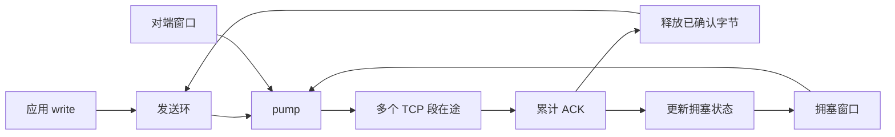

# TCP

TCP 提供连接管理、可靠有序字节流、双向关闭、滑动窗口和 NewReno 拥塞控制。用户程序通过 socket、read/write、poll 和 shutdown 使用连接。

## 模块

| 文件 | 职责 |
| --- | --- |
| `socket/tcp_socket.*` | 连接状态、应用读写、监听、接入和生命周期 |
| `socket/tcp_sender.cpp` | 发送推进、累计 ACK、窗口更新、重传和 persist |
| `socket/tcp_receiver.cpp` | TCP 选项、握手输入、序号校验、接收和 FIN 处理 |
| `transport/stream_buffer.cppm` | 分页发送环和带逐字节重排位图的接收环 |
| `transport/congestion.cppm` | 慢启动、拥塞避免、快速重传和 NewReno 快速恢复 |
| `transport/retransmission_timer.cppm` | RTT 采样、Karn 规则、RTO 与指数退避 |
| `transport/tcp_protocol.cpp` | 首部与校验和、四元组分派、监听匹配和 RST 响应 |

路径均相对于 `kernel/net/`。函数说明见 [内核函数导航](functions/kernel/README.md#net)。

## 发送窗口

每个连接有 16 KiB 发送环。数据由应用写入后，保留到累计 ACK 确认；ACK 释放空间并唤醒等待写入的程序。

```text
发送环：已经确认并释放 | 已发送但未确认 | 已入队但未发送 | 空闲空间
                         SND.UNA        SND.NXT        队列末尾
```

`pump()` 按以下额度连续发送多个段：

```text
可新增在途字节 = min(对端接收窗口, 拥塞窗口) - 当前在途字节
每段长度 = min(排队数据, 可新增额度, 协商 MSS, 当前物理页连续空间)
```

`write()` 返回写入本地发送队列的字节数。队列未满时，即使对端窗口为零或还有未确认数据，程序仍能排队；队列满后，阻塞调用等待，非阻塞调用返回 `-EAGAIN`。`poll(POLLOUT)` 反映发送队列空间。

窗口更新同时检查 ACK 范围和 `SND.WL1/SND.WL2` 对应的序号、新旧确认关系。过旧的 ACK 不会覆盖新窗口，超前 ACK 不会释放未发送数据。序号比较使用 32 位回绕规则。



## 接收与重排

每个连接有 16 KiB 接收环，以及 2 KiB 的逐字节存在位图。收到窗口内的乱序段时保存数据，连续数据前沿保持不动；缺口填补后，前沿一次推进到所有已连续的数据末尾。

重叠数据采用首次到达内容，重复报文不会重复交给应用。物理槽位按序号映射，跨物理页和序号回绕使用同一套逻辑。

应用只能读取连续字节。读操作腾出容量后，窗口更新 ACK 按累计释放空间发送；从零窗口恢复、窗口完全空闲时立即通知。正常数据接收使用立即累计 ACK。

FIN 也占一个序号。乱序 FIN 先登记，只有它之前的数据全部连续后才进入 EOF；FIN 本身不进入应用字节流，FIN 后的数据不再交付。

## 拥塞控制与丢包恢复

初始拥塞窗口为两个 MSS。慢启动按确认的新字节增长，拥塞避免按确认量累计，每个窗口增加约一个 MSS。

连续三个合格的重复 ACK 触发快速重传：重传最早未确认数据，设置慢启动门限，进入快速恢复。NewReno 使用恢复边界区分部分 ACK 与完整 ACK；部分 ACK 继续修复下一个缺口，确认到恢复边界后退出快速恢复。

RTO 到期时，拥塞窗口降至一个 MSS，重传最早未确认数据，并对 RTO 指数退避。经历重传的数据不用于 RTT 采样；后续全新数据恢复有效采样。确认前沿推进后重新计时。

对端零窗口由独立 persist 计时处理。探测间隔从一秒退避至六十秒，发送一个数据字节或 ACK 探测；不会把持续零窗口当成拥塞事件。窗口重开时立即修复未被接收的探测字节，再推进发送队列。

## 状态与关闭

支持主动、被动和同时打开，以及半关闭、同时关闭、RST 和 TIME_WAIT。

`shutdown(SHUT_WR)` 先发送排队数据，再在其后发送 FIN。FIN 与最后的数据可以同时在途，不必等待所有数据确认。收到对端 FIN 后，CLOSE_WAIT 仍允许应用发送最后的响应。

最后一个 File 引用关闭时，注册表继续持有尚未完成的连接，负责 ACK、重传、FIN 和 TIME_WAIT。连接结束后释放全部页。RST 或失败进入 CLOSED 时取消待发送状态，后续时钟不会重新发送旧数据。

数据与 FIN 挂起期间，120 秒没有有效入站活动则超时；握手和普通重传最多进行六次超时重传。TIME_WAIT 和 FIN_WAIT_2 的回收时间为三十秒。跨核时钟回调允许快照早于最近活动时间，不对这种快照执行无符号减法超时判断。

## 资源与接口

| 项目 | 当前值 |
| --- | --- |
| 发送环 / 接收环 | 各 16 KiB |
| 接收重排位图 | 2 KiB，位于 socket 对象页 |
| 每个 TCP 对象 | 对象页一页，发送页四页，接收页四页，共 36 KiB |
| 单段发送 MSS 上限 | 1460 字节，同时受出口 MTU 和对端 MSS 限制 |
| RTO | 初始一秒，最大六十秒 |
| socket 注册槽 | 64，包含监听、未 accept 和关闭中的连接 |
| backlog 上限 | 8 |

缓冲区采用逐页分配，任一阶段失败都回收已分配页。应用读写按批次复制，不在内核栈放置整份发送或接收窗口。

当前使用 16 位接收窗口，握手协商 MSS。SACK、窗口扩大、时间戳、ECN、TCP keepalive 和用户态带外数据接口尚未实现；数据立即发送，未启用 Nagle。ISN 由计数器与时钟生成。

## 验证

```sh
cmake --build --preset dev
ctest --preset dev -R '^(network_contract|socket_[15]cpu|http_[15]cpu|dns_[15]cpu)$' --output-on-failure
```

原生报文测试使用可控时钟和真实 TCP 报文，覆盖：

- ACK 前已有多个数据段发出、发送队列满、部分确认和累计确认。
- 三重复 ACK、NewReno 部分 ACK、超时重传、Karn 采样和退避。
- 陈旧窗口、超前确认、零窗口探测和窗口重开。
- 乱序、重叠、重复、序号回绕、接收零窗口与乱序 FIN。
- 主动和同时打开、SYN 丢失、半关闭、同时关闭和 TIME_WAIT 回收。
- RST 后停止重传、过旧时钟快照，以及九个分配阶段的完整回滚。

QEMU 在单核和三核下，各重复两轮 256 KiB 主动与被动传输，再运行 512 KiB 同时收发。HTTP、DNS、DHCP、网桥和信号回归使用同一份内核。原生网络契约另外通过 ASan/UBSan 运行。

协议依据：[TCP](https://www.rfc-editor.org/rfc/rfc9293.html)、[拥塞控制](https://datatracker.ietf.org/doc/html/rfc5681)、[NewReno](https://datatracker.ietf.org/doc/html/rfc6582)、[RTO](https://www.rfc-editor.org/rfc/rfc6298.html)。
