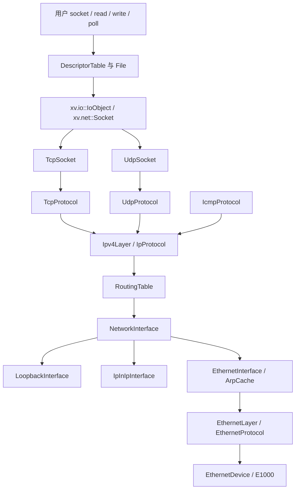

# 分层 IPv4、TCP/UDP 与 socket

实现前的网络基线已提交并推送为 `bb2a632`。E1000 现支持启动期发现多块设备及共享中断；原来混合在 `stack.cpp` 的 Ethernet/ARP/IP/UDP 处理已经拆开。`stack.cpp` 现在只保留旧实验 PID 端口 API 的兼容适配。

## 架构与所有权



| 模块/目录 | 责任 |
| --- | --- |
| `kernel/io/object.cppm` (`xv.io`) | 与具体设备无关的 read/write/poll/close 能力，File 持有后端 |
| `kernel/net/core/` | Endpoint、地址值类型、网络序字节工具、唯一拥有权 Packet、服务组装 |
| `kernel/net/link/` | Ethernet EtherType 分派、ARP 邻居缓存/请求/回复/待解析队列 |
| `kernel/net/interface/` | 接口注册、可选地址、以太/回环/IP-in-IP 多态实现 |
| `kernel/net/ip/` | IPv4 首部验证、最长前缀选路、有限分片重组、ICMP |
| `kernel/net/transport/` | UDP/TCP 校验与报文编码、重传计时器 |
| `kernel/net/socket/` | 抽象 Socket、InetSocket 共性、具体 TCP/UDP socket 与注册表 |
| `kernel/net/platform/` | 页分配、单调时间、用户复制、当前 PID、可中断等待 |
| `kernel/syscall/syssocket.cpp` | socket ABI 校验、地址转换、File 安装和失败回滚 |
| `kernel/drivers/net/e1000/` | 硬件 DMA 收发及完成页回收，不知道 TCP 或用户描述符 |

`EthernetProtocol`、`IpProtocol`、`DatagramSink` 明确每层接收契约，通过虚接口按 EtherType/IP 协议号分派；具体协议由启动服务静态装配。`Socket` 通过 `IoObject` 接入 File，TCP 与 UDP 独立实现传输语义，文件系统不依赖 TCP 状态机。

`Packet` 独占一个物理页，禁止复制，允许移动。默认析构归还页面；成功交给 DMA、ARP 待解析队列或 socket 接收队列时显式 `release()`。错误分支自然析构，避免遗漏释放。具体 socket 由物理页 placement 构造；TCP 独立申请 RX 页，中途失败会归还两阶段已申请资源。

## 运行与测试

```bash
conda activate OS-LAB
cmake --preset dev
cmake --build --preset dev
ctest --test-dir build/dev --output-on-failure -R '^(network_.*|socket_[13]cpu|multinet_[13]cpu)$'
cmake --build build/dev --target qemu
```

`qemu` 和 `qemu-gdb` 默认带 E1000，启动输出 `e1000: ready`，随后逐接口输出实际配置。自动测试选择临时宿主机端口、独立磁盘副本并结束 QEMU；单核/三核各在同次启动连续运行两轮。

- `network_contract` 使用同一协议实现和可控时钟，验证短包、校验和、队列上限、绑定继承与耗尽、ARP、反序分片重组/重叠拒绝/超时、ICMP Echo、SYN/数据重传、重复数据去重、乱序恢复、非法 ACK/RST、超时和分配回滚；最终检查所有网络页面归还。
- `network_1cpu/3cpu` 保留旧 UDP API 的真实往返、MTU、空报、截断、fork、退出清理、信号中断和 SA_RESTART 测试。
- `multinet_1cpu/3cpu` 验证双子网、相同端口绑定不同本地地址、共享 PCI INTx 与每设备 MAC。
- `socket_1cpu/3cpu` 验证 UDP 描述符、fstat、poll、dup/fork、非阻塞、TCP 主动/被动连接、18 KB 流传输、零窗口后恢复、半关闭、EOF、连接拒绝及回环 TCP。

`tests/socket_network.py` 自动启动宿主机 UDP/TCP 回显服务及客体 TCP 监听端口转发。手动运行 `sockettest` 需要传入宿主机 UDP 回显端口、TCP 回显端口和拒绝连接端口，并在程序输出 `listening` 后连接转发的客体 TCP2021；建议直接使用自动测试完成整套验证。

入站连接可通过 CMake 的后端参数配置：

```bash
cmake --preset dev '-DXV_NET_BACKEND=user,id=net0,hostfwd=tcp:127.0.0.1:26001-:2021,hostfwd=udp:127.0.0.1:26000-:2000'
cmake --build build/dev --target qemu
```

恢复默认：`cmake --preset dev -DXV_NET_BACKEND=user,id=net0`。手动启动 QEMU 必须保留：

```text
-device e1000,netdev=net0,bus=pcie.0,addr=01.0,mac=52:54:00:12:34:56
```

## Socket 用户接口

包含 `user/runtime/user.h` 即获得 `kernel/net/socket/socket.h` 中的 ABI。`sockaddr_in` 为 16 字节，IPv4 和端口使用网络字节序，借助 `htonl/htons/ntohl/ntohs` 转换。

```cpp
int fd = socket(AF_INET, SOCK_STREAM, IPPROTO_TCP);
sockaddr_in remote{};
remote.sin_family = AF_INET;
remote.sin_addr.s_addr = htonl(0x0a000202);
remote.sin_port = htons(26099);
if (connect(fd, reinterpret_cast<sockaddr *>(&remote), sizeof(remote)) == 0) {
    write(fd, "hello", 5);
    shutdown(fd, SHUT_WR);
    char data[128];
    int n = read(fd, data, sizeof(data));
    // 流可能返回部分长度；实际程序应循环处理。
}
close(fd);
```

| 接口 | 行为 |
| --- | --- |
| `socket(AF_INET,type,protocol)` | 支持 `SOCK_STREAM`/`SOCK_DGRAM`，协议0或对应 TCP6/UDP17；类型可加 `SOCK_NONBLOCK` |
| `bind(fd,sockaddr*,len)` | 支持 ANY、本机和回环；端口零分配 ephemeral |
| `connect` | TCP 主动握手；UDP 保存默认目标并筛选来源 |
| `listen` / `accept` | TCP 有界 backlog；accept 返回新 fd，支持省略来源地址 |
| `sendto` / `recvfrom` | UDP 显式目标/来源；TCP 不允许逐次指定目标，接收保持流语义 |
| `send(fd,buf,len,flags)` / `recv(fd,buf,len,flags)` | C++ 便捷重载，委托 sendto/recvfrom；支持 `MSG_DONTWAIT` |
| `read` / `write` | TCP 字节流可部分传输；已 connect 的 UDP 一次调用对应一个数据报 |
| `shutdown` | TCP 的 `SHUT_RD`/`SHUT_WR`/`SHUT_RDWR`，保留另一方向与 File 引用 |
| `getsockname` / `getpeername` | 本地/远端地址，未连接的 peer 返回 `-ENOTCONN` |
| `getsockopt(SOL_SOCKET,SO_ERROR)` | 取出并清除挂起的正 errno |
| `fcntl` / `poll` / `dup` / `fork` / `close` / `fstat` | 沿用 File 机制；socket 元数据为 `T_SOCKET` |

非阻塞 TCP connect 返回 `-EINPROGRESS`；等待 `poll(POLLOUT)` 后读 `SO_ERROR` 确认成功/失败。连接拒绝为 `-ECONNREFUSED`，RST 为 `-ECONNRESET`，重传耗尽为 `-ETIMEDOUT`。本项目直接返回负错误，没有 errno TLS。

socket 最后一个 File 引用消失才触发 close；dup/fork 引用共享同一连接、数据队列及 O_NONBLOCK。UDP 立即释放，TCP 把未确认数据和 FIN 的后续责任留给注册表，关闭或超时后再释放。accept 返回的新 File 不继承监听 File 的 O_NONBLOCK。

read/write、accept、sendto、recvfrom 的等待可被信号中断，沿用 EINTR/SA_RESTART。connect 被信号中断后保留在途连接，不自动重复连接；应用可继续 poll/SO_ERROR 或 close。

旧实验 `bind(port)`、五参数 `send/recv` 和 `unbind(port)` 仍保留；旧 bind 与新的三参数 bind 使用 C++ 重载兼容，底层 fd 绑定系统调用命名为 `sockbind`。旧接口使用 PID 引用，socket 使用 File 引用，两者共享 UDP 端口占用检查。

## IP、ARP 与计时

默认 QEMU 策略为 eth0 配置 `10.0.2.15/24` 和网关 `10.0.2.2`；MAC 从对应设备 EEPROM 读取。多接口、可选地址和隧道配置见 [接口与选路说明](network-interfaces.md)。静态路由按最长前缀和 metric 选择出口；每个以太接口独立解析 ARP，回环与隧道直接处理纯 IP。IPv4 不做主机间路由转发。

有限重组按入站接口/源/目的/id/protocol 匹配，支持反序到片，逐字节位图检测重叠，重叠时整体丢弃。最多四个重组槽，每报最多4062字节 IP 负载，15秒到期；出站设置 DF，超 MTU 返回错误。ICMP 当前处理 Echo Request/Reply 和 UDP 无绑定端口的不可达回复。

TCP 覆盖 SYN-SENT、SYN-RECEIVED、ESTABLISHED、FIN-WAIT-1/2、CLOSING、CLOSE-WAIT、LAST-ACK、TIME-WAIT。数据使用序号/确认号和伪首部校验和；按序接收，重复前缀裁剪，乱序段通过累计 ACK 促使对端重传。发送保留一个未确认段，遵守 peer MSS/窗口。零窗口通过探测获取窗口更新。

独立 `RetransmissionTimer` 保存 SRTT、RTTVAR 和 RTO，采用 alpha1/8、beta1/4、Karn 采样约束及指数退避，RTO 为1..60秒。硬件计时器每100ms在 hart0服务网络；最多六次重传后给出超时错误。项目 TIME_WAIT 保留30秒，FIN_WAIT2也有30秒清理边界。

锁顺序：驱动先释放设备锁再回调协议；回环接口先取出并解锁再分派；SocketRegistry 是 socket/兼容端口的统一条件锁。用户地址复制在注册锁外完成；睡眠在锁内登记等待、解锁后执行。IRQ 和 timer 路径只操作内核页及对象状态。

## 资源边界与后续范围

| 资源 | 当前上限 |
| --- | ---: |
| E1000 RX/TX 环 | 各16项，TX留一项空槽 |
| 接口 / 静态路由 / 每接口 IPv4 地址 | 8 / 32 / 4 |
| 启动期 PCI E1000 | 最多4块 |
| 每以太接口 ARP 邻居 / 待解析报文 | 16 / 8 |
| IPv4 重组槽 / 回环队列 | 4 / 16 |
| socket 注册表 | 64个对象，含未接受和关闭中的 TCP |
| TCP backlog / 每连接 RX | 8 / 4096字节 |
| TCP 未确认发送段 / MSS上限 | 1 / 1460字节 |
| UDP socket 接收队列 / 出站负载 | 16报 / 最多4042字节，另受出口 MTU 限制（MTU1500时1472字节） |
| 旧 PID UDP 端口 / 引用 | 32 / 256 |

这是可与宿主机互通的教学主机栈，尚未覆盖生产 TCP 的全部功能：没有多段滑动发送窗口、拥塞窗口增长、快速重传/SACK、窗口扩大、时间戳、URG接口或加密随机 ISN；乱序不暂存。也未实现 DHCP、IPv6、通用 socket 选项/消息向量、组播和出站 IPv4 分片。容量耗尽会返回错误或丢包，TCP通过重传恢复；TIME_WAIT对象占用注册槽，不能把“应用已 close”理解为立即可复用四元组。

协议核对依据：[IPv4 RFC791](https://www.rfc-editor.org/rfc/rfc791.html)、[ICMP RFC792](https://www.rfc-editor.org/rfc/rfc792.html)、[TCP RFC9293](https://www.rfc-editor.org/rfc/rfc9293.html)、[重传计时 RFC6298](https://www.rfc-editor.org/rfc/rfc6298.html)。这些来源用于核对协议字段和行为，不表示本教学子集实现了全部标准要求。

函数级 Doxygen 位于 [网络总导航](functions/kernel/README.md#net)，可从 [IP](functions/kernel/net/ip/ipv4.cpp.md)、[TCP socket](functions/kernel/net/socket/tcp_socket.cpp.md)、[UDP socket](functions/kernel/net/socket/udp_socket.cpp.md)、[文件流](functions/kernel/io/object.cppm.md) 进入。索引生成和原生 hover 边界见 [工具说明](functions/README.md)。
