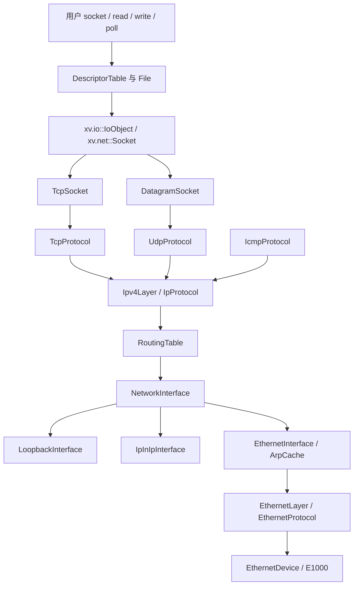

# 分层 IPv4、TCP/UDP 与 socket

实现前的网络基线已提交并推送为 `bb2a632`。E1000 现支持启动期发现多块设备及共享中断；原来混合在 `stack.cpp` 的 Ethernet/ARP/IP/UDP 处理已经拆开。旧实验 PID 端口 API、`stack.cpp` 兼容适配和旧系统调用已移除，UDP 收发统一进入 SocketRegistry/DatagramSocket。

## 架构与所有权



| 模块/目录 | 责任 |
| --- | --- |
| `kernel/io/object.cppm` (`xv.io`) | 与具体设备无关的 read/write/poll/close 能力，File 持有后端 |
| `kernel/net/core/` | Endpoint、地址值类型、网络序字节工具、唯一拥有权 Packet、服务组装 |
| `kernel/net/link/` | Ethernet EtherType 分派、ARP 邻居缓存/请求/回复/待解析队列 |
| `kernel/net/interface/` | 接口注册、可选地址、以太/回环/IP-in-IP 多态实现 |
| `kernel/net/filter/` | IPv4 过滤 hook、独立规则核心、边界解析与管理服务 |
| `kernel/net/ip/` | IPv4 首部验证、最长前缀选路、有限分片重组、ICMP |
| `kernel/net/transport/` | UDP/TCP 校验与报文编码、重传计时器 |
| `kernel/net/socket/` | 抽象 Socket、InetSocket 共性、具体 TCP/UDP socket 与注册表 |
| `kernel/net/platform/` | 页分配、单调时间、用户复制、可中断等待 |
| `kernel/syscall/syssocket.cpp` | socket ABI 校验、地址转换、File 安装和失败回滚 |
| `kernel/drivers/net/e1000/` | 硬件 DMA 收发及完成页回收，不知道 TCP 或用户描述符 |

`EthernetProtocol`、`IpProtocol`、`DatagramSink`、`TcpSegmentSink` 明确每层接收契约，通过虚接口按 EtherType/IP 协议号分派；具体协议由启动服务静态装配。`Socket` 通过 `IoObject` 接入 File，TCP 与 UDP 独立实现传输语义，文件系统不依赖 TCP 状态机。

`Packet` 独占一个物理页，禁止复制，允许移动。默认析构归还页面；成功交给 DMA、ARP 待解析队列或 socket 接收队列时显式 `release()`。错误分支自然析构，避免遗漏释放。具体 socket 由物理页 placement 构造；TCP 独立申请 RX 页，中途失败会归还两阶段已申请资源。

`Packet::Context` 保存报文处理元数据，目前为隧道解封深度。移动、克隆、回环、ARP 待解析队列及 UDP 接收队列均保留上下文；`release()` 仅交出页面，长度和上下文保留为值，用于队列接管。释放后的对象不再拥有页面，`data()` 为空，不能继续读写字节。带上下文的页面接管构造器用于从队列恢复拥有权；const 报文只提供只读字节视图。

`Ipv4Reassembly` 单独拥有四个重组槽、逐字节重叠位图、页面与十五秒超时，不依赖网卡、接口类、路由或防火墙。入口对象身份、源/目的地址、ID、协议和隧道上下文共同隔离重组状态；完成后保留上下文，并修复长度、分片标志和校验和。`Ipv4Layer` 负责目的地址检查、INPUT 过滤与协议分派，重组完成报文在重组锁外重新进入该路径，因此过滤与计数仍以完整数据报为单位。组件按内核服务长期存活；短期使用者应在停止接收后调用 `clear()` 释放未完成页面。

普通 IPv4 发送与 DHCP 引导广播共用 `write_header()` 和 `output_allowed()`，保持 TTL、DF、ID、地址、校验和与 OUTPUT 时机一致；各自的选路和引导条件检查仍留在对应入口。

类的 `.cppm` 接口、私有流程类型与各层迁移入口见
[网络声明式流程](network-flows.md)。现有类继续持有状态和依赖，节点负责连接具名业务阶段。

## 模块维护约定

- 新功能沿现有层次接入：协议处理留在协议层，管理请求在控制边界转换，对象创建与依赖注入集中在 `core/service.cpp`。
- 接口只暴露调用者需要的能力。可以独立计算或解析的逻辑依赖值对象，避免把驱动、系统调用和完整服务实现带入依赖。
- 同一含义沿用现有术语；新增内部参数使用完整名称表达端口、接口及长度。固定布局用户 ABI 保持兼容，在边界处转换。
- 报文页面的借用、移动、释放和队列接管须清楚；持锁范围与锁外复制、回调、发送分开表达。
- 函数先呈现主要流程，再将有独立职责的操作提取为具名函数；避免把多个状态修改和失败分支压在一行。
- 改动后同步函数文档与语义绑定，依据影响范围运行原生契约和真实单核、五核网络测试。

生产组装的 `initialize()` 依次初始化服务、注册回环与以太接口、挂接协议、应用启动配置并封存接口和路由，最后启动默认 DHCP。各阶段有独立的局部函数；自定义 `NetworkSetup` 继续负责自定义配置。`timer_tick()` 在协议处理前后分别服务接口，以便及时处理回环队列中新产生的报文。

路由表独占路由记录及其数量、容量和启动封存状态。管理层使用值快照与具名修改操作，租约配置使用整组路由替换，网桥使用 `references()` 查询接口占用；这些调用方不再依赖路由数组布局。单条路由方法使用 `ConfigurationGuard`，涉及接口地址与路由的联合更新由外层 Guard 覆盖整个事务。

`AddressConfiguration` 统一拥有手工地址与租约地址的配置事务：检查地址、槽位与归属，在同一 `ConfigurationGuard` 下协调接口地址和路由组提交。`NetworkManager` 只把管理请求转换为地址/路由操作；`LeaseConfiguration` 把 DHCP 租约转换为地址、网关和 metric，不再接触地址存储。接口的运行期链路状态、DHCP 标记和拓扑代次通过具名方法修改。`InterfaceRegistry` 负责启动注册及运行期 `publish()` / `withdraw()`，网桥管理器不再操作注册数组。

TCP 协议层通过 `TcpSegmentSink` 交付已校验的借用报文，不依赖 socket 注册表或连接私有状态。注册表统一管理连接分派与待接受子连接，TCP socket 通过显式注入的发送对象发包，不再查找全局 TCP 单例。独立协议栈实例的相同地址与端口可由原生契约验证互不干扰，详见 [TCP 分层说明](network-tcp.md)。

## 设计检查依据

| 目标 | 实现依据 |
| --- | --- |
| 抽象易懂 | 生产组装按阶段呈现；接收沿协议契约分派；地址事务、规则计算与重组队列各有独立对象 |
| 命名一致 | 内部元数据明确端口、接口和长度；`address_owner` 与 `lease_owner` 区分归属；`create_tcp()` 同时服务主动与被动连接 |
| 代码风格 | 全部 net C++/共享头遵循仓库 `.clang-format`，分支和循环使用大括号，不压缩多步控制流 |
| 可复用 | 纯规则引擎、独立解析器、地址事务、自动路由构造、IPv4 首部构造及重组组件可分别验证；TCP 支持独立实例注入 |
| 低耦合 | 管理器不访问接口/路由/注册数组；TCP 编解码不依赖 socket 实现；平台相关操作集中在 platform |
| 高内聚 | 路由表拥有路由存储，地址服务拥有联合事务，注册表拥有连接分派及子连接生命周期，重组组件拥有片段页面 |

原生契约验证两个独立 TCP 栈使用相同四元组时互不干扰；`tests/packet_reassembly.cpp` 验证独立页面拥有权、上下文、入口隔离、容量和超时；单核/五核 QEMU 网络测试验证实际系统集成。有限容量、无 IPv4 转发、无 IPv6 和既有协议子集保持为明确的功能边界。

## 运行与测试

```bash
conda activate OS-LAB
cmake --preset dev
cmake --build --preset dev
ctest --test-dir build/dev --output-on-failure -L network
cmake --build build/dev --target qemu
```

`qemu` 和 `qemu-gdb` 默认带 E1000，启动输出 `e1000: ready`，随后逐接口输出实际配置。自动测试选择临时宿主机端口、独立磁盘副本并结束 QEMU；单核/五核各在同次启动连续运行两轮。

- `network_contract` 使用同一协议实现和可控时钟，验证短包、校验和、队列上限、socket 容量与释放、ARP、反序分片重组/重叠拒绝/超时、ICMP Echo、SYN/数据重传、重复数据去重、乱序恢复、非法 ACK/RST、超时和分配回滚；最终检查所有网络页面归还。
- `network_1cpu/5cpu` 使用 socket/sendto/recvfrom 验证真实往返、MTU、空报、截断、fork、退出清理、信号中断和 SA_RESTART 测试。
- `multinet_1cpu/5cpu` 验证双子网、相同端口绑定不同本地地址、共享 PCI INTx 与每设备 MAC。
- `socket_1cpu/5cpu` 验证 UDP 描述符、fstat、poll、dup/fork、非阻塞、TCP 主动/被动连接、256 KiB 主动/被动流传输与 512 KiB 同时收发、零窗口后恢复、半关闭、EOF、连接拒绝及回环 TCP。

`tests/socket_network.py` 自动启动宿主机 UDP/TCP 回显服务及客体 TCP 监听端口转发。手动运行 `sockettest` 需要传入宿主机 UDP 回显端口、TCP 回显端口和拒绝连接端口，并在程序输出 `listening` 后连接转发的客体 TCP2021；建议直接使用自动测试完成整套验证。

入站连接可通过 CMake 的后端参数配置：

```bash
cmake --preset dev '-DXV_NET_BACKEND=user,id=net0,hostfwd=tcp:127.0.0.1:26001-:2021,hostfwd=udp:127.0.0.1:26000-:2000'
cmake --build build/dev --target qemu
```

恢复默认：`cmake --preset dev -DXV_NET_BACKEND=user,id=net0`。手动启动 QEMU 必须保留：

```text
-device e1000,netdev=net0,bus=pcie.0,addr=01.0,mac=52:54:00:12:34:56
```

按地址、协议、端口和接口过滤 IPv4 报文，见 [iptables 防火墙](network-firewall.md)。

运行中查看或修改接口、地址、路由及邻居缓存，见 [用户态网络管理](network-management.md)。

完整以太帧交换、MAC 学习和桥本机接入见 [软件网桥](network-bridge.md)。

## Socket 用户接口

包含 `user/runtime/user.h` 即获得 `kernel/net/socket/socket.h` 中的 ABI。`sockaddr_in` 为 16 字节，IPv4 和端口使用网络字节序，借助 `htonl/htons/ntohl/ntohs` 转换。

```cpp
int fd = socket(AF_INET, SOCK_STREAM, IPPROTO_TCP);
sockaddr_in remote{};
remote.sin_family = AF_INET;
remote.sin_addr.s_addr = htonl(0x0a000202);
remote.sin_port = htons(26099);
if (connect(fd, reinterpret_cast<sockaddr *>(&remote), sizeof(remote)) == 0) {
    write(fd, "hello", 5);
    shutdown(fd, SHUT_WR);
    char data[128];
    int n = read(fd, data, sizeof(data));
    // 流可能返回部分长度；实际程序应循环处理。
}
close(fd);
```

| 接口 | 行为 |
| --- | --- |
| `socket(AF_INET,type,protocol)` | 支持 `SOCK_STREAM`/`SOCK_DGRAM`，协议0或对应 TCP6/UDP17；类型可加 `SOCK_NONBLOCK` |
| `bind(fd,sockaddr*,len)` | 支持 ANY、本机和回环；端口零分配 ephemeral |
| `connect` | TCP 主动握手；UDP 保存默认目标并筛选来源 |
| `listen` / `accept` | TCP 有界 backlog；accept 返回新 fd，支持省略来源地址 |
| `sendto` / `recvfrom` | UDP 显式目标/来源；TCP 不允许逐次指定目标，接收保持流语义 |
| `send(fd,buf,len,flags)` / `recv(fd,buf,len,flags)` | C++ 便捷重载，委托 sendto/recvfrom；支持 `MSG_DONTWAIT` |
| `read` / `write` | TCP 字节流可部分传输；已 connect 的 UDP 一次调用对应一个数据报 |
| `shutdown` | TCP 的 `SHUT_RD`/`SHUT_WR`/`SHUT_RDWR`，保留另一方向与 File 引用 |
| `getsockname` / `getpeername` | 本地/远端地址，未连接的 peer 返回 `-ENOTCONN` |
| `getsockopt(SOL_SOCKET,SO_ERROR)` | 取出并清除挂起的正 errno |
| `fcntl` / `poll` / `dup` / `fork` / `close` / `fstat` | 沿用 File 机制；socket 元数据为 `T_SOCKET` |

非阻塞 TCP connect 返回 `-EINPROGRESS`；等待 `poll(POLLOUT)` 后读 `SO_ERROR` 确认成功/失败。连接拒绝为 `-ECONNREFUSED`，RST 为 `-ECONNRESET`，重传耗尽为 `-ETIMEDOUT`。本项目直接返回负错误，没有 errno TLS。

socket 最后一个 File 引用消失才触发 close；dup/fork 引用共享同一连接、数据队列及 O_NONBLOCK。UDP 立即释放，TCP 把未确认数据和 FIN 的后续责任留给注册表，关闭或超时后再释放。accept 返回的新 File 不继承监听 File 的 O_NONBLOCK。

read/write、accept、sendto、recvfrom 的等待可被信号中断，沿用 EINTR/SA_RESTART。connect 被信号中断后保留在途连接，不自动重复连接；应用可继续 poll/SO_ERROR 或 close。

UDP 与 TCP 均通过 File/socket 管理，端口绑定系统调用为 `sockbind`，用户运行库提供三参数 `bind` 包装。旧 PID 端口接口已删除。

## IP、ARP 与计时

默认通过 QEMU 内置 DHCP 服务获取地址、掩码和网关，首次地址常见为 `10.0.2.15/24`，不再预写该值；MAC 从对应设备 EEPROM 读取。见 [DHCP 说明](network-dhcp.md)，`netctl dhcp wait eth0` 可等待租约。多接口、可选地址和隧道配置见 [接口与选路说明](network-interfaces.md)。静态路由按最长前缀和 metric 选择出口；每个以太接口独立解析 ARP，回环与隧道直接处理纯 IP。IPv4 不做主机间路由转发。

有限重组按入站接口/源/目的/id/protocol 匹配，支持反序到片，逐字节位图检测重叠，重叠时整体丢弃。最多四个重组槽，每报最多4062字节 IP 负载，15秒到期；出站设置 DF，超 MTU 返回错误。ICMP 当前处理 Echo Request/Reply 和 UDP 无绑定端口的不可达回复。

TCP 覆盖 SYN-SENT、SYN-RECEIVED、ESTABLISHED、FIN-WAIT-1/2、CLOSING、CLOSE-WAIT、LAST-ACK、TIME-WAIT。数据使用序号/确认号和伪首部校验和；按序接收，重复前缀裁剪，乱序段通过累计 ACK 促使对端重传。发送保留一个未确认段，遵守 peer MSS/窗口。零窗口通过探测获取窗口更新。

独立 `RetransmissionTimer` 保存 SRTT、RTTVAR 和 RTO，采用 alpha1/8、beta1/4、Karn 采样约束及指数退避，RTO 为1..60秒。硬件计时器每100ms在 hart0服务网络；最多六次重传后给出超时错误。项目 TIME_WAIT 保留30秒，FIN_WAIT2也有30秒清理边界。

锁顺序：驱动先释放设备锁再回调协议；回环接口先取出并解锁再分派；SocketRegistry 使用统一条件锁保护 socket 状态及监听子连接。用户地址复制在注册锁外完成；睡眠在锁内登记等待、解锁后执行。IRQ 和 timer 路径只操作内核页及对象状态。

## 资源边界与后续范围

| 资源 | 当前上限 |
| --- | ---: |
| E1000 RX/TX 环 | 各16项，TX留一项空槽 |
| 接口 / 静态路由 / 每接口 IPv4 地址 | 8 / 32 / 4 |
| 启动期 PCI E1000 | 最多4块 |
| 每以太接口 ARP 邻居 / 待解析报文 | 16 / 8 |
| IPv4 重组槽 / 回环队列 | 4 / 16 |
| socket 注册表 | 64个对象，含未接受和关闭中的 TCP |
| TCP backlog / 每连接 RX / TX | 8 / 16 KiB / 16 KiB |
| TCP 在途数据 / MSS 上限 | 受对端窗口和 NewReno 拥塞窗口共同限制 / 1460 字节 |
| UDP socket 接收队列 / 出站负载 | 16报 / 最多4042字节，另受出口 MTU 限制（MTU1500时1472字节） |

TCP 使用 16 KiB 收发环、乱序重排、累计 ACK、NewReno 拥塞控制、快速重传和 RTO/persist 计时，连接状态与测试见 [TCP 说明](network-tcp.md)。TIME_WAIT 对象继续占用注册槽，关闭中的连接由注册表维护至回收。IPv6、组播、出站 IPv4 分片和消息向量尚未实现。

协议核对依据：[IPv4 RFC791](https://www.rfc-editor.org/rfc/rfc791.html)、[ICMP RFC792](https://www.rfc-editor.org/rfc/rfc792.html)、[TCP RFC9293](https://www.rfc-editor.org/rfc/rfc9293.html)、[重传计时 RFC6298](https://www.rfc-editor.org/rfc/rfc6298.html)。这些来源用于核对协议字段和行为，不表示本教学子集实现了全部标准要求。

函数级 Doxygen 位于 [网络总导航](functions/kernel/README.md#net)，可从 [IP](functions/kernel/net/ip/ipv4.cpp.md)、[TCP socket](functions/kernel/net/socket/tcp_socket.cpp.md)、[UDP socket](functions/kernel/net/socket/udp_socket.cpp.md)、[文件流](functions/kernel/io/object.cppm.md) 进入。索引生成和原生 hover 边界见 [工具说明](functions/README.md)。

用户态域名解析与 `nslookup` 已实现，支持 DHCP DNS、IPv4 A/CNAME、UDP 与 TCP 回退，见 [DNS 说明](network-dns.md)。

HTTP 用户态客户端与 `curl` 已实现，支持流式响应、分块解码、重定向和文件下载，见 [HTTP 说明](network-http.md)。

UDP 的端口占用、接收队列和生命周期统一由 socket 管理。fork 共享 File 引用，close/exit 经描述符表回收；不再有独立 PID 端口表、网络继承/退出回调或旧 bind(port)/send/recv/unbind 系统调用。旧编号 30–33 为空，不重新分配现有系统调用编号。UDP 68 继续由内核 DHCP 保留。

配置访问由 `ConfigurationGuard` 统一保护。Guard 在检查配置锁 owner 前先关闭本地中断，避免检查期间被抢占并迁移 CPU；每个 Guard 独立配对恢复关中断计数，只有实际 acquire 的实例负责 release。支持嵌套调用、调用前已关中断和借用已有配置锁。临界区仍禁止睡眠、发包回调及反向获取 ARP/设备锁，锁外快照的对象存活和代次校验另行维护。见 [独立函数说明](functions/kernel/net/interface/configuration.cppm.md)。

`network_contract` 包含针对配置 Guard 的确定性测试：另一线程持锁时，归属查询必须已经处于关中断作用域；还验证竞争互斥、嵌套、已有中断禁用作用域、借用手工持锁和提前返回的计数恢复。宿主机用线程局部计数模拟关中断，实际内核中断恢复另由单核/五核 QEMU 网络回归覆盖。

IPv4 Echo 测量、受限 ICMP socket 与 clear 见 [网络测量命令](network-tools.md)。
