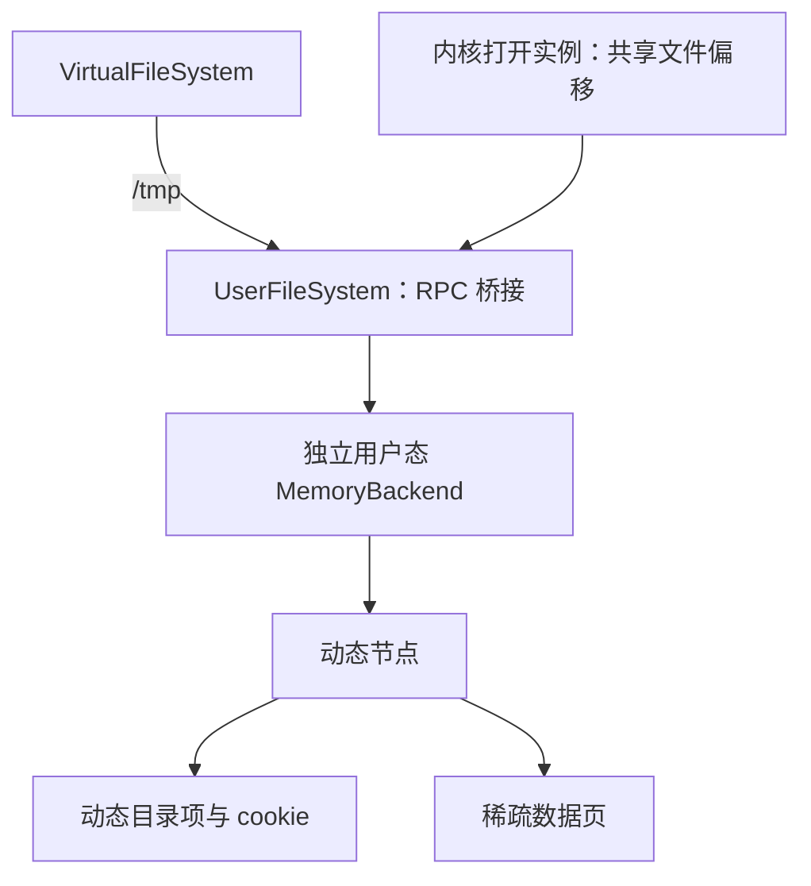

# RAM 文件系统

系统启动时由独立用户态服务在 `/tmp` 挂载 ramfs。`user/fs/backends/ramfs/backend.cpp` 的 `MemoryBackend` 管理文件内容、目录项和节点对象，内存从服务自身地址空间按需分配，不写磁盘，也不占用磁盘文件的直接/间接块配额。默认引导和独立 `ramfsd` 使用同一个后端，见 [文件系统服务迁移](fs-service-migration.md)。

```sh
mkdir /tmp/work
echo hello > /tmp/work/message
cat /tmp/work/message
ls /tmp/work
rm /tmp/work/message
rm /tmp/work
ramfstest
```

文件在进程退出后仍可通过名称访问。unlink 移除最后一个名称后，已有 fd 仍可继续使用；最后打开引用也消失时回收内容和节点。重启后整个 RAM 文件系统为空。

## 结构



MemoryBackend 实现节点和目录操作，VFS 处理路径、挂载转换及跨文件系统硬链接检查。`/tmp/..` 返回根服务中的父目录；`/tmp` 挂载点不能被删除。旧内核 RamFileSystem 只保留为宿主机参考测试，不链接到生产内核。

节点、目录项和数据页分别增长，目录项保存名称、目标及递增 cookie，读取时转换为目录 ABI。点目录由后端合成，不接受对点目录建立硬链接。删除目录项不会让旧 cookie 指向另一个条目。

文件使用稀疏数据页，读取未分配的洞返回零，扩展逻辑长度无需分配整片数据。文件描述符的共享偏移仍由内核打开实例管理，dup/fork 保持共享语义；独立 open 的偏移相互独立。

## 同步与回收

每个后端服务串行处理该实例的请求。内核桥接保护通用 inode 引用，并在最后一个本地引用消失后发送聚合 Forget；后端据此决定已删除对象能否回收。

后端保留孤儿目录所需的父链。因此目录被删除但仍作为 cwd 或打开目录存在时，父节点也保持有效；不再需要时迭代释放，避免深目录递归耗尽服务栈。

创建先取得节点，再发布目录项；任何阶段分配失败都回滚未发布节点。每条写请求先准备所需页面，分配失败撤销新页并保留旧内容和长度；系统调用跨多条请求时可以返回此前已完成的字节数。截断回收尾部页面并清零保留页的尾部，其他打开文件保持原偏移，后续越过新 EOF 写入的间隙为零。

数据读写和节点最终关闭不申请磁盘日志。路径系统调用保留通用边界，但服务模式不预留内核日志；磁盘服务自行管理持久事务。

## 范围

本实现提供普通文件、目录、硬链接、改名、读写、stat、truncate、unlink、相对路径、dup/fork 和 cwd 生命周期。数据驻留内存，没有交换后备或单独配额；节点和名称按需分配，没有示例 memfsd 的固定节点数或 1 MiB 容量限制。通用目录接口支持完整对象编号，旧 dirent/read 接口仍受其字段宽度限制。

## 验证

```sh
cmake --build --preset dev
ctest --test-dir build/dev --output-on-failure -R '^(userfs_memory_contract|fs_service_ramfs_[15]cpu|fs_service_ramfs_lifecycle_[15]cpu)$'
```

ramfstest 验证 1 MiB 文件、用户指针错误、共享偏移、跨页目录、硬链接、非空目录、删除后继续打开、截断补零、孤儿 cwd 和多进程并发。userfs_memory_contract 直接测试生产用户后端的分配失败回滚、2 GiB 稀疏洞、改名和全部内存回收；生命周期测试验证独立 exec、忙卸载拒绝、服务退出与原目录恢复。

当前源码见 [用户态 RAM 后端](../user/fs/backends/ramfs/backend.cpp)。旧 [内核 RAM 节点实现](functions/kernel/fs/ramfs/ramfs.cpp.md)用于宿主机参考测试。

## 用户与权限

/tmp 根固定为 root:root 01777。新节点记录创建者有效 uid/gid，文件 0666、目录 0777 再扣除 umask。创建/链接检查父目录 W/X；删除还检查 sticky 属主规则，所有检查与命名空间修改都在树锁内完成。

完整规则见 [用户、组与权限](users-permissions.md)。
