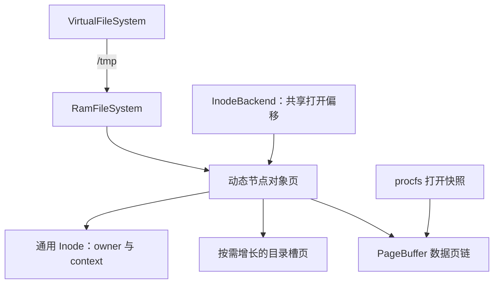

# RAM 文件系统

系统启动时在 `/tmp` 挂载 ramfs。文件内容、目录项和节点对象存放在物理内存页中，按需分配，不写磁盘，也不占用磁盘文件的直接/间接块配额。

```sh
mkdir /tmp/work
echo hello > /tmp/work/message
cat /tmp/work/message
ls /tmp/work
rm /tmp/work/message
rm /tmp/work
ramfstest
```

文件在进程退出后仍可通过名称访问。unlink 移除最后一个名称后，已有 fd 仍可继续使用；最后打开引用也消失时回收内容和节点。重启后整个 RAM 文件系统为空。

## 结构



RamFileSystem 实现节点和目录操作，VFS 处理路径、挂载转换及跨文件系统硬链接检查。`/tmp/..` 返回磁盘父目录；`/tmp` 挂载点不能被删除。

普通文件和目录都由对象页承载，目录槽保存名称与目标节点指针，读取时转换为现有 dirent ABI。点目录由后端合成，不接受对点目录建立硬链接。删除的槽可以复用，目录槽页在所属目录回收时释放。

PageBuffer 同时用于 RAM 文件和 procfs 快照。每页含页链指针和数据区，支持跨页读写、按需增长、部分成功返回、越过 EOF 写入补零以及整体清空。文件描述符的共享偏移仍由 InodeBackend 管理，dup/fork 保持原有共享语义；独立 open 的偏移相互独立。

## 同步与回收

当前后端用一把树睡眠锁串行化目录及数据操作，引用计数使用独立的短暂自旋锁。可能是最后一个引用时，在等待树锁期间仍保留引用，避免另一个 unlink 提前释放节点。

目录拥有父节点的固定引用。因此目录被删除但仍作为 cwd 或打开目录存在时，父节点也保持有效；释放这类目录时逐级迭代回收父固定引用，避免深目录递归耗尽内核栈。

创建先取得节点，再发布目录槽；任何阶段分配失败都回滚未发布节点。数据写入耗尽内存时返回已经写入的字节数；失败快照则整份丢弃。truncate 清空数据页，其他打开文件保留原偏移，后续越过新 EOF 写入的间隙为零。

数据读写和节点最终关闭不申请日志事务。路径系统调用仍保留外层事务，因为它们可能穿越或释放磁盘目录引用。原生测试检查 RAM 操作不产生磁盘写入。

## 范围

本实现提供普通文件、目录、硬链接、读写、stat、truncate、unlink、相对路径、dup/fork 和 cwd 生命周期。数据驻留物理内存，没有交换后备或单独配额。可同时存活的节点号为 1..65535，以匹配现有 dirent 格式；回收节点后编号可复用。单个文件的逻辑大小受通用有符号字节计数和可用内存约束。

本次还把默认磁盘镜像从 4000 个块扩为 8192 个块，为新增用户程序和磁盘回归留出空间；这不改变 RAM 文件的存储位置。

## 验证

```sh
cmake --build --preset dev
ctest --test-dir build/dev --output-on-failure -R '^(fs_contract|ramfs_[15]cpu|procfs_[15]cpu)$'
```

ramfstest 验证 1 MiB 文件、用户指针错误、共享偏移、跨页目录、硬链接、非空目录、删除后继续打开、截断补零、孤儿 cwd 和多进程并发。原生 fs_contract 还注入节点分配、写入中途与多页快照分配失败，并核对物理页回收及磁盘零写入。

函数说明见 [RAM 节点实现](functions/kernel/fs/ramfs/ramfs.cpp.md) 和 [动态页缓冲](functions/kernel/fs/buffer/page_buffer.cpp.md)。

## 用户与权限

/tmp 根固定为 root:root 01777。新节点记录创建者有效 uid/gid，文件 0666、目录 0777 再扣除 umask。创建/链接检查父目录 W/X；删除还检查 sticky 属主规则，所有检查与命名空间修改都在树锁内完成。

完整规则见 [用户、组与权限](users-permissions.md)。
