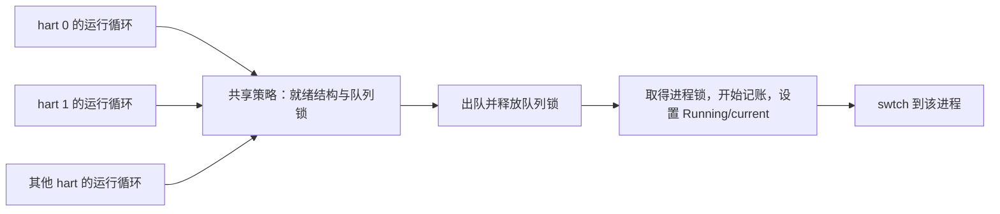

# 可选时钟调度策略

默认调度器为 `fair`。保留 `round-robin`，新增 `mlfq`，三种策略共用原来的
进程锁、Runnable 发布、CPU 绑定筛选、上下文切换和本核 TLB fencing 协议。
这不是 Linux 调度器的移植，也没有增加实时调度 ABI。

## 选择与初始化

```sh
conda activate OS-LAB
cmake --preset dev                       # 默认 fair
cmake --build --preset dev
cmake --preset round-robin
cmake --build --preset round-robin
cmake --preset mlfq
cmake --build --preset mlfq
```

也可以配置 `-DXV_SCHEDULER=fair|round-robin|mlfq`。无效配置被 CMake 拒绝。
`SchedulerKind` 与 `initialize(SchedulerKind)` 提供内核启动时的显式选择；
无参数 `initialize()` 使用构建默认值。无效枚举或重复初始化返回 false，不更换已选择实现。
启动初始化使用 CAS 串行并以 release 发布；其他 hart 仍通过原有启动屏障等待整个内核准备完成。
不支持运行时热切换。启动输出 `scheduler: ...` 可核对实际选择，
`configured_scheduler_kind()` 在初始化后返回实际选择。

## 类与模块职责

- `runtime/scheduler_runtime.cppm/.cpp` 的 `SchedulerRuntime` 实现公开 Scheduler 接口，运行共用选取/切换循环。
- `policies/fair.cppm` 的 `FairPolicy` 固定公平模式，`policies/mlfq.cppm` 的 `MlfqPolicy` 固定反馈模式；二者继承策略队列适配器。
- `policies/round_robin.cppm` 的 `RoundRobinPolicy` 使用原 FIFO 队列及每次时钟请求让出的行为。
- `policies/scheduling_policy.h` 保留可独立测试的共享算法和记账代码；三个模块入口不复制这些算法。
- `runtime/scheduler_context.cppm/.cpp` 负责进程锁、Running/current、swtch 和 TLB fencing。

实际运行机制已统一命名为 SchedulerRuntime；策略目录下的 round_robin 只表示轮转策略。

## 公平策略

`scheduling_policy.h` 的 `RunQueue` 不依赖 Process、锁、分配器或寄存器，
只接收实体和时间戳。`PolicyReadyQueue` 将它接入实际内核，并使用 `r_time()` 计时。
实体嵌入 Process，不额外分配节点，描述符在排队和运行期间不能回收。

公平策略用红黑树按虚拟运行时间排序，以入队序号打破相同运行时间的平局。
虚拟运行时间累计实际执行区间，而不是调度次数；短暂运行后主动阻塞或让出也会记账。
权重默认为 1024，各进程目标是相等 CPU 时间。模型支持 1..4096 权重，
分数余量跨多次运行保留，避免短片段的整数舍入抹去权重；当前没有用户态 nice/setweight 接口。
权重须在首次入队前设定，排队或运行时不能由外部修改。

单调的最小虚拟运行时间同时观察就绪树和各 hart 的运行实体，
包括尚未提交的实际执行时间。新任务和唤醒任务不会从虚拟时间零点取得无限追赶额度；
正在让出的实体也必须参与最小值计算，不能因为短暂离开运行集合而丢掉尚未获得的 CPU 份额。
时间戳差采用无符号运算，累计值采用饱和加法。

公平份额和按运行时间排序的设计参考了
[Linux 的 CFS 说明](https://www.kernel.org/doc/html/latest/scheduler/sched-design-CFS.html)。
本实现使用一张共享树，不实现 Linux 的 EEVDF、cgroup、公平组调度或逐核负载平衡。

## 轮转与 MLFQ

`round-robin` 使用原来的 `FifoReadyQueue`，每个硬件时钟中断仍请求让出。
因此保留原行为作为对照和可选实现。

`mlfq` 使用三条 FIFO，时间额度为 1、2、4 个基础单位。运行时间跨主动让出累计，
额度用完后降低优先级；不会通过反复短暂让出重置额度。每 20 个基础单位统一提升优先级，
保持各层原有 FIFO 顺序；运行实体同步更新额度起点，睡眠实体下次激活时观察提升代次。
周期提升限制低优先级任务被持续高优先级工作推迟的时间。

## 时钟、锁与交接

基础单位仍为 `TimerInterval = 1000000` 个 QEMU virt 时间基准单位，即原来的约 100 ms。
`uptime/pause` 的单位、全局 tick 计数和时钟重设方式保持原样。
公平策略按就绪与运行实体数量计算执行片段，范围为 1..2 个基础单位。
公平策略与 MLFQ 在没有排队工作时可继续运行当前任务，避免不必要的切换；
有积压时由预算和策略决定是否抢占。CPU 绑定过滤可能使本 hart 暂无可执行任务，
但不会从队列删除其他 hart 的工作。

时钟处理仍先计数、重设硬件定时器、服务设备，再询问 `Scheduler::timer_tick()`。
未到抢占条件时返回 Resume；用户/内核陷入仍完成各自的返回或 CSR 恢复路径。

发布和开始/停止记账使用“进程锁 → 队列锁”。出队只持队列锁，释放后才等待进程锁，
避免与发布者形成锁环。yield 在发布队列前完成运行时间记账；随后 suspend 不重复计费。
进程退出、睡眠和停止时在 suspend 前结束运行实体。上下文切换后不能缓存原 hart 的 CpuState。
进程存储在回收前额外核对其已不在任何就绪/运行结构中。

## 多核如何工作

系统静态构造一个 SchedulerRuntime 和三种策略，启动时选择其中一种。
各 hart 调用同一个 Runtime 的 run，但函数调用栈、RunFlow::Context、CpuState 和调度栈分别属于各自的 hart；
Runtime 中的策略指针在启动发布后不再改变。



1. **唯一领取与安全交接。** 一次出队在队列锁内完成，其他 hart 不能再领取同一队列项。
   出队后才等待进程锁。如果原 hart 刚把该进程重新入队、尚未完成 swtch，领取者会等到原 hart 释放进程锁后才运行。
   因此不会让一个进程同时在两核执行，也不会持队列锁等待进程锁而形成反向锁环。
2. **自然分摊与亲和性。** 未绑定的进程可由任意空闲 hart 领取，重新就绪后也可能迁移到另一核。
   绑定进程只允许指定 hart 领取，其他核跳过并保留它。恢复执行后通过 current_cpu 重新取得本核状态，不能沿用切换前的核指针。
3. **公平策略的全局视图。** 一棵就绪红黑树供所有 hart 使用；运行集合记录每核正在执行的实体。
   推进最小虚拟运行时间时同时考虑就绪项、运行实体当前的时间投影及正在让出的实体，避免遗漏其他核的 CPU 使用。
4. **轮转和 MLFQ 的共享视图。** 轮转共用一条 FIFO；MLFQ 共用三层 FIFO 和同一个提升代次。
   提升与出入队串行，所有运行实体的额度起点一起更新，睡眠实体在下次激活时观察代次。
5. **本核抢占与唤醒延迟。** 每核定时器独立触发策略判定，本核只挂起自己的当前进程；hart 0 额外维护原有全局 uptime 和设备服务。
   当前没有逐核运行队列、工作窃取、跨核唤醒 IPI 或独立负载均衡线程。新工作在同一共享结构内可见，空闲核通过本核定时器重新检查。

共享队列实现简单且不需要逐核迁移协议，代价是调度竞争集中在一把队列锁；亲和性筛选可能扫描多个不适合本核的就绪项。
这里不把单核/五核功能验证当作高核数扩展性或严格跨亲和性集合份额的证明。

## 验证范围

- `scheduling_policy_contract`：不同运行片段长度下的 CPU 公平性、两种权重及短片段分数累计，
  轮转对照，SMP 最小虚拟时间、CPU 绑定筛选、空队列不抢占、时间戳回绕，MLFQ 额度累计与提升。
- 实际 Process/就绪队列的宿主契约：锁、绑定筛选、运行实体退出、描述符及栈的完整回收。
- 陷入契约：请求抢占与继续运行两种结果，时钟重设、用户返回和内核 CSR 恢复均保留。
- `scheduler_1cpu` / `scheduler_5cpu`：独立 QEMU 磁盘副本上的 CPU 工作进展，启动标签检查。
  这是调度集成和粗粒度不饥饿检查，不是整体吞吐或精确份额的性能证明，也不测量 fork 时间。

## 用户地址空间的决定

当前用户 ABI 只有连续的堆增长、镜像/栈和特殊页登记，没有匿名 mmap 等需要选择空闲区间的调用者。
因此暂不在每个 AddressSpace 中增加一份平行的空闲地址池：现有 VirtualRegions 已表达区域归属，
另放一张未被分配路径使用的空闲表会增加 fork、exec、OOM 回滚与销毁时的一致性负担。
内核地址池保持可复用；未来加入实际的区间分配 ABI 时，再将区域登记与空闲区间的提交/回滚统一接入。
