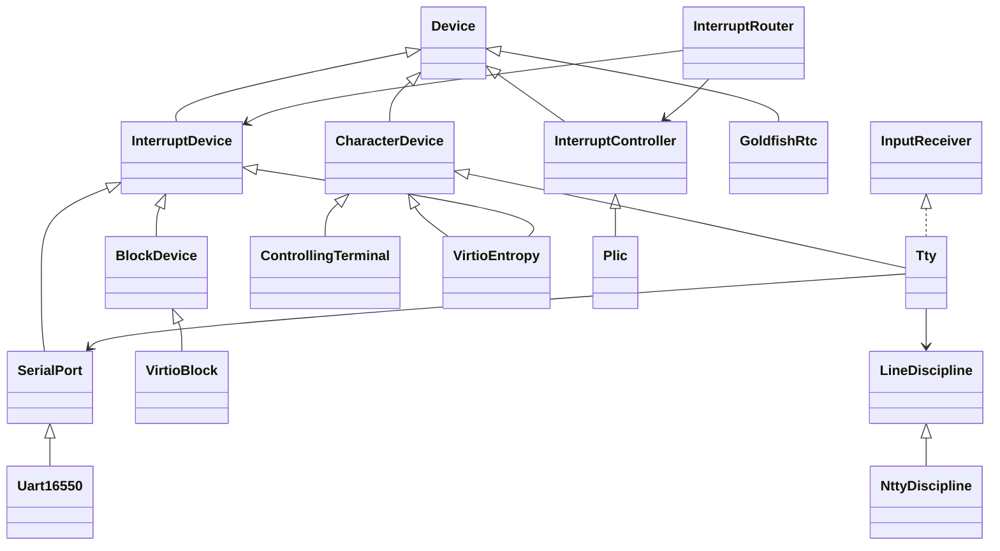

# 驱动模块

统一入口是 `import xv.drivers;`。公共接口与具体硬件实现分开，普通调用方
不依赖 UART、PLIC 或 VirtIO 的寄存器、描述符和内部锁。



`Device` 定义名称和启动初始化；各类设备再提供自己的能力接口。
接口对象不可复制，基类析构受保护，禁止经基类删除；具体实例由板级代码
静态拥有。通过虚调用和显式能力接口工作，无需 RTTI、异常或内核标准库。

| 目录或文件 | 职责 |
| --- | --- |
| `drivers.cppm` | 主接口和板级服务入口，仅重导出公共接口 |
| `device.cppm` | 共同的 `Device` 抽象 |
| `serial/` | `SerialPort` / `InputReceiver` 接口和 16550a 实现 |
| `console/` | `CharacterDevice` / `IoBuffer` 字符设备接口 |
| `tty/` | TTY 状态、读写等待、ioctl 和可替换的 N_TTY 风格行规程 |
| `block/` | 与文件系统无关的 `BlockDevice` 接口 |
| `rtc/` | Goldfish RTC 的串行低/高位读取及 epoch 时钟 |
| `entropy/` | VirtIO entropy 的现代特性协商、DMA 所有权、补充队列及可中断等待 |
| `block/virtio/` | VirtIO MMIO 块设备、私有协议常量和队列布局 |
| `interrupt/` | 中断控制器接口、PLIC 实现和固定设备表路由 |
| `mmio.cppm` | 内部的非拥有 MMIO 窗口，执行 volatile 寄存器访问 |
| `platform/` | 内部平台操作：等待、唤醒、用户复制、内存屏障及 DMA 页分配 |
| `board/qemu_virt.cpp` | QEMU virt 地址、IRQ、唯一实例、依赖装配和字符设备注册 |

`.cppm` 中的硬件实现分区不从主接口导出；实现文件通过 `module xv.drivers;`
加入同一模块。地址和 IRQ 只由板级装配传给驱动。当前仍面向 QEMU virt，
目前没有设备树枚举、热插拔、设备卸载或动态更换驱动。

## 对象与调用关系

串口只认识 `InputReceiver`，接收中断通过 `receive()` 交付字符。
`Tty` 实现接收接口和字符设备接口，组合 `SerialPort &` 与
`LineDiscipline &`。`NttyDiscipline` 负责输入转换、行编辑、回显和规范记录，
TTY 核心负责 termios、窗口大小、读写串行化、等待和 ioctl。
具体实例由板级代码静态拥有。详见 [TTY 实现与支持边界](tty/README.md)。
`IoBuffer` 显式区分内核和用户地址，平台适配通过 `xv.process` 复制用户内存。

`board/qemu_virt.cpp` 在早期启动时把控制台实例注册进 `xv.fs::DeviceRegistry`。
文件系统设备文件通过 `CharacterDevice` 接口调用实际对象，原 `devsw` 函数指针
表与适配头文件已移除。驱动公开接口不依赖 FS；板级实现导入 FS 完成装配。

块缓存持有缓冲区的睡眠锁，通过 `block_device().transfer()` 传入方向、
512 字节扇区号、DMA 数据地址和字节数。文件系统块号到扇区号的转换留在
`bio.cpp`。VirtIO 保存每个请求的状态、等待通道和描述符，不再持有 `buf *`，
`buf` 也不再保存设备完成标志。

```cpp
import xv.drivers;

void read_sectors(unsigned long first, void *dma_data, unsigned bytes)
{
  xv::drivers::block_device().transfer(
      xv::drivers::BlockOperation::Read, first, dma_data, bytes);
}
```

`transfer()` 是同步、可阻塞的操作；字节数必须是正的扇区倍数。调用者在返回前
保持数据缓冲区有效、可 DMA 访问且独占。当前平台使用一致性的恒等直接映射，
没有增加 IOMMU、散布聚集、用户页固定或非一致性缓存维护。队列的三张物理页
由驱动在启动时分配，供设备整个运行期使用；没有 shutdown 或卸载协议。

`InterruptRouter` 持有控制器接口和固定设备表。初始化时校验 IRQ 非零且唯一，
为表中来源设置优先级；每个 hart 启用同一组来源。分派时先 claim，再调用
匹配的 `InterruptDevice`，最后 complete。IRQ 0 不做完成操作，未知非零 IRQ
也会完成并交给板级代码报告，避免中断控制器一直保留领取状态。
`xv.trap` 的外部中断处理器只调用板级路由入口，不分支识别具体设备。

## 启动与并发约束

1. 全部设备及其依赖表使用 `constinit`，链接脚本仍拒绝全局构造/析构数组。
2. `initialize_console()` 初始化控制台锁、绑定接收对象并配置 UART，随后
   注册字符设备。这个阶段不使用物理页分配器。
3. 内存分配器、页表和进程表就绪后初始化中断路由，并配置当前 hart。
4. 块缓存、inode 和文件表就绪后初始化块设备，此时才分配 VirtIO DMA 页。
5. 发布启动完成后，其他 hart 配置自己的 PLIC 上下文。

对象构造仅安装静态状态；`initialize()` 只调用一次，且必须在设备可能被使用
之前完成。板级地址、接收对象和设备表在中断启用后不再修改。

UART 的 `write()` 只在进程上下文使用，以睡眠锁串行化输出；`put_sync()`
保持轮询方式，用于早期打印、回显和 panic，不依赖睡眠锁或分配器。
控制台读和 VirtIO 请求等待继续遵循“登记通道、释放自旋锁、睡眠、重取锁”
顺序。输入处理和磁盘完成处理使用 `ScopedLock` 管理不阻塞的临界区。
VirtIO 发布描述符与读取完成环之间保留 I/O 屏障；设备写入的完成环和状态
通过 volatile 访问。

## 验证

`driver_contract` 编译实际控制台、UART、PLIC、VirtIO 和中断路由实现，
以宿主机寄存器窗口、串口接收替身和设备完成模拟验证：

- TTY 行编辑、EOF 边界、规范/原始输入、环形缓冲、输入与输出转换。
- `VMIN/VTIME` 四种组合、ioctl、模式切换、复制失败和 killed 读取。
- 中断来源配置，已知、未知、空 IRQ 的分派和完成顺序。
- PLIC 上下文寄存器和 UART 初始化、同步及进程输出。
- VirtIO 请求方向、扇区与描述符内容、DMA 完成、队列回绕和描述符回收。
- 无效传输和错误完成索引的诊断。

宿主机测试不替代真实设备的时序与并发验证；QEMU 的多核启动测试和
`usertests -q` 覆盖真实串口 IRQ、进程等待、磁盘并发和文件系统路径。

```bash
cmake --build --preset dev
ctest --preset dev --output-on-failure
cmake --build --preset freelist
ctest --preset freelist --output-on-failure
python tests/clangd_modules.py --clangd "$CONDA_PREFIX/bin/clangd"
```

控制终端打开通过进程会话取得短暂的原子寿命引用，再在组锁外完成设备打开。
PTY 的所有寿命计数操作使用原子读改写，列表增删仍由 PTY 锁保护；静态
console 不需要动态寿命引用。详细协议和字符/块设备注册权限见
[devfs](../../docs/devfs.md)。

默认 QEMU 使用第三个 VirtIO MMIO 槽提供宿主 `/dev/urandom`，对应 IRQ 3；
设备缺失时 entropy 驱动不分配队列，也不产生替代数据。板级初始化在分配器
和内核映射就绪后初始化队列，然后装配中断路由。槽 0、1 继续供块设备使用。
