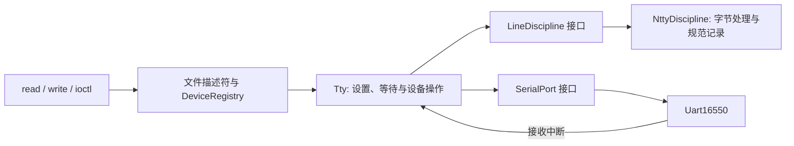

# TTY 核心与行规程

当前实现参照 Linux 的 TTY / line discipline / 串口驱动分层，在 xv6 的
freestanding C++20 模块中实现终端核心与 termios 子集。
参考 [Linux 行规程文档](https://docs.kernel.org/driver-api/tty/tty_ldisc.html)
和 [Linux termios UAPI](https://github.com/torvalds/linux/blob/master/include/uapi/asm-generic/termbits.h)。
这不是 Linux 源码移植，也不提供 Linux 程序二进制兼容。



`board/qemu_virt.cpp` 用 `constinit` 分别拥有 UART、行规程和 TTY，显式注入
依赖。`LineDiscipline` 是可替换抽象；具体 `Tty`、`NttyDiscipline` 和 UART
实现留在内部模块分区。现有主设备号 CONSOLE 的 `console` 节点接入此 TTY，
已有 init/sh 的打开和继承流程继续工作。设备名称为 ttyS0，目前没有额外的
设备节点枚举、`/dev/tty` 控制终端别名或动态终端注册。

## 支持的行为

- 规范模式：换行、VEOL、VEOL2（IEXTEN）提交记录；VERASE、VKILL、
  VWERASE、VLNEXT；VEOF 提交记录且不作为数据返回。控制字符设置为零即禁用。
- 非规范模式：保留 NUL、Ctrl-D 等任意字节，支持 VMIN/VTIME 的四种组合。
  VMIN 被本次 read 的长度限制；收到的数据可逐步复制以释放环形缓冲空间，
  因而 VMIN 大于输入缓冲容量也不会单纯因容量而无法满足。
- ISTRIP、IGNCR、ICRNL、INLCR 输入处理；OPOST、ONLCR 输出处理。
- ECHO、ECHOE、ECHOK、ECHOKE、ECHONL、ECHOCTL 回显；原始模式不执行规范行编辑。
- 控制终端、前台进程组与 Ctrl-C：见 [终端交接与验证](foreground.md)。
- `TCGETS`、`TCSETS`、`TCSETSW`、`TCSETSF`、`TCFLSH(TCIFLUSH)`、
  `TIOCGWINSZ`、`TIOCSWINSZ`、`FIONREAD`。
- `ioctl`、`tcgetattr`、`tcsetattr`、`tcflush`、`cfmakeraw` 用户接口。

共享头 `kernel/tty/termios.h` 使用 Linux asm-generic TCGETS 的 36 字节布局、
控制字符索引和请求号，窗口结构为 8 字节。系统调用号仍属于本项目 ABI。
所有不支持的模式位、非零行规程号和未知请求返回 -1，且不改变当前设置。
ISIG 实现 VINTR/SIGINT 与 VSUSP/SIGTSTP。
串口格式固定为 B38400 / CS8 / CREAD / CLOCAL；不支持修改波特率与硬件流控。

默认启用规范模式、回显、DEL 删除、Ctrl-U 删除行、Ctrl-W 删除词、Ctrl-V
引用下一个字节、Ctrl-D EOF。为保留项目日志与 shell 的 LF 约定，默认 OPOST
开启而 ONLCR 关闭，可显式启用。Ctrl-P 现在作为普通输入，不再在行规程内
触发进程转储。内核 printk/panic 的同步输出绕过 termios。

输入环形缓冲容量为 128 个槽。规范模式为结束符保留一个槽，长行丢弃超出
127 个数据字节的输入，直到收到结束符；不会因缓冲满而提前交付半行。
读操作保留记录边界；空 EOF 产生一次零字节读取，跟在数据后的 EOF 结束
该次记录，不在下一次读取额外生成 EOF。复制失败不消费对应输入字节。
关闭 ICANON 会发布已有输入并移除 EOF 标记；重新启用时已有未读数据作为
一个可读记录，之后的输入重新按规范模式处理。TCSETSF 在安装设置前清空输入。

## 等待和锁

TTY 自旋锁保护设置、行规程状态、窗口大小和定时等待标记。接收中断持锁
调用行规程，回显只走串口同步轮询输出，不睡眠。进程读写分别用可中断获取的睡眠锁串行化。
读者检查状态后，在 TTY 自旋锁内登记可中断通道，释放锁后睡眠；接收、设置变化、
输入清空和定时通知通过相同通道唤醒。恢复后重查条件，kill 沿用进程唤醒协议。

写操作先在状态锁下取得输出模式快照，再释放自旋锁完成用户复制与串口写入。
TCSETSW/F 取得写锁并等待 UART LSR.TEMT，包括移位寄存器排空后才安装设置。
没有异步软件输出队列，因此当前拒绝 TCOFLUSH/TCIOFLUSH；输入清空始终可用。

VTIME 单位为 100 ms。QEMU virt 平台适配从固定 10 MHz 的硬件 time 计数器
转换毫秒；周期中断仅唤醒定时读者，读者使用实际经过时间判断到期。
MIN=0/TIME>0 从读调用开始计时；MIN>0/TIME>0 等首字节后启动并在后续字节
到来时重新计时。通知最多受现有约 100 ms 周期和调度延迟影响，不提供高精度
到期保证。系统 TickClock 的计数方式没有改变；移植其他平台时须替换时间换算。

## 使用和验证

```sh
stty -a
stty -echo
stty echo
stty raw min 1 time 0
stty sane
ttytest
```

`stty sane` 恢复本项目的默认设置。参数解析在全部成功后才安装设置。
`ttytest` 检查系统调用、用户地址验证、普通管道拒绝、超时、窗口操作、
排空和被 kill 的阻塞读者。`tests/smoke.py --tty` 进一步通过真实 QEMU UART
注入二进制输入、行编辑和 EOF，并验证 raw/sane 切换后的 shell。

```sh
cmake --build --preset dev
ctest --preset dev -j1 -R '^(driver_contract|fs_contract|tty_[13]cpu)$'
```

原生 driver_contract 编译真实 TTY、行规程和 UART 实现，通过可控时间及串口
替身检查四种 MIN/TIME 组合、输入输出转换、编辑、EOF、溢出、模式切换和
复制失败。单核和三核 QEMU 测试覆盖真实 IRQ、定时等待及 kill/锁释放。

## 本轮范围之外

控制终端、前台进程组和 Ctrl-C 已接入。仍没有 PTY、devpts、
SIGWINCH、IXON/IXOFF、poll、完整挂断和动态卸载；窗口改变只保存尺寸。
SIGTTIN 与停止状态已实现，SIGTTOU/TOSTOP 尚未实现。字节行规程没有
UTF-8 字符宽度或完整的光标列追踪，tab 可视删除按单格处理。

Ctrl-Z、jobs、fg/bg 的路径与验证见 [作业控制说明](../../process/signals/job-control.md)。
