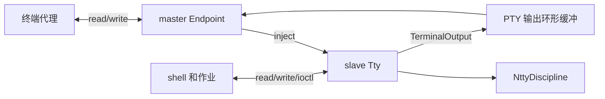

# 匿名 PTY

`openpty(int fds[2])` 返回两个可读写的文件描述符：`fds[0]` 为 master，
`fds[1]` 为 slave。这是本项目的系统调用 ABI（48），并非 libc 的五参数
openpty，也不是 Linux 的 `/dev/ptmx` / `/dev/pts` 接口。

## 使用

重新构建并启动 QEMU 后，运行：

```text
pty
$ cat
```

此时处于通过 PTY 启动的第二个 shell。Ctrl-C、Ctrl-Z、jobs、fg、bg 在
这个 shell 的控制终端上工作。Ctrl-D 在空提示符结束内层 shell；Ctrl-]
由外层代理识别，关闭 master 并返回原 shell。`pty cat` 等形式可以直接启动
指定程序。`pty` 需要标准输入是终端，不能用命令输入管道代替。

应用直接使用时：父进程保留 master；子进程关闭 master，调用 setsid 和
slave 的 TIOCSCTTY，把 slave 复制到 0/1/2，再 exec。父进程关闭自己的
slave 引用，否则 master 无法观察到子程序关闭 slave 的 EOF。

## 分层与所有权



`TerminalOutput` 定义进程上下文的 transmit/drain 和不可睡眠的 put_sync。
SerialPort 实现该接口，以保留 UART 行为；PTY 的 Output 实现把输出写入软件
环形缓冲。TTY 和行规程因此共用字符处理、termios、读取条件及信号生成。

每对 PTY 在一个分配器页内构造，拥有行规程、TTY、两个 Endpoint 和 1024
字节输出缓冲。输入沿用行规程的 128 个槽。File 新增 Endpoint 种类，直接
引用设备对象，无需占用设备主设备号或创建 inode。dup/fork 保留同一个 File；
仅 File 的最后引用释放时才调用 Endpoint::close。两个端点都关闭后，从
时钟通知链表移除该对 PTY，析构并释放页面。时钟遍历与释放由同一个锁保护，
不会访问已释放的 TTY。

## 数据与等待

- master write 把字节送进行规程，执行规范编辑、输入转换、回显和 ISIG。
  已提交输入占满缓冲时等待 slave 消费；raw 模式支持连续大于缓冲容量的传输。
  规范模式单行仍最多 127 个数据字节，沿用串口 TTY 的长行截断规则。
- slave write 使用 TTY 输出转换，并在 master 缓冲不足时等待。转换后的每个
  小块原子入队，避免中断后重复写出半个 CRLF。
- master read 读取输出和回显，不执行第二次行规程；复制失败不消费失败字节。
- 所有过程等待都是可被停止/终止信号打断的等待；睡眠前登记通道并释放自旋锁。
  IRQ 输入继续使用不可睡眠的 receive，软件输入使用可等待的 inject。
- master 注入信号后，显式处理信号唤醒通知；无需依赖另一个 UART 中断。
- timer_tick 通知活动 PTY，使 slave 的 VMIN/VTIME 使用已有 TTY 计时规则。

锁的方向为 TTY 状态锁 -> PTY 输出锁；关闭端点必须先释放输出锁，再执行
TTY hangup。列表锁只保护计时遍历和生命周期，关闭时在退出 TTY 操作后才
取得列表锁。页回收发生在所有链表访问之外。

## ioctl 与关闭

master 的 termios/窗口设置请求转发给 slave；FIONREAD 在 master 上报告输出
字节数，在 slave 上报告可读输入数。master 不能通过 TIOCSCTTY 成为控制终端；
前台组请求沿用原有会话权限检查。

最后一个 slave 引用关闭后，master 可以读完已排队输出，随后 read 返回 0，
write 返回 -1。最后一个 master 引用关闭时，向 slave 的前台组投递 SIGHUP
和 SIGCONT，然后解除控制终端关联、唤醒等待者。SIGHUP 支持默认终止和忽略。
slave 可以读完已有输入（包括尚未换行的尾部），之后 read 返回 0；write
返回 -1。与 Linux master 的 EIO 行为不同，本项目以零字节读取表示 EOF，
也不提供 errno。关闭后不允许重新绑定控制终端。

`pty` 代理通过 poll 同时等待真实终端输入、master 输入/输出和真实终端输出，
一个进程完成双向转发；只 fork 内层程序。真实终端在代理期间采用 raw 模式，
VMIN=1/VTIME=0，因此 Ctrl-C/Ctrl-Z 会到达内层 PTY。不再使用独立的输出
转发进程，也不周期检查子进程状态；master 的 HUP 驱动输出排空和连接清理。
就绪等待、背压和超时约定见 [poll 说明](../../../fs/poll.md)。

## 首版边界

没有 devpts、按路径重新打开 slave、TIOCPKT、select、
SIGWINCH。用户态信号处理已接入，见 [信号说明](../../../process/signals/README.md)。初始窗口大小由代理复制，之后的窗口
变化不会自动传播。TCOFLUSH/TCIOFLUSH 暂不支持。

回显沿用 IRQ 安全的不可阻塞接口，输出缓冲已满时可能丢弃回显；应用的普通
slave write 使用背压，不静默丢弃数据。后续可为回显增加独立队列及流控。

## 验证

`ptytest` 检查独立设置、规范输入、raw 二进制、输出转换、错误地址、计时、
双向大块背压、关闭唤醒、dup/fork、分配失败回滚、Ctrl-C/Ctrl-Z 与停止组
挂断。`ctest -R '^pty_[13]cpu$'` 还通过代理启动真实 shell，验证 cat 的
停止、bg 后 SIGTTIN、fg 后读操作继续、Ctrl-C，以及正常 EOF/主动断开恢复
外层终端。复用的驱动、文件、进程组、信号契约和三核作业控制也已针对性检查；
此次未运行完整回归。

代理已通过 O_NONBLOCK 批量转发，保留部分传输尾部并处理 EAGAIN；stdin/stdout
标志在退出时恢复，仅允许前台运行。API 与共享状态说明见
[非阻塞 I/O](../../../fs/nonblocking.md)。
