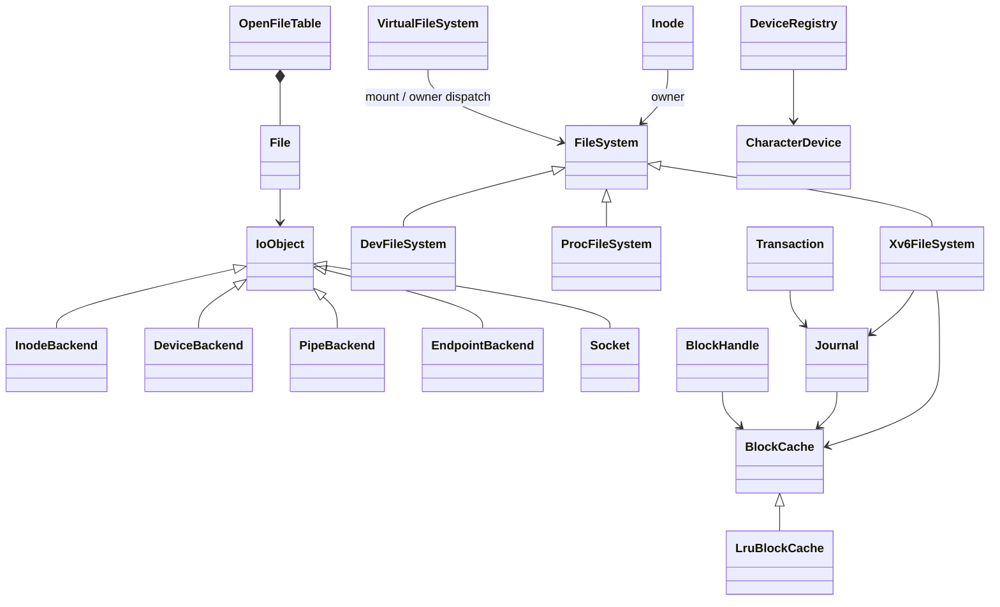

# 文件系统模块

统一入口为 `import xv.fs;`。文件系统运行时类型属于具名模块；磁盘格式和
用户 ABI 仍使用共享头文件。现有文件系统镜像、用户程序、mkfs 继续兼容。

| 目录或文件 | 职责 |
| --- | --- |
| `fs.cppm` | 统一入口，重导出公开分区 |
| `format/layout.h` | superblock、磁盘 inode、目录项和磁盘布局常量 |
| `stat.h`、`fcntl.h` | 用户 ABI 的文件状态和打开标志 |
| `cache/` | `BlockCache` 抽象、LRU 实现、`Buffer` 与移动式 `BlockHandle` |
| `journal/` | redo journal、事务容量预留、恢复与 `Transaction` 守卫 |
| `inode/` | `Inode`、`FileSystem` 抽象、xv6 磁盘实现与块分配 |
| `path/` | 磁盘目录项、创建、硬链接和 unlink |
| `vfs/` | 公共路径解析、节点归属分发与挂载边界 |
| `devfs/` | 合成设备目录、null/zero 与动态 pts 节点 |
| `procfs/` | 系统与进程信息的只读内容快照 |
| `file/` | 打开文件表、引用计数、统一 IoObject 后端及适配器和字符设备注册表 |
| `pipe/` | 管道环形缓冲、等待唤醒和两端生命周期 |
| `platform/` | 进程、内存和内核原语适配及私有引用操作桥接 |
| `service.cpp` | 唯一实例及依赖装配 |



具体 LRU、xv6 磁盘实现、管道和具体文件后端均为内部模块分区。公开接口不依赖
进程模块；内核平台实现导入 `xv.process`，处理用户复制、killed 检查、当前目录
以及等待和唤醒。进程资源接口可以导入 FS 类型，接口依赖图仍然无环。

## 块缓存与块句柄

```cpp
import xv.fs;

void inspect(unsigned block_number)
{
  auto block = xv::fs::cache().read(1, block_number);
  auto *data = block->bytes();
  // 使用 data；离开作用域时释放块锁和缓存引用。
}
```

`BlockHandle` 持有一个已锁定 Buffer 的引用，不可复制、可以移动。析构及
`reset()` 释放锁和引用；移动赋值先释放旧引用，再接收新引用。不能在释放句柄
后继续使用其数据指针，不能把持有的睡眠锁交给另一个进程/线程释放。

缓存的身份、有效位、引用数、锁和 LRU 链表字段不向调用者开放；`Buffer` 提供
数据和只读的设备/块号查询。替代缓存可以构造 Buffer，并通过基类的受保护
`identify()` 设置身份。LRU 实现以自旋锁保护身份和引用，再在释放自旋锁后
获取块睡眠锁。缓存耗尽仍沿用原先的 panic 策略。

日志 pin 引用独立于块句柄引用。调用者释放句柄后，日志中的脏块继续固定，
提交安装到 home block 后才 unpin，防止尚未提交的修改被回收。

## 日志事务与 inode 锁

```cpp
import xv.fs;

void update_in_transaction(unsigned allocated_data_block)
{
  xv::fs::Transaction transaction;
  auto block = xv::fs::cache().read(1, allocated_data_block);
  block->bytes()[0] = 42;
  xv::fs::journal().record(*block);
  // block 先析构并解锁，随后 transaction 析构，必要时提交。
}
```

调用者应持有已分配数据块的所有权；普通文件写入通过打开文件接口完成。
`Transaction` 在构造时预留日志操作容量，析构或 `finish()` 结束操作。它不可
复制；最后一个 outstanding 操作触发提交，提交过程中不持有日志自旋锁。

提交和恢复保持原有磁盘协议：写日志数据块 → 写提交头 → 安装到 home blocks
→ 清除提交头。重复记录同一块继续执行 absorption，仅持有一个 pin 引用。
这是已有日志语义的类化，没有增加 fsync、设备 flush/barrier 或电源故障模型
方面的新保证。

`LockedInode` 管理已持引用的 inode 睡眠锁，不负责释放 inode 引用。它和事务的
作用域顺序必须确保 inode 锁在事务提交前释放。引用释放可能截断文件并写日志，
因此磁盘节点的 `FileSystem::release()` 必须处于事务中；devfs 节点仅更新内存引用计数。

## inode、路径与打开文件

`Inode` 将引用数、锁、有效位、磁盘元数据及块地址收为私有，由具体文件系统
管理。调用方仅通过 `kind()`、`device_major()` 等读取必要信息，相关元数据
要求调用者持有 inode 锁。

路径遍历统一由 VFS 处理；磁盘目录创建、硬链接、unlink 和孤儿回收保留原有算法。节点修改逻辑
已移到文件系统实现，系统调用层负责读取用户参数和安装描述符。`create()`
要求调用者处于事务中，成功返回一个带引用且已锁定的 inode；`lookup()` 返回
带引用、未锁定的 inode。相对路径从进程当前目录取得独立引用。

`OpenFileTable` 通过自旋锁保护引用分配和计数。`File` 只保存公共状态与一个
`IoObject*`；实际 inode、管道方向、设备/端点和网络状态由具体后端维护。
适配器放在 File 的内置对齐存储中，不为每次打开额外分配物理页。

最后一次 release 在表锁内把引用设为关闭中的 -1，再解锁调用后端 close；
清理完成后才把槽位设为零，避免内置对象存储提前复用。后端关闭可睡眠，
整个关闭期间不持文件表锁。未绑定 File 的失败回滚也沿用此路径。

读写和 poll 直接虚调用后端，元数据由后端提供并统一复制到用户空间。
ioctl 和 socket 操作查询独立能力接口。inode 偏移位于每次打开的 InodeBackend，
独立 open 各有偏移，dup/fork 仍共享后端与偏移；大写入保留事务切分规则。
完整接口、生命周期与测试见 [统一 I/O 说明](../../docs/io.md)。

`DeviceRegistry` 保存 `CharacterDevice *`，板级启动注册实际控制台。注册只在
其他 CPU/进程开始使用设备之前进行，设备实例必须在系统运行期保持有效。
原 `devsw` 函数指针数组已移除。

管道仍占用一个物理页，在该页显式构造对象。读写保留通道登记、释放自旋锁、
睡眠及重新获取锁的顺序，保持字节流、部分复制失败、关闭与 EOF 语义。两端
最后关闭后，显式析构管道并归还页面。

## 启动、兼容与验证

服务实例采用 `constinit`，不增加全局构造/析构运行时。启动时依次初始化块缓存、
inode 表和打开文件表；磁盘驱动就绪后，初始进程在可睡眠上下文初始化磁盘 FS、
日志恢复和孤儿回收。当前使用一个磁盘根文件系统，并在 `/dev`、`/proc` 分别挂载设备和进程信息文件系统。挂载规则与
设备注册见 [VFS 与 devfs](../../docs/devfs.md)。

原有 stat 布局和打开标志保留；新增 O_NONBLOCK 与 fcntl 状态操作。磁盘结构、直接/间接块规则和 mkfs 格式保持不变。原
`file.h`、`buf.h`、`device_switch.h` 及 `resource_fwd.h` 已移除，运行时调用方导入
模块。进程引用操作通过 `xv.process` 内部的 resource_platform 分区对接，
内核后端直接调用文件表和文件系统模块接口；原生契约测试替换该模块内平台实现，
继续检查引用计数和事务边界。旧的四个 C 链接桥接函数及其源文件已删除。

原生 `fs_contract` 编译实际缓存、日志、inode、路径、打开文件和管道实现，
只替换设备与进程平台操作，以内存中的 mkfs 镜像验证：

- 块句柄移动与释放、缓存命中、容量恢复和脏块 pin/absorption。
- 提交写入顺序，以及提交头写入前后快照的恢复结果。
- 直接/间接块、分段写、共享偏移、stat、硬链接与 unlink 后继续使用打开文件。
- 用户复制失败、字符设备分派、跨环形缓冲的阻塞管道传输、EOF 和页面回收。
- 多线程创建/读写/删除、日志空间等待、打开文件表耗尽与引用回收。

这些测试覆盖现有协议，不替代真实设备的持久性/故障时序验证。QEMU 完整用户
回归与 RAM 矩阵继续验证实际多核、文件系统和进程路径。两套完整 QEMU 回归
串行运行，避免同时占用宿主机资源导致测试超时。

```bash
cmake --build --preset dev
ctest --preset dev --output-on-failure
cmake --build --preset freelist
ctest --preset freelist --output-on-failure
python tests/clangd_modules.py --clangd "$CONDA_PREFIX/bin/clangd"
```

`OpenFileTable::ioctl()` 只接受设备文件，通过设备 major/minor 找到
`CharacterDevice` 并转发请求。TTY 的 termios 和用户复制由驱动层处理，
文件系统不解析终端设置；普通文件及管道返回 -1。

File 的原子状态标志与非阻塞管道/设备读写见 [非阻塞 I/O](nonblocking.md)。
