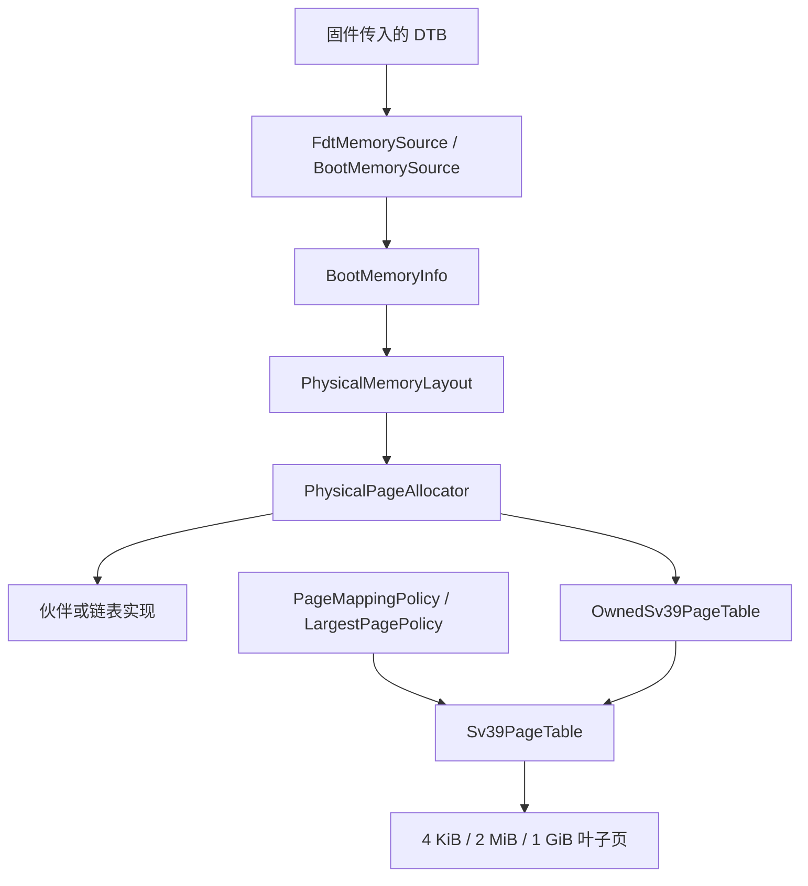

# 内存模块

调用方统一使用 `import xv.memory;`。公开入口 `memory.cppm` 显式列出地址、区域、布局、启动信息、分配器和 Sv39 页表 API；具体分配算法留在内部分区中。全部保持 freestanding C++20，不引入标准库、异常或完整 RTTI。

## 从目录找代码

```text
memory/
├── memory.cppm                        对外模块入口
├── CMakeLists.txt
├── README.md
├── address/                           地址与区域值对象
│   ├── physical_address.cppm
│   └── physical_memory_range.cppm
├── layout/                            物理内存布局与平台地址常量
│   ├── physical_memory_layout.cppm
│   └── memlayout.h
├── boot/                              启动时发现 RAM、安装分配器
│   ├── boot_memory.cppm
│   ├── boot_memory.cpp                 设备树解析
│   └── kalloc.cpp                      启动集成与分配器平台操作
├── allocator/                         分配抽象、公共内部定义、实例选择
│   ├── page_allocator.cppm             PhysicalPageAllocator 与 OwnedPage
│   ├── allocator_service.cpp           构造、选择和发布唯一实例
│   ├── allocator_detail.cppm           两种实现共享的内部辅助定义
│   ├── buddy/                         伙伴算法的具体实现
│   │   ├── buddy_page_allocator.cppm
│   │   └── buddy_page_allocator.cpp
│   └── freelist/                      链表算法的具体实现
│       ├── freelist_page_allocator.cppm
│       └── freelist_page_allocator.cpp
└── paging/                            页表与虚拟内存映射
    ├── sv39_page_table.cppm            页表类、映射策略与 RAII 所有者
    ├── sv39_page_table.cpp
    ├── vm.cpp                         内核与进程地址空间集成
    └── vm.h
```

阅读分配器时，先看 [抽象接口](allocator/page_allocator.cppm)，再看 [实例服务](allocator/allocator_service.cpp)，最后按需进入 [伙伴实现](allocator/buddy/buddy_page_allocator.cpp) 或 [链表实现](allocator/freelist/freelist_page_allocator.cpp)。接口与实现文件放在同一个职责目录，避免在全局接口目录和实现目录之间往返。

这里的 `boot/` 只负责内存发现与初始化；CPU 启动入口仍位于 `kernel/boot/`。`layout/` 描述哪些物理区域可用，`paging/` 负责把它们映射到虚拟地址空间。

目录只用于组织源码，不决定 C++ 模块名称。移动后仍是同一个 `xv.memory` 模块及其分区，外部调用方继续 `import xv.memory;`，内部继续使用 `import :allocator;`、`import :buddy;` 等声明。CMake 显式登记各子目录中的源文件与模块接口；新增分配器时，在 `allocator/` 下增加实现目录，并在实例服务和构建清单中登记。

## 启动路径与对象职责



| 类型 | 职责 |
| --- | --- |
| `PhysicalAddress` | 显式地址值、对齐、偏移、绝对物理页号 |
| `PhysicalMemoryRange` | 半开区域、边界、完整页、区域内索引与反向转换 |
| `BootMemorySource` | 抽象 RAM 信息来源，提供 `discover()` |
| `FdtMemorySource` | 解析设备树的 RAM、固件保留区域及 `reserved-memory` |
| `BootMemoryInfo` | 保存发现结果，不分配或拥有物理页 |
| `PhysicalMemoryLayout` | 规划可分配区域、可直接映射区域及元数据保留区 |
| `PhysicalPageAllocator` | 分配策略、能力查询、元数据需求、分配、释放与拆分 |
| `PageMappingPolicy` | 抽象映射粒度策略，根据虚实地址对齐和剩余长度选择叶子级别 |
| `LargestPagePolicy` | 在允许范围内依次选择 1 GiB、2 MiB、4 KiB |
| `Sv39PageTable` | 写入/查询 Sv39 页表，统计叶子和页表页，不拥有映射目标 |
| `OwnedPage` | RAII 管理一张物理页，`release()` 显式转移所有权 |
| `OwnedSv39PageTable` | RAII 管理根页表及其下级页表，销毁时回收页表帧 |

页表对象依赖分配器和映射策略的抽象接口。`initialize(kind, BootMemorySource&, first_usable)` 支持替换信息来源；测试中的配置型来源与固件设备树来源使用同一套布局和分配逻辑。无需通过 `dynamic_cast` 判断具体类型。

## 可变长度 RAM

默认运行：

```bash
conda activate OS-LAB
cmake --preset dev
cmake --build --preset dev
cmake --build build/dev --target qemu
```

配置 QEMU 使用 2 GiB RAM：

```bash
cmake --preset dev -DXV_RAM_MB=2048
cmake --build --preset dev
cmake --build build/dev --target qemu
```

`XV_RAM_MB` 控制 QEMU 的 `-m` 参数，不生成内核 RAM 容量宏。同一个内核 ELF 可以直接在不同 `-m` 配置下启动。默认值仍为 128 MiB。恢复默认可重新配置 `-DXV_RAM_MB=128`。

启动汇编保留固件的 DTB 地址参数，由 hart 0 在分页启用前解析；其他 hart 等待初始化完成。QEMU virt 自动生成设备树，其 `/memory/reg` 对应 `-m` 指定的内存。[QEMU 文档](https://www.qemu.org/docs/master/system/riscv/virt.html#hardware-configuration-information)

原 `PHYSTOP` 和按 128 MiB 编译的页状态数组已经移除。伙伴分配器的 `tags_` 与链表分配器的 `states_` 使用指针，容量由本次启动的 RAM 页数决定。布局规划器从可用 RAM 中预留足够、页对齐的元数据区域，再初始化所选实现；元数据本身不会被分配出去。

内核镜像前缀、DTB 本身、FDT reservation block 和 `reserved-memory` 指定的区域均不参与分配；`no-map` 区域还从直接映射范围排除。内核镜像与 `no-map` 重叠会被拒绝。设备树格式及保留块按其大端字段和边界解析。[DTB 规范](https://devicetree-specification.readthedocs.io/en/stable/flattened-format.html)

伙伴算法的索引仍以完整 RAM 区域起点为基准，避免可用区域起点未对齐时破坏 XOR 伙伴关系。每个实际可用区段独立播种空闲块；保留区域在元数据中保持不可分配。启动时不再给所有尚未拥有的 RAM 写入填充值，伙伴实现的大 RAM 启动不必触碰全部物理内存；实际分配填充 5、释放填充 1 的语义不变。链表实现仍需为每张空闲页写入链表节点。

当前平台边界：

- QEMU virt，内核物理加载地址仍为 `0x80000000`；默认 FDT 来源接受一个连续 RAM bank。多 bank 会明确失败，不会静默漏掉后续 bank。
- RAM 最后不足一页的部分不参与管理。直接映射与动态内核栈别名共用低半 Sv39 窗口；物理 RAM 末端不能超过 `(2^38 - 4 * PageSize) / 3` 向下页对齐的上界（约 85 GiB）。
- FDT 解析支持 v17 及向后兼容的后续版本、1/2 个地址/长度 cell，最多 24 层节点、16 个保留项、2 MiB blob；布局最多 32 个区段，超限返回失败。
- 元数据不足或保留后没有可用页时拒绝安装分配器。无可信设备树时不猜测 RAM 大小。
- 固件交付的 DTB 初始字节区间必须可访问；QEMU 默认启动满足这一约定。解析器的偏移、字符串、保留块和整数运算均有范围检查。

## 1 GiB / 2 MiB / 4 KiB 映射

`LargestPagePolicy` 根据虚拟地址、物理地址与剩余长度选最大合法页；大页必须按自身大小同时对齐虚实地址。[RISC-V 特权架构规范](https://docs.riscv.org/reference/isa/v1.11/_attachments/riscv-privileged.pdf)

```cpp
import xv.memory;

void map_example(xv::memory::PhysicalPageAllocator &memory)
{
  xv::memory::LargestPagePolicy policy;
  xv::memory::OwnedSv39PageTable owned(memory, policy);

  if (!owned.root())
    return;

  auto result = owned.view().map_range(
      0x40000000UL,
      xv::memory::PhysicalAddress(0x100000000UL),
      1UL << 30,
      xv::memory::Sv39PageTable::Read | xv::memory::Sv39PageTable::Write);

  // 例子中的地址仅用于演示映射；调用方负责确保物理目标存在。
  // 离开作用域时回收页表帧，不释放作为映射目标的物理内存。
  (void)result;
}
```

可向相同页表类注入 `LargestPagePolicy(Sv39LeafLevel::Page4KiB)`，限制为普通页。分配器仍可以只支持 4 KiB 帧：建立 1 GiB 直接映射是在页表中描述已经存在的 RAM，不要求一次分配 1 GiB 连续块。伙伴分配器原有的 4 KiB..2 MiB 分配能力保持不变。

`translate()` 处理所有三级叶子及页内偏移；已有 C VM 遍历也按实际叶子级别处理。当前 1 GiB 页用于内核直接映射，用户地址空间维持原有 4 KiB / 2 MiB 行为。

内核文本 RX、数据 RW 分别提交映射请求，策略不能跨越权限边界或 `no-map` 空洞合并。未对齐的头尾回退到较小粒度。页表本身、元数据及内核栈均能在实际 RAM 的高地址处分配，包括超过 4 GiB 的物理地址。

`map_range()` 返回范围、权限、冲突和内存不足等明确结果，不覆盖已有映射。失败可能保留已经成功映射的前缀；临时构建树可由 `OwnedSv39PageTable` 析构整体清理。`clear()` 只释放下级页表，不释放叶子映射目标；`release()` 将根与整个树的所有权交给长期持有者。页表编辑要求调用方提供并发排他与适当的 TLB fencing，静态映射与栈窗口的上级目录在放行其他 hart 前建立；运行时栈映射受区域锁保护，独占叶表可随栈回收。

启动自检验证文本/数据权限、每个直接映射区段首尾、RAM 结束边界。随后打印各级叶子数量与实际页表页数。

## 地址与分配接口

```cpp
import xv.memory;

void use_page()
{
  auto &memory = xv::memory::allocator();
  xv::memory::OwnedPage page(memory);

  if (page)
  {
    auto address = xv::memory::PhysicalAddress::from_pointer(page.get());
    auto page_number = address.page_number();
    (void)page_number;
  }
}
```

地址转换为整数须显式调用 `raw()`；`from_pointer()`/`pointer<T>()` 只转换数值，不执行页表翻译。`MemorySize` 表示字节数，`PageIndex` 表示索引。

`PhysicalMemoryRange` 提供 `contains()`、`contains_block()`、`page_aligned()`、`page_count()`、`page_index()` 与 `page_address()`。页索引运算要求按页对齐的区域及页起始地址；地址溢出、负偏移、非法对齐和非法索引触发 panic。合法运算可在编译期执行。

`allocate(order)` 返回连续且按块大小对齐的 `2^order` 页，失败返回空指针；释放时必须提供准确所有权和原始阶数。`split_to_pages()` 保留数据，把块转换为独立单页所有权。旧 `kalloc/kfree/superalloc/superfree/supersplit` 包装已删除，所有调用方使用分配器模块接口。

实例启动时显式构造在静态存储中，以 release/acquire 发布，生命周期内固定使用。初始化失败不发布实例；第二次成功安装请求被拒绝。通过 `--preset freelist` 可以选择链表默认实现，两种实现都会编译进内核。

## 验证与 IDE

```bash
# 默认 128 MiB：完整用户回归、页表测试、原生契约测试与 RAM 矩阵
ctest --preset dev --output-on-failure
# 同一 ELF，在不同 RAM 配置下执行启动和有界页表/RAII检查
ctest --preset dev -L ram --output-on-failure
# 原生测试及实际 LSP 诊断、跳转、补全
ctest --preset dev -L memory --output-on-failure
python tests/clangd_modules.py --clangd "$CONDA_PREFIX/bin/clangd"
```

原生测试直接编译真实模块，仅替换平台锁、填充与 panic 原语。覆盖地址/区域边界、设备树错误/保留项、运行时元数据、保留区不可分配、耗尽恢复、拆分合并、四线程所有权、混合页映射、权限、重映射冲突、页表分配失败与 RAII 回收。

本轮实测：伙伴和链表配置均通过 8 项 CTest。128 MiB 配置包含完整 `usertests -q`；64、257、2048、2049 MiB 矩阵使用同一个内核 ELF，包含启动、RAII 和页表边界检查。2 GiB RAM 的整个内核映射使用 7 张页表页（28 KiB），包含 1 个 1 GiB 叶子；2049 MiB 的 1 MiB 尾部使用普通页，页表页总数为 9。这些是旧静态栈布局的数据。当前启动统计包含直接映射、设备和 trampoline，打印发生在预建动态栈页表之前；该额外元数据成本见下文。

模块接口位于 `.cppm`，实现位于 `.cpp`，清单集中在 `cmake/memory-modules.cmake`。clangd 默认使用 CMake 生成的 BMI，模块修改后先构建再重启语言服务；原生与 RISC-V 目标各有独立 BMI。

### 内核页表启动服务

`import xv.memory;` 后通过 `kernel_page_table()` 访问共享 `KernelPageTable`。
引导核在物理内存初始化完成后调用 `initialize()` 创建内核页表；所有 hart
在使用该页表前各自调用 `activate_hart()`，写入本核 `satp` 并执行
`sfence.vma`。重复初始化或未初始化就启用会触发 panic。

页表根地址由对象私有持有，`root()` 提供只读查询供页表统计使用。
创建映射、权限和直接映射自检位于 `paging/kernel_page_table.cpp`；
`paging/vm.cpp` 保留用户页表和传统 VM 辅助函数。
引导核通过启动完成的 release/acquire 屏障向其他 hart 发布页表。

### 用户页表模块接口

`paging/user_paging.cppm` 是 `xv.memory` 导出的用户页表服务；`paging/vm.cpp`
作为模块实现单元提供实际算法。进程和系统调用不再通过全局 C 函数访问页表。

| 操作 | 模块接口 |
| --- | --- |
| 创建/释放根页表 | `create_user_table` / `free_user_table` |
| 映射/取消映射 | `map_user_pages` / `unmap_user_pages` |
| 调整已分配范围 | `allocate_user_pages` / `deallocate_user_pages` |
| fork 拷贝与保护页 | `clone_user_pages` / `protect_user_guard` |
| 查找与翻译 | `walk_entry` / `translate_user_page` / `is_user_mapped` |
| 用户内存复制 | `copy_from_user` / `copy_to_user` / `copy_user_string` |
| 懒分配缺页 | `resolve_user_fault` |
| 页表实验 | `demote_user_pages` / `print_page_table` |
| 内核映射 | `map_kernel_range` |

页表编码宏仍由汇编共用的常量头提供。寄存器操作导入 `xv.arch`，填充/移动
导入 `xv.runtime`，诊断导入 `xv.print`。空洞、超大页拆分、用户权限检查和
失败清理由区域登记及共享页引用统一约束，详见 [虚拟区域、缺页与 COW](../../docs/virtual-memory.md)。

### 可增长进程的保护栈

每个进程和每 hart 调度器默认各保留 2 MiB 虚拟内核栈和相邻 2 MiB 无映射保护区，初始只提交
8 个 4 KiB 物理页（32 KiB）。栈区域编号由独立位图管理，不再依赖物理页编号。
`XV_KERNEL_STACK_MIB` 支持 2、4、8、16、32、64，调整后重新构建内核。
物理页按使用向下增长到预留容量；到达保护区或分配失败会 panic，不会跨入其他进程栈。

启动预建栈窗口的共享上级目录，约 128 页（512 KiB）。创建每个栈时预建完整容量
的独占叶表，物理数据页仍只提交初始 32 KiB。完整栈和保护区同时登记到内核 VirtualRegions。
元数据在发布槽位之前准备好，退出时随已提交页一起回收；调度切换及回收仍执行本核 TLB fencing。

内核异常先进入每 hart 16 KiB 应急栈。未持自旋锁时可用分配器补页并补充应急池；
持锁时仅从预留的 64 个物理页取页，不取得分配器或栈区域锁。有效 PTE 的权限错误、
保护区访问和应急页耗尽会明确 panic，不反复重试。普通入口的额外 32 KiB 余量属于可选预提交。
完整协议与临界区容量边界见 [虚拟内存说明](../../docs/virtual-memory.md)。

预留容量及保护区给虚拟槽数量设置了上限；默认约 32767 个，实际进程数量首先受
可用物理内存限制。当前仅验证 QEMU virt 的既定 RAM 测试矩阵。
