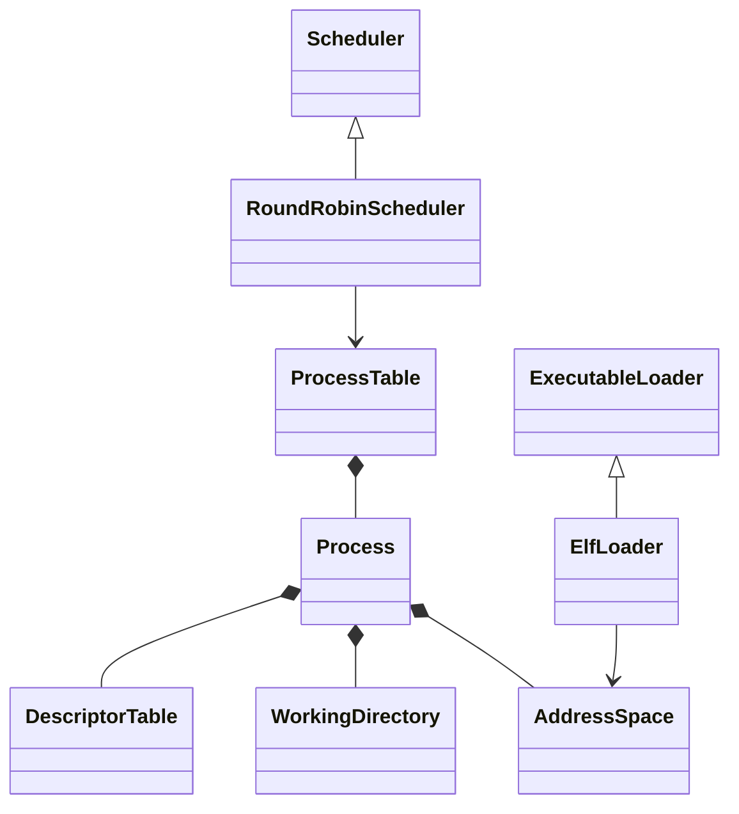

# 进程模块

统一入口为 `import xv.process;`。旧 `proc.h`、`proc.cpp`、`exec.cpp` 和
`elf.h` 已拆分，外部代码使用模块接口，不再通过全局 `struct proc` 访问内部字段。

| 文件或目录 | 职责 |
| --- | --- |
| `process_module.cppm` | 模块入口，导出公共分区与生命周期服务 |
| `process.cppm` | `Process`、`ProcessState`、`CpuState` 和当前进程/CPU 查询 |
| `arch/` | 上下文、陷阱帧布局及必要的 `swtch.S` |
| `resources/` | 描述符表和当前目录的引用所有权 |
| `memory/` | 进程地址空间、用户复制、增长与缺页处理 |
| `lifecycle/` | 进程槽位、PID、fork/exit/wait/kill、资源回收和服务装配 |
| `scheduler/` | `Scheduler` 抽象与 `RoundRobinScheduler` 实现 |
| `exec/` | `ExecutableLoader` 抽象、ELF64 协议和 `ElfLoader` 实现 |

`ProcessTable`、轮转调度器和 ELF 实现属于内部模块分区，不从入口重导出。
`Scheduler` 和 `ExecutableLoader` 是有实际实现的替换点；描述符表和地址空间
使用具体资源类，避免为每个状态对象增加虚函数。当前服务固定装配轮转调度器
和 ELF64 加载器，未实现运行时切换或多线程共享进程地址空间。



## 文件与目录引用

`DescriptorTable` 管理进程的固定容量描述符表。引用语义为：

| 操作 | 引用所有权 |
| --- | --- |
| `get(fd)` | 返回借用引用，无效 fd 返回空 |
| `install(file)` | 成功接收一个引用；失败时引用仍属于调用者 |
| `take(fd)` | 删除槽位并把引用转交调用者，不减少引用计数 |
| `close(fd)` | 删除槽位并释放一个引用 |
| `duplicate(fd)` | 增加一个引用并安装到最低空闲槽；表满时归还临时引用 |
| `inherit_from(parent)` | 向空子表复制每个描述符引用，保留槽号和空洞 |
| `close_all()` | 退出时逐一移除并关闭引用，允许文件关闭中的阻塞操作 |

一个进程当前只有一个内核执行线程。描述符表由这个线程访问；fork 对子表的
初始化发生在发布 Runnable 之前，因此此表不增加额外锁。未来增加共享文件表
或进程内多线程时，需要重新定义其同步和借用引用生命周期。

`WorkingDirectory` 持有一个 inode 引用。相对路径查找调用 `duplicate()`
取得独立引用；fork 继承引用；chdir 调用 `replace()` 接收新引用并释放旧引用。
`replace()` / `clear()` 若可能释放旧 inode，调用者必须处于文件系统事务中。
退出仍在 `begin_op()` / `end_op()` 之间清理目录。

这两个对象使用显式清理：资源释放可能睡眠或触发日志事务，不能在持有进程锁
回收槽位时隐式执行析构。它们保存 `xv.fs` 公开的 `File` / `Inode` 引用，不访问对象内部布局。四个私有
C 链接适配函数连接引用操作，原生进程测试可以替换这些操作检查引用计数。

## 地址空间与 exec

`AddressSpace` 管理用户页表根和内存大小，封装 eager/lazy 增长、缺页处理、
用户复制和字符串复制。普通文件和管道不再读取进程的页表、大小字段。
`page_table()` 仅作为与现有 VM、trap、页表实验代码的底层互操作出口；旧 VM
分配和映射算法继续复用。

`create()` 用于空地址空间，借用进程的 trapframe 和可选只读 PID 页；
`reset()` 取消这些特殊映射并释放用户内存和页表，不释放被借用的特殊页。
这些页由进程槽位负责分配、回收。fork 先为子进程创建独立根及特殊映射，
再复制父进程的用户内存。

ELF 加载通过 `PendingImage` 在栈上拥有候选地址空间，通过 `ExecutableFile`
在栈上管理 inode 锁、引用和文件系统事务。头部、段、用户栈或参数复制失败，
临时对象自动回收，保留旧地址空间与用户寄存器。

全部准备完成后，`Process::commit_image()` 交换新旧地址空间并更新 PC、SP、
argv 和进程名；候选对象随后释放旧空间。加载器仍面向现有 ELF64 程序格式，
本次未增加动态链接、共享库或其他可执行格式。

```cpp
import xv.process;

int copy_to_current_user(unsigned long address, const void *data, unsigned long count)
{
  return xv::process::current()->memory().copy_out(address, data, count);
}
```

## 进程表、调度与架构边界

`Process` 把调度状态、父子关系、退出状态和进程锁设为私有，由进程表与调度器
协作访问。外部使用 `id()`、`is_killed()`、`registers()`、`files()`、
`directory()` 和 `memory()` 等有具体职责的入口。

进程表保持现有 PID 分配、初始进程、fork 发布、父子回收和孤儿转交算法。
wait 锁仍先于进程锁；fork 在资源准备完成后发布子进程；exit 在进入 Zombie
之前关闭描述符并释放目录引用，wait 回收用户内存及槽位。

调度器保留原有扫描选择行为。`suspend()` 要求只持有当前进程锁、中断关闭、
进程状态已离开 Running，并保留现有中断嵌套检查。进程锁跨 `swtch` 的交接
仍显式获取和释放，不能由普通作用域守卫包围。

`prepare_sleep(channel)` 先登记通道，调用者再释放条件锁并 `sleep()`；
`wakeup()` 清除登记通道并把 Sleeping 进程置为 Runnable，保留防丢失唤醒协议。

`Context`、`TrapFrame` 保持汇编寄存器布局，通过大小与关键字段偏移断言验证。
`CpuState` 保留供 sync 平台使用的中断嵌套深度和恢复标志。CPU 数组、进程表、
调度器和加载器均使用 `constinit`；链接脚本继续拒绝启动构造/析构数组。
内核不引入异常、RTTI、堆对象注册或标准库依赖。

sync、drivers 和 fs 的公共模块不依赖进程模块；它们的内核平台实现导入进程接口。
进程资源公开接口导入 fs，以引用实际的文件和 inode 类型。
因此具名模块的接口依赖图保持无环，运行时的锁/调度互相调用集中在实现层。
必要的汇编入口 `swtch` 保留 C 链接；其他旧进程 C 入口已迁移为模块服务。
首次调度返回用户态通过 `xv.trap::return_to_user()` 准备 CSR 和 trampoline 跳转，
调度器实现不再计算用户页表 token 或直接跳转 userret。

## 验证

原生 `process_contract` 运行实际描述符表和目录资源实现，以文件/inode 引用
计数替身检查槽位、所有权转移、dup 表满回滚、fork 引用、父子独立关闭、目录
替换以及释放所需的事务边界，同时检查接口和架构布局的编译期约束。
原生测试不模拟真实上下文切换；调度、等待、地址空间和 exec 由 QEMU 的多核
启动、页表测试、RAM 矩阵及完整 `usertests -q` 验证。

```bash
cmake --build --preset dev
ctest --preset dev --output-on-failure
cmake --build --preset freelist
ctest --preset freelist --output-on-failure
python tests/clangd_modules.py --clangd "$CONDA_PREFIX/bin/clangd"
```
