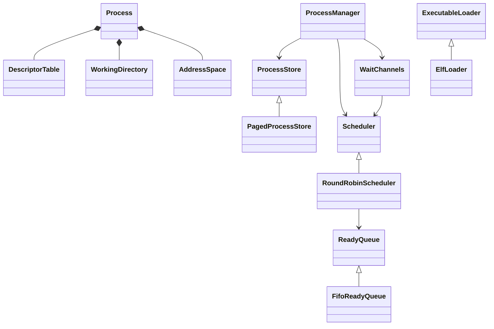

# 进程模块

统一入口为 `import xv.process;`。旧 `proc.h`、`proc.cpp`、`exec.cpp` 和
`elf.h` 已拆分，外部代码使用模块接口，不再通过全局 `struct proc` 访问内部字段。

| 文件或目录 | 职责 |
| --- | --- |
| `process_module.cppm` | 模块入口，导出公共分区与生命周期服务 |
| `process.cppm` | `Process`、`ProcessState`、`CpuState` 和当前进程/CPU 查询 |
| `arch/` | CPU 状态查询与绑定、寄存器布局及 `swtch.S` |
| `resources/` | 描述符表和当前目录的引用所有权 |
| `memory/` | 进程地址空间、用户复制、增长与缺页处理 |
| `lifecycle/` | `ProcessManager`：PID、fork/exit/wait/kill、资源回收和服务装配 |
| `storage/` | `ProcessStore` 抽象与动态链式 `PagedProcessStore` |
| `scheduler/` | 按 policies / queues / runtime 分开的策略、队列和上下文机制 |
| `wait/` | 等待通道索引与 prepare_sleep/sleep 协议 |
| `exec/` | `ExecutableLoader` 抽象、ELF64 协议和 `ElfLoader` 实现 |

进程存储、就绪队列、调度策略和 ELF 实现均属于内部模块分区。当前由服务层
注入 `PagedProcessStore`、`FifoReadyQueue`、`RoundRobinScheduler` 和 ELF64 加载器。
存储和就绪队列都可以换成其他派生实现；调度器不持有存储对象，不访问容器、
容量或进程枚举接口。未增加运行时热切换或进程内多线程。



## 文件与目录引用

`DescriptorTable` 管理进程的固定容量描述符表。引用语义为：

| 操作 | 引用所有权 |
| --- | --- |
| `get(fd)` | 返回借用引用，无效 fd 返回空 |
| `install(file)` | 成功接收一个引用；失败时引用仍属于调用者 |
| `take(fd)` | 删除槽位并把引用转交调用者，不减少引用计数 |
| `close(fd)` | 删除槽位并释放一个引用 |
| `duplicate(fd)` | 增加一个引用并安装到最低空闲槽；表满时归还临时引用 |
| `inherit_from(parent)` | 向空子表复制每个描述符引用，保留槽号和空洞 |
| `close_all()` | 退出时逐一移除并关闭引用，允许文件关闭中的阻塞操作 |

一个进程当前只有一个内核执行线程。描述符表由这个线程访问；fork 对子表的
初始化发生在发布 Runnable 之前，因此此表不增加额外锁。未来增加共享文件表
或进程内多线程时，需要重新定义其同步和借用引用生命周期。

`WorkingDirectory` 持有一个 inode 引用。相对路径查找调用 `duplicate()`
取得独立引用；fork 继承引用；chdir 调用 `replace()` 接收新引用并释放旧引用。
`replace()` / `clear()` 若可能释放旧 inode，调用者必须处于文件系统事务中。
退出仍在 `begin_op()` / `end_op()` 之间清理目录。

这两个对象使用显式清理：资源释放可能睡眠或触发日志事务，不能在持有进程锁
回收槽位时隐式执行析构。它们保存 `xv.fs` 公开的 `File` / `Inode` 引用，不访问对象内部布局。引用操作通过私有模块平台分区连接到 `xv.fs`，原生进程测试替换该分区的实现检查引用计数。

## 地址空间与 exec

`AddressSpace` 管理用户页表根和内存大小，封装 eager/lazy 增长、缺页处理、
用户复制和字符串复制。普通文件和管道不再读取进程的页表、大小字段。
`page_table()` 仅作为与现有 VM、trap、页表实验代码的底层互操作出口；旧 VM
分配和映射算法继续复用。

`create()` 用于空地址空间，借用进程的 trapframe 和可选只读 PID 页；
`reset()` 取消这些特殊映射并释放用户内存和页表，不释放被借用的特殊页。
这些页由进程槽位负责分配、回收。fork 先为子进程创建独立根及特殊映射，
再复制父进程的用户内存。

ELF 加载通过 `PendingImage` 在栈上拥有候选地址空间，通过 `ExecutableFile`
在栈上管理 inode 锁、引用和文件系统事务。头部、段、用户栈或参数复制失败，
临时对象自动回收，保留旧地址空间与用户寄存器。

全部准备完成后，`Process::commit_image()` 交换新旧地址空间并更新 PC、SP、
argv 和进程名；候选对象随后释放旧空间。加载器仍面向现有 ELF64 程序格式，
本次未增加动态链接、共享库或其他可执行格式。

```cpp
import xv.process;

int copy_to_current_user(unsigned long address, const void *data, unsigned long count)
{
  return xv::process::current()->memory().copy_out(address, data, count);
}
```

## 动态进程存储

`ProcessManager` 管理生命周期，`ProcessStore` 管理登记与对象存活。
`PagedProcessStore` 使用链式节点，每个节点从物理分配器取得一页，placement
构造 `Process`，另按需分配一页带保护页的内核栈。没有 `NPROC` 数组或固定
进程数量限制；可用内存不足时 fork 返回 -1。节点地址在登记期间不变。

回收时先清理 trapframe、只读 PID 页、用户地址空间等资源，再从登记链移除
对象，执行析构、取消栈映射并归还节点页与栈页。分配中途失败走同一所有权
清理路径，不保留随历史并发量增长的描述符/栈缓存。PID 单调分配，达到正
int 范围上界后拒绝新分配，避免溢出和重复 PID。

存储接口不暴露链表布局：

- `allocate()` / `find(predicate)` 返回持有进程锁的稳定指针。
- `visit(visitor)` 在进程锁保护下访问对象；回调不得睡眠或再次进入存储。
- `release(process)` 消费进程锁和对象所有权；调用者之后不能解锁或访问指针。
- 查询先取登记锁，再取进程锁；回收先标记 Unused 并释放进程锁，再取登记锁
  删除，等待已经借出进程锁的查询完成后才析构。

wait 锁继续保护父子关系，并先于登记锁、进程锁。fork 准备完资源和父子关系
后才发布就绪；退出先关闭文件及目录，再成为 Zombie。父进程 wait 后才回收
对象。孤儿转交和调试遍历使用存储接口，不依赖容器形态。

PID 查询与 wait 目前仍为线性访问；PID 索引、独立父子链仍是后续优化方向。
wakeup 已脱离登记链，使用下面的等待通道索引。

## 独立就绪队列与调度

`ReadyQueue` 定义 `enqueue/take`；`FifoReadyQueue` 使用进程内的独立链接，
与存储登记链无关。普通入队/取任务是 O(1)，有 CPU 绑定时跳过不适合当前核
的节点。重复入队会触发不变量诊断；进程锁保护状态，队列锁保护队列链接。

所有 Used/Running/Sleeping → Runnable 转换通过 `Scheduler::make_runnable()`
完成并入队。`take()` 先移出节点并释放队列锁，调度器随后才等待进程锁，避免
与发布者的“进程锁 → 队列锁”顺序形成环。Runnable/Running 状态保证取出的
对象不能被生命周期管理回收。

`suspend()` 仍要求只持当前进程锁、中断关闭、状态已离开 Running。
进程锁跨 `swtch` 的交接显式进行。yield 可在切换前发布就绪，但其他 CPU
必须等原 CPU 完成切换并交出进程锁后才能执行它。无可用任务时执行 wfi，
不再用“只剩 init 和 sh”推断空闲；每核定时器保证新工作出现后的有限唤醒延迟。

`prepare_sleep(channel)` 先登记事件，再释放条件锁并 `sleep()`；提前发生的
wakeup 清除登记，后续 sleep 不会睡下去。实际睡眠者由 wakeup/kill 经调度器
发布就绪。睡眠及首次返回用户态的机制是模块函数，不依赖具体调度策略。

## 等待通道索引

`WaitChannels` 使用带锁的哈希桶和进程内等待链接；桶数只影响碰撞成本，
不限制等待者数量。唤醒只访问对应桶，并匹配通道，而非扫描全部进程。
这避免扩容后每次缓冲区释放都锁定所有进程；原有 forkforkfork 压力用例在
大量等待文件系统锁的进程下也能完成。

锁顺序为“等待桶 → 进程 → 就绪队列”；队列取任务先释放队列锁再取进程锁。
等待登记成员 `wait_key_` 与是否已通知的 `chan` 分开：kill 持进程锁清除 chan，
即使目标尚未实际 sleep，也不会丢失通知；它无需反向取得等待桶锁。
下一次 prepare、正常 wake 或退出时的 cancel 在桶锁下移除登记。

退出在资源关闭前取消残余登记，回收拒绝仍在等待索引中的对象。索引不保存
可被直接回收的裸悬空节点；cancel 与 wake 的锁交接保证通知方完成访问后
才允许释放进程。访存和调度状态仍由进程锁保护。

## 内核栈与架构边界

栈映射由 `xv.memory::KernelPageTable` 管理。启动时按实际 RAM 只预建覆盖全部
潜在物理栈帧的页表元数据，尚不分配进程或栈帧。运行时仅原子更新叶子 PTE，
不创建/回收共享页表节点；每个栈映射旁的保护页保持无映射。

栈虚拟别名由物理栈帧索引计算；调度器在进入/离开进程内核栈时执行本核
sfence.vma。回收必须等退出上下文完成、进程锁交出后才取消映射并释放帧。
预建页表的内存属于固定启动开销，fork/exit 不造成持续增加的页表元数据。
地址布局和成本见 memory 模块说明。

`Context` / `TrapFrame` 保持汇编布局断言，`CpuState` 保留中断嵌套状态。
服务对象使用 constinit，动态 Process 显式 placement 构造/析构；不引入异常、
RTTI、宿主机标准库或启动构造函数。只有 swtch 和汇编/链接器符号保留 ABI 边界。

## 验证

`process_storage_contract` 编译实际登记链、FIFO、CPU 绑定、等待索引和锁，
覆盖 192 个稳定地址、分配失败回滚、重复入队、通道替换/提前通知，以及
扩容、遍历、取任务、取消等待和回收的多线程交错。
`procext` 在 1 核、3 核 QEMU 中让 96 个子进程同时存活，检查管道唤醒、
kill、wait 和多轮复用。完整 usertests 检查 fork 压力、孤儿转交、内存耗尽
和释放后的空闲页恢复。

原生 `process_contract` 运行实际描述符表和目录资源实现，以文件/inode 引用
计数替身检查槽位、所有权转移、dup 表满回滚、fork 引用、父子独立关闭、目录
替换以及释放所需的事务边界，同时检查接口和架构布局的编译期约束。
原生测试不模拟真实上下文切换；调度、等待、地址空间和 exec 由 QEMU 的多核
启动、页表测试、RAM 矩阵及完整 `usertests -q` 验证。

```bash
cmake --build --preset dev
ctest --preset dev --output-on-failure
cmake --build --preset freelist
ctest --preset freelist --output-on-failure
python tests/clangd_modules.py --clangd "$CONDA_PREFIX/bin/clangd"
```

## 底层模块依赖

地址空间实现通过 `xv.memory` 的用户页表接口操作映射和复制用户内存；
调度器通过 `xv.sync` 操作嵌套中断状态，通过 `xv.arch` 访问寄存器。
字符串和诊断分别导入 `xv.runtime` 与 `xv.print`，不再包含 `defs.h`。

资源管理的 `resource_platform` 是私有模块分区：内核实现直接调用
`xv.fs::files()` 和 `xv.fs::filesystem()`，原生测试替换该平台实现并验证
原有引用计数和事务约束。`filedup/fileclose/idup/iput` C 桥接已删除。
只有上下文切换的 `swtch` 和汇编/链接器符号保留必要的 ABI 声明。

调度子目录的文件职责及关联位置见 [调度目录说明](scheduler/README.md)。CPU 状态不再放在轮转策略中，首次进入用户态由 lifecycle/first_return.cpp 管理。
