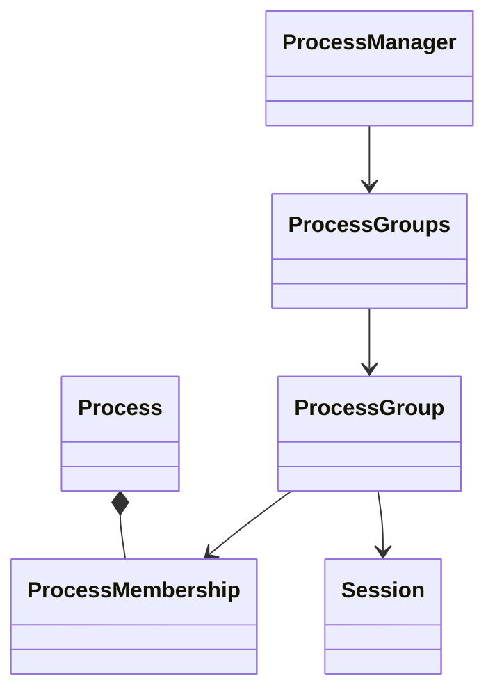

# 进程组与会话

这一层提供作业控制所需的身份与生命周期基础。用户接口为 `getpgrp()`、
`setpgid(pid, pgid)`、`getsid(pid)`、`setsid()`，内核调用统一经过
`xv.process` 的服务接口和 `ProcessManager`。错误沿用本项目约定，返回 -1，
没有增加 errno。规则参考 [setpgid](https://man7.org/linux/man-pages/man2/setpgid.2.html)、
[setsid](https://man7.org/linux/man-pages/man2/setsid.2.html) 和
[getsid](https://man7.org/linux/man-pages/man2/getsid.2.html)。

## 对象与所有权



`ProcessMembership` 嵌入地址稳定的 Process 描述符，记录 PID、父 PID、是否
成功 exec、所属组及组内链接。`ProcessGroups` 拥有组登记链并保护全部关系。
`Session` 具有稳定 SID 和组计数；`ProcessGroup` 具有稳定 PGID、会话引用与
成员链。它们不借用组长或会话首进程的 Process 指针。

每个组和会话目前分别按需取得一页物理内存，以 placement 构造对象；没有
固定组数量或会话数量上限，也不为每次 fork 新建组和会话。此实现强调简单
所有权，元数据空间利用率以后可通过 slab 等后端改善。

组长被 wait 回收后，只要还有成员，组仍存在；会话首进程被回收后，只要
还有组，会话仍存在。最后一个成员离开时回收空组，最后一个组消失时回收
会话。加入已有组或继承成员关系不分配内存。新组/会话分配失败返回 -1，
保留原有身份，归还中途取得的页面。

## 系统调用规则

| 调用 | 行为 |
| --- | --- |
| `getpgrp()` | 返回调用者当前 PGID |
| `getsid(0)` | 返回调用者 SID |
| `getsid(pid)` | 返回指定已登记进程的 SID；允许跨会话查询 |
| `setpgid(0, 0)` | 为调用者创建或加入以其 PID 命名的组 |
| `setpgid(pid, 0)` | 目标组号取目标进程 PID |
| `setpgid(pid, pgid)` | 修改自身，或尚未成功 exec 的直接子进程的组 |
| `setsid()` | 创建 SID=PID、PGID=PID 的新会话和新组，返回 SID |

`setpgid` 只允许在同一会话内变更，不允许修改会话首进程的组。
目标组必须已存在于该会话中，或新组号等于目标进程 PID。
负 PID/PGID、非直接子进程、找不到的目标均返回 -1。

`setsid` 不允许当前 PID 同时仍是任何现存进程组的 PGID。这既阻止当前组长
创建会话，也阻止曾任组长的进程在旧组仍有其他成员时创建会话。
初始进程明确建立 SID=PGID=PID；目前 init、shell 及普通后代默认继承它。

## 生命周期与同步

- fork 完成资源准备后，在设置父子关系的同一家庭锁临界区内登记继承身份，
  然后才发布 Runnable；子进程的 exec 标记总是重新置为 false。
- 成功 exec 在 `Process::commit_image()` 的不可失败提交阶段记录 exec 标记，
  PGID/SID 保留；加载或参数准备失败不会设置标记。标记与父进程 setpgid
  共用分组锁，二者有明确先后关系。exec 之后进程仍能修改自己的组。
- exit 将子进程交给 init 时，同步更新它们的成员登记父 PID。
- Zombie 在 wait 回收前保留成员身份，可被 getsid 查询。wait 回收时先移除
  成员，再清理其他资源、释放描述符；存储后端禁止回收仍登记在组中的对象。

组锁只保护身份对象，不取得家庭锁、存储登记锁、进程锁或调度队列锁，不
调用用户复制、睡眠和调度。生命周期路径可以持家庭锁或进程锁再进入组服务；
查询和 setpgid 不必遍历 ProcessStore，也不取得目标进程锁。
页面分配/回收是非睡眠操作，允许在组锁内调用。查询返回整数 ID，不向外
借出成员、组或会话指针。当前按组和成员线性查找，后续可增加索引。

## 验证与范围

```sh
cmake --build --preset dev
ctest --preset dev -j1 -R '^(process_groups_contract|process_groups_[13]cpu)$'
```

原生契约编译实际分组实现，替换页面来源，检查分配失败回滚、192 个同时
存在的组、首进程回收、最后成员迁移、exec/setpgid 竞态、并发查询与最终
页面回收。QEMU `grouptest` 用管道握手验证四个系统调用、失败/成功 exec
前后的父进程权限、跨会话限制、首进程回收后的存活成员及多轮创建回收。
同一测试覆盖单核和三核，可在 shell 手动运行 `grouptest`。

信号层支持默认终止和停止/继续；控制终端、前台组、Ctrl-C/Ctrl-Z 和 shell
jobs/fg/bg 已接入，见 [作业控制说明](../signals/job-control.md)。孤儿进程组的
SIGHUP/SIGCONT 规则仍未实现。setsid 不会关闭已打开的 console 描述符。

Session 和 ProcessGroup 的原始存储由 memory 模块的 slab 对象服务提供，
按实际类型大小和对齐申请。析构后通过所属缓存归还；家庭/组引用、锁顺序及失败回滚语义保留。
