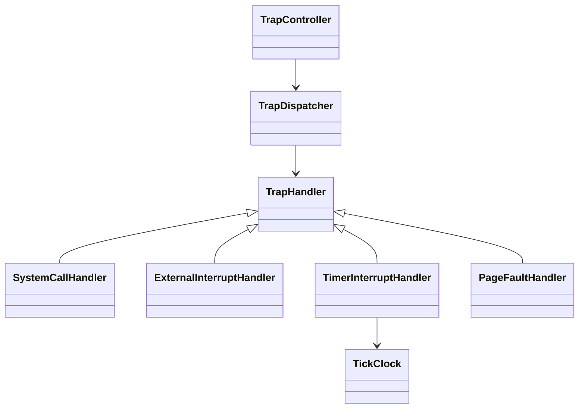

# Trap 模块

统一入口为 `import xv.trap;`。原 `trap.cpp` 按事件解码、处理器、分派控制、
时钟和 RISC-V 平台边界拆分。汇编寄存器保存/恢复和 C ABI 名称保持兼容。

| 文件或目录 | 职责 |
| --- | --- |
| `trap.cppm` | 主接口和默认服务入口 |
| `event/` | `TrapCause`、`TrapEvent`、`CauseKind` 和 `TrapAction` |
| `dispatch/` | `TrapHandler` 抽象和固定处理器表的 `TrapDispatcher` |
| `handlers/` | 系统调用、外部中断、定时器和用户数据缺页处理器 |
| `controller/` | 用户/内核入口校验、终止/让出 CPU、现场恢复及用户返回 |
| `clock/` | tick 计数、中断重设、uptime 和 pause |
| `platform/` | 内部平台操作契约，不从模块入口导出 |
| `arch/riscv/` | CSR、process/drivers 适配、薄 C ABI 入口及必要汇编 |
| `service.cpp` | 静态实例和默认处理器表装配 |



处理器属于内部模块分区，普通调用方使用分派器、控制器和时钟服务。默认表以
`constinit` 静态装配，不使用堆注册、异常或 RTTI。处理器表是非拥有的，表与
处理器实例必须比 dispatcher 活得更久；按表顺序选择第一个接受事件的处理器。
所有控制器事件状态保存在本次调用的栈中，共享控制器不保存某个 hart 的 CSR。

## 事件与策略

`TrapCause` 分开解释 RV64 scause 的最高中断位和低位原因码，避免把异常码 9
误认作外部中断。`TrapEvent` 在处理器可能打开中断、阻塞或调度前一次性捕获
cause、PC、status 和 fault value。

| 默认处理器 | 接受的事件 | 行为 |
| --- | --- | --- |
| `SystemCallHandler` | 用户来源的异常 8 | 检查 killed，保存 PC + 4，然后开中断并通过 `xv.syscall::dispatch()` 分派 |
| `ExternalInterruptHandler` | 中断 9 | 交给 drivers 的 PLIC/设备路由，返回 Resume |
| `TimerInterruptHandler` | 中断 5 | 更新时钟并重设本 hart 定时器，返回 Yield |
| `PageFaultHandler` | 用户来源的读缺页 13、写缺页 15 | 调用当前地址空间的缺页处理，成功后重试原指令 |

处理器返回类型化的 `Resume`、`Yield`、`Terminate` 或 `Unhandled`，替代旧
`devintr()` 的 0/1/2 整数约定。缺页失败和未知用户事件会报告捕获的现场、标记
进程 killed 并以 -1 退出；系统调用前后保留 killed 检查。指令缺页仍不做按需
加载，内核缺页和 supervisor ecall 仍不能进入用户态恢复/系统调用处理器。

系统调用 PC 在开中断之前增加一次。若 exec 成功替换用户 PC，返回控制流程
使用替换后的寄存器现场，不再根据旧事件覆盖它。

## 进入和返回

用户路径：

```text
uservec 汇编 → usertrap 薄 C 入口 → TrapController::handle_user
             → TrapDispatcher → 选中的处理器
             → killed 检查 / 必要时让出 CPU
             → 准备用户返回现场 → 返回 satp token → userret 汇编
```

控制器检查 SPP 为用户来源，先把 stvec 切到 kernelvec，再保存用户 PC、调用
处理器。这样系统调用打开中断后，嵌套中断会走内核入口。

内核路径检查 SPP 和关闭中断的状态。默认仅接受定时器与外部中断，其他事件
panic。定时器仅在有当前进程时请求调度；调度返回后恢复进入时的 sepc/sstatus，
因为期间可能在别的 hart 运行过其他 trap。

`arch/riscv/entry.cpp` 保留 `usertrap()` 返回 unsigned long、`kerneltrap()`
返回 void 的 C ABI，分别转发控制器。`kernelvec.S` 和 `trampoline.S` 的寄存器
偏移、栈保存和恢复指令不变；内核链接脚本继续限制 trampoline 为单页。寄存器
布局断言继续由 `xv.process` 的 Context/TrapFrame 接口提供。

RISC-V 返回适配先关闭中断，再设置 trampoline 中的 uservec 地址；填入
trapframe 的 kernel satp、内核栈、usertrap C 入口和当前 hart ID；清除 SPP，
设置 SPIE，并把用户 PC 写回 sepc。用户页表切换和 sret 仍由 userret 汇编完成。

进程首次调度通过 `return_to_user()` 统一准备并进入 userret，这条路径不返回。
调用者必须处于有效进程上下文，已完成资源作用域和锁交接。普通 trap 返回使用
`handle_user()` 的返回值交给汇编，不在 C++ 代码中提前切换用户页表。

## 时钟服务

`TickClock` 封装原 tickslock/ticks。每个 hart 的定时器中断都会把 stimecmp 重设
为 `r_time() + TimerInterval`；只有 hart 0 增加全局计数并唤醒等待者。共享常量
`TimerInterval = 1000000` 同时用于 boot/start.cpp 的首次设置和后续中断重设，
单位是 time CSR 的时基单位，不新增动态频率发现或补偿漏过的周期。

```cpp
import xv.trap;

unsigned elapsed_ticks()
{
  return xv::trap::clock().uptime();
}
```

`pause(count)` 只用于进程上下文，负数按零处理。它在时钟锁内检查 unsigned
计数差，先登记通道，释放锁后睡眠，再取锁重查；被 killed 时返回 -1。
unsigned 差值保留计数回绕语义。系统调用不再访问原始时钟变量或锁。
构造时可以指定初始 tick 值，默认零；initialize 只初始化锁，启动时调用一次。

## 模块边界与验证

trap 公开接口只依赖值对象和 sync；process、drivers、syscall 和 CSR 访问集中在
RISC-V 平台实现中。进程调度器实现可以导入 trap 返回接口，公开模块依赖图
保持无环。Kernel 平台和 native 平台分别编译并使用各自的 BMI。

`trap_contract` 编译实际 C ABI 入口、控制器、默认处理器、时钟和分派实现，
只替换 CSR、process、IRQ 与 syscall 平台操作。覆盖：

- 中断位/原因码解码、处理器表顺序和未知事件。
- PC 更新、开中断与系统调用顺序，exec 替换 PC，调用前后的 killed。
- 读写缺页访问方向，失败与非法用户事件终止。
- 用户/内核来源校验，内核拒绝用户恢复策略，空闲 hart 的定时器。
- 调度导致 CSR 被覆盖后的恢复，首次用户返回的准备与跳转顺序。
- hart 0 计数、各 hart 重设定时器、真实线程等待/唤醒和 tick 回绕。

native 平台不执行真实 sret、页表切换或寄存器汇编；这些路径继续由 QEMU
多核启动、页表检查、RAM 矩阵和完整 usertests 验证。两种配置的完整 QEMU 回归
串行执行。

```bash
cmake --build --preset dev
ctest --preset dev --output-on-failure
cmake --build --preset freelist
ctest --preset freelist --output-on-failure
python tests/clangd_modules.py --clangd "$CONDA_PREFIX/bin/clangd"
```
